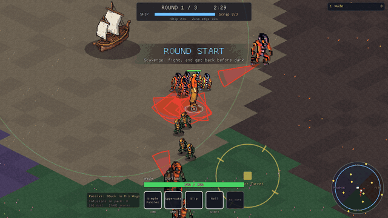
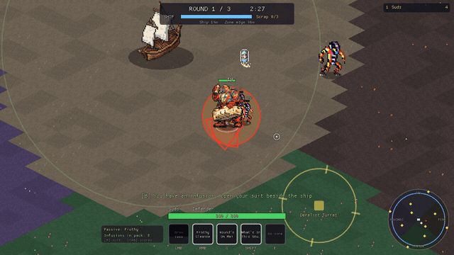
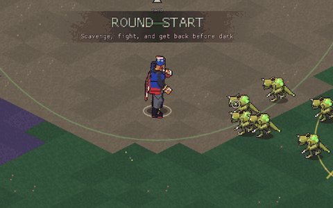

# Alien Arena prototype: playtest guide

A playable 1 to 4 player prototype of Alien Arena on the Gambit engine.
It exists to answer one question: is this game fun? Everything here is
built to be cheap to change.





## The loop

1. **Lobby.** Everyone picks a character. Once all connected players have
   picked, the drop starts after a short countdown.
2. **Round (3 of them, ~2.5 to 3 min each).** You start at the crashed ship.
   Aliens pour in from all sides; each quarter of the map belongs to one
   genus (north ice, east fire, south poison, west psychic; the minimap
   shows it). Kill things, grab the **infusions** they drop, haul **scrap**
   back to repair the ship. Raids march on the ship every ~45s.
   After about a third of the round the **Blue Zone** starts closing on the
   ship; outside it you take damage. When the timer runs out, anyone not
   near the ship is lost for the night.
3. **Night (intermission).** Open the suit screen. Your first infusion
   becomes your **core** ability (E). The rest go into Offense / Defense /
   Mobility / Genealogy trees, where same-genus infusions level up. Press
   **R** to ready up.
4. **Final stand.** After round 3 the ship is lost and **The Matriarch**
   arrives. Kill her to win. If the whole crew is down at once, or the ship
   is destroyed during a round, you lose.

Score is per player (damage, healing, kills, revives, objectives, scrap,
minus deaths). The top scorer each round gets a bonus infusion: "when I
win, we win".

## Controls

| Input | Action |
| --- | --- |
| WASD | Move |
| Mouse | Aim (you always face the cursor) |
| LMB / Space | Basic attack (hold to keep attacking) |
| RMB | Charged ability (hold, release to fire) |
| Q | Special |
| Left Shift | Mobility |
| E | Core ability (needs a core infusion) |
| F | Interact with objectives (scrapyards, turrets) |
| B | Suit screen (only works beside the ship mid-round) |
| R | Ready up (night / end screen) |
| Tab (hold) | Full scoreboard |
| Esc | Pause |

Stand over a downed teammate for 3 seconds to revive them. Standing near
the ship slowly heals you.

**Playtest cheats** (for poking at things, not for real tests):
F5 skip phase, F6 +2 of every infusion, F7 spawn a pack near you,
F8 god mode, F9 kill everything, F10 spawn the boss, F11 spawn a swarm
of Toxliths where you are aiming.

## Playable characters

Eight kits are implemented from the Character Concepts doc. Characters
with a green frame on the select screen are playable; the rest are shown
as concept-only.

| Character | Role | In one line |
| --- | --- | --- |
| Suds | Defender | Brews give everyone Guard; lost Guard turns into Wound on enemies; belch stuns enemies and berserks allies |
| Gravon | Striker | Big arcing cleaves, a charged guaranteed crit, a dash; once per round he survives a killing blow as the blade |
| Isaac | Winger | Light cone that heals allies per enemy hit, a Lifeline tether that pulls him in, a blink-heal |
| Zephyr | Playmaker | Piercing wind slashes, a vortex that clusters and stuns, a shield that blows enemies away |
| Mina | Striker | Exploding bomb balls, a charged lob, an artillery barrage |
| Volgore | Defender | Drags enemies in, snares and dooms them, goes Berserk to become a wall |
| Wade | Striker | Fast punches, held uppercuts, Slip to counter-punch, Roll |
| El Presidente | Playmaker | Grappler: grab a foe and carry it overhead, then every button changes: Látigo spin-throw, Bomba leaping slam, Abrazo bear hug, Grande Rana Bomba belly splash |

Every hit goes through the effects system from the spec (Guard, Wound,
Stunned, Berserk, Vulnerable, and so on), and the 16 infusion effects plus
4 core abilities from the Genera and Infusion spec are all implemented.

## Running it

### Build

Same dependencies as before (see README.md). Then:

```bash
make build
```

### Solo

```bash
./build/Client --embedded
```

### 2 to 4 players on one machine

```bash
./build/Server
```

Then, in separate terminals (one per player):

```bash
./build/Client
```

Or the dev script, which starts a server and N clients:

```bash
NUM_CLIENTS=2 make dev
```

### Over a LAN or the internet

The server listens on UDP port 1234. Players connect with:

```bash
./build/Client --connect 192.168.1.20
```

For friends outside your network, forward UDP 1234 to the host or use a
virtual LAN tool (Tailscale, ZeroTier) and connect to that address.
Everyone must run the same build.

## What is real and what is placeholder

- **Characters:** Wade and El Presidente are built by the sprite forge
  (`tools/sprite_forge`, see its README): 3D models in code, rendered to
  8-direction pixel art with real animation frames for every move. The
  other six are still a single pose cut from their concept art, mirrored,
  with procedural animation (bob, lean, lunge, squash, hit flash) until
  they get a forge actor.
- **Enemies:** Toxlith is a forge actor; the rest are the alien-arena sprite sheets (idle / run / die),
  with the per-genus stats from the Unity project. The boss reuses the
  Synaptogon body, tinted.
- **Map:** generated by `tools/arena_map/generate_arena.py`. Flat,
  low-contrast tiles on purpose so combat reads clearly. It is a normal
  Tiled file: open `assets/maps/arena.tmx` in Tiled to move things.
- **Ship:** the existing placeholder sprite.
- **Effects:** drawn in code (arcs, cones, bursts, beams), coloured by
  theme. Suds' can and the explosion use the sheets from alien-arena.
- **Audio:** none yet beyond the existing music system.

## Tuning

Numbers live in two places:

- `src/ArenaData.cpp`: enemy stats, character health / speed, cooldowns
  and ability text
- `include/ArenaData.h` (`Arena::Tuning`): round length, zone sizes,
  enemy pressure, ship health, revive time, scoring

Ability behaviour is in `src/CharacterKits.cpp` (one class per character),
infusions in `src/Infusions.cpp`, enemy behaviour in `src/EnemySystem.cpp`,
match flow in `src/MatchDirector.cpp`.

Before playtesting a balance change, run the bot simulator. It plays a
whole match on the real server code in under a second:

```bash
./build/ArenaSim --bots Suds,Gravon,Isaac,Zephyr
./build/ArenaSim --bots Wade --seed 3
```

Current balance with the simple bots (3 seeds each): Suds + Gravon +
Isaac + Zephyr won 2 of 3; Mina + Volgore + Wade + Isaac lost all 3,
once in the boss fight; 2-player teams fell in rounds 1 to 3; solo always
fell in round 1. The bots never dodge telegraphs and never use the suit
mid-round, so people should do clearly better. If solo or duo still
feels hopeless with humans, lower `ENEMIES_BASE` in `Arena::Tuning`
first.

## What to look for in a playtest

The design pillars, phrased as questions:

- **Strategic crunch:** does the shrinking zone force real decisions
  (one more fight vs. head back)? Is round 1 too long or too short?
- **Comradery in competition:** do people help each other (revives,
  Isaac / Suds buffs) while still caring about the scoreboard?
- **Creative builds:** do infusion choices feel different? Does anyone
  build around Suds' Guard / Wound loop or Gravon's crits?
- **Clarity:** can you read enemy attacks (red telegraphs) and dodge them?
  Is it obvious which hits are yours?

Useful things to note: which character people pick first and which they
avoid, when people die and why, and whether anyone ever opens the suit
screen mid-round.
