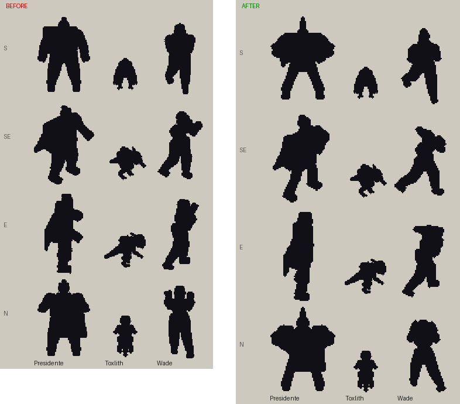
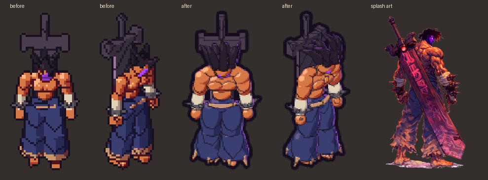
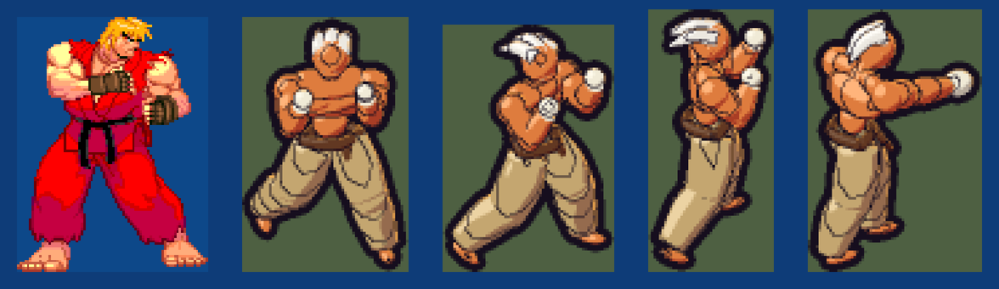
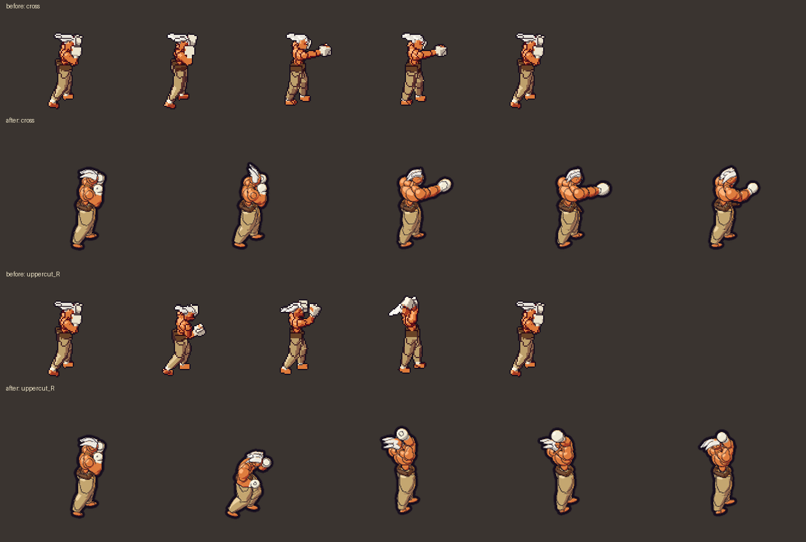
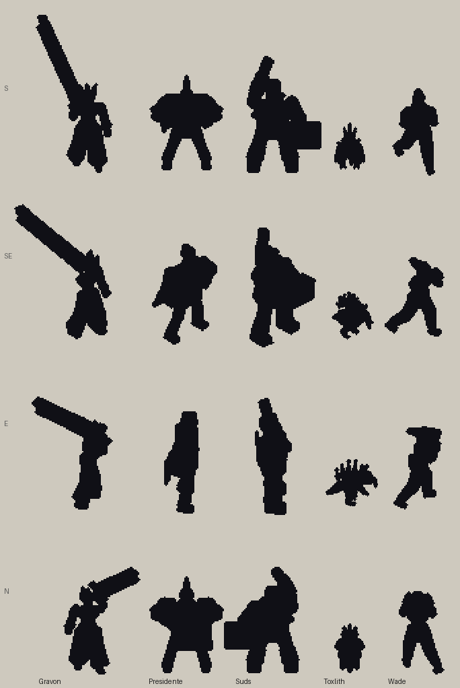
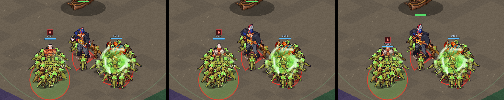

# Art direction: silhouettes first

From the team's "On-Ramp: Art" doc: **clarity over all things.** Every new
character, enemy, particle effect or obstacle must pass the "who's that?"
test: black it out and you still know instantly what it is. Alien Arena
asks for split-second decisions, and it is extremely frustrating to make
the wrong one because you didn't know what you were looking at.

## Style target

Inspirations: **Street Fighter III: 3rd Strike / Marvel vs Capcom 2**,
**Hades**, **Risk of Rain 2**, **Battlerite**. What we take from each:

| From | We take |
| --- | --- |
| 3rd Strike / MvC2 | heroic exaggeration: huge hands and forearms, broad shoulders, narrow waists, tapered limbs; expressive poses with anticipation and follow-through |
| Hades | bold dark ink outlines, high-contrast cel shading, saturated colour, a coloured rim light that pops characters off the ground |
| Risk of Rain 2 | simple, bold forms and clean colour blocks; every survivor has their own body plan and reads from far away |
| Battlerite | top-down readability: chunky proportions, oversized weapons and heads, clear colour coding |

**No pixel art.** Characters are 3D models rendered in the forge's "toon"
style (`STYLE = "toon"` in an actor module):
- anti-aliased edges;
- three flat cel bands;
- bold ink outlines and creases;
- a rim light in the hero's signature colour (`RIM`).

Models use curved, tapering `tube`s and smooth blobs, not boxes.

**Still open:** pre-rendered sprites versus real-time 3D. At full
resolution a pre-rendered hero costs a lot of texture memory (Gravon's
sheet is about 200 MB of GPU memory). See `DECISIONS.md`.

## Proportions and motion: what "feel" is made of

The 3rd Strike / MvC2 feel lives in proportions and movement more than
in rendering detail. Every hero is built on the **heroic body kit**
(`tools/sprite_forge/actors/_body.py`):
- a real spine (hips, abdomen, chest, neck, head),
- curved muscle,
- proportion parameters: head, shoulders, waist, forearms, hands, legs,
  feet.

Animation follows fighting-game principles. The forge supports each of
them directly:

| Principle | How |
| --- | --- |
| Anticipation, snap, hold, recoil | key poses with `ease="out"` into the strike and a held impact key |
| Overlapping action (hips lead, fist arrives last) | `Clip(..., overlap=seconds per joint depth)` |
| Smear / squash and stretch | six-value joint poses scale a limb: `(rx, ry, rz, sx, sy, sz)` |
| Secondary motion (hair, sashes, capes) | `FOLLOW = {joint: (drive, gain, stiffness, damping, drag)}` springs |
| Weight and rhythm in idles | knee bend, bounce and shoulder roll driven together |

Twists add up down the spine. Keep the sum of hips + abdomen + chest
rotations about a move's real twist (about ±30° for a punch), or the
torso spins sideways.

**Proportion target: 3rd Strike, not DBZ.** Think Ken:
- **Height:** about seven heads tall, with long legs (about half his
  height) in a wide stance, knees bent out.
- **Torso:** squared, capped shoulders spreading past the hips over a
  real waist; a trapezoid, not a barrel, and not balloon muscle.
- **Arms:** long, with solid upper arms; fists that read but are not
  oversized mitts.
- **Posture:** per character. Ken is upright and proud; a boxer like Wade
  tucks in behind his guard. Take the proportions from the reference, not
  the stance.

In the body kit that means a modest `deltoid` and `pecs`, a `square`
clavicle bar, longer `arm_length` / `leg_length`, and a flatter
`chest` depth. Our camera sits 30° above, so legs read a little shorter
and heads a little bigger than in a side-on fighter; build slightly long
in the legs to compensate.

## Rules for every in-game asset

1. **Shape before detail.** What identifies a character must be in the
   outline, not inside it. A mask, a belt or a tattoo vanishes in
   silhouette.
2. **One dominant shape and one signature piece** that breaks the outline
   from every direction. The camera is high, so things above the head and
   things sticking out sideways read best; anything in front of the torso
   disappears.
3. **No shared skeletons by default.** Proportions are identity. Start from
   the character's own shape, not from another actor scaled up.
4. **Pose with personality, not just attitude.** Read the character's
   entry in the Character Concepts doc and pose who they are: weight on one
   leg, head angle, where the hands rest. A pose built only to break the
   outline (an arm stuck up like a torch, a lunge held forever) reads as
   distinct but weird.
5. **Let the silhouette tell the lore** where it can. Gravon *is* the
   sword (Soulblade: the blade and its host have separate health), so at
   rest his whole outline reads as a sword.
6. **Size is a cue, not the only cue.** Two characters with the same shape
   at different sizes still read alike in a fight.
7. **Detail level:** about 64 art pixels for an average character
   (DD-AA-007). Forge actors use `PIXEL_SCALE = 1.35`: chunkier pixels,
   same size on screen.
8. **Check it.** Run `python3 tools/sprite_forge/silhouette.py` after every
   bake and look at the lineup. The `/design-review` skill asks for it on
   art changes.

## Shape briefs

Write one before modelling a character. Keep it to a few lines.

**El Presidente: the inverted triangle.**
Boulder shoulders and a trapezius that buries his neck, on sturdy legs
planted wide. A tall red-and-white crest on the mask is the top of his
outline from every side. The showman: his idle is a power pose, chest out,
chin up, fists on hips and elbows flared, so there are gaps between arms
and body. From behind, the flag cape is a
solid banner.

**Wade: the Old Head's guard.**
A no-nonsense veteran boxer: a tight, short white crop (never spiked),
a full dark beard and hard brows, and bold black tiger stripes from his
left shoulder down to the wrist. White wraps run up his forearms, he wears
a brown belt over baggy khakis, and his lower legs are bandaged. His guard
is a boxer's, not a karateka's:
- chin tucked behind high, tight fists, with the elbows flared slightly out;
- shoulders hunched and rolled forward, with a slight lean in;
- bladed feet about shoulder width, rear heel light.

**Suds: the barrel and the cooler.**
A wide barrel of a torso in a blue Hawaiian shirt, on red armoured legs. A
big white cooler juts out at his left hip. The life of the party: his idle
is a toast ("Round's on me!"), can raised beside his grin, belly out,
leaning back with his weight on one leg. His moves (toss, belch, a volley
of brews, chug-and-flex) all come from the can arm.

**Gravon: the blade.**
Gravon is the sword; the man is its host. At rest the blade runs straight
down his spine: pommel and grip above his head, crossguard across his
shoulders, blade tapering past his legs. From the front his whole outline
reads as a sword; from behind, the runed blade covers him. The host slumps
under it, head bowed and arms hanging, like a vessel the sword is wearing.
He draws it only to swing (slashes, the overhead smash, Fury, the lunge),
then it returns to his back.

**Toxlith: the warty toad.**
Squat and wide: lumpy acid-green skin, a crest of magenta spines with
glowing venom beads on the tips, red eyes and a long pink tongue. Low and
wide, the opposite of every hero; the spiky crest is its top edge from any
side.

**For the rest of the cast**, start from their concept art; most of it
already has strong outline hooks:
- Zephyr: a ragged, flowing cloak.

## Enemies

Each genus needs its own body plan, and small, medium and large must
differ in shape, not just scale. A starting point:

| Genus | Body plan |
| --- | --- |
| Venoxarid | low and skittering, tails |
| Cerebrian | floating, swollen brain bulbs |
| Frigidariant | angular, crystalline, blocky |
| Magnarok | hunched, rocky, heavy |

The eleven old enemy sheets are one alien recoloured and rescaled. They
fail the test, as the on-ramp doc already says.

## Beyond silhouettes: finding yourself in a crowd

When a swarm piles onto a player, enemy bodies cover their outline whatever
its shape. The crest keeps Presidente findable; Wade, half his height,
gets buried. Silhouettes tell you *which character*, but two more things
are needed:

- **A per-player colour rim or outline** that draws over enemies.
- **Distinct ring shapes for effects** (spiky poison, a turning crown for
  Empowered), not only colours.

Neither is built yet.
