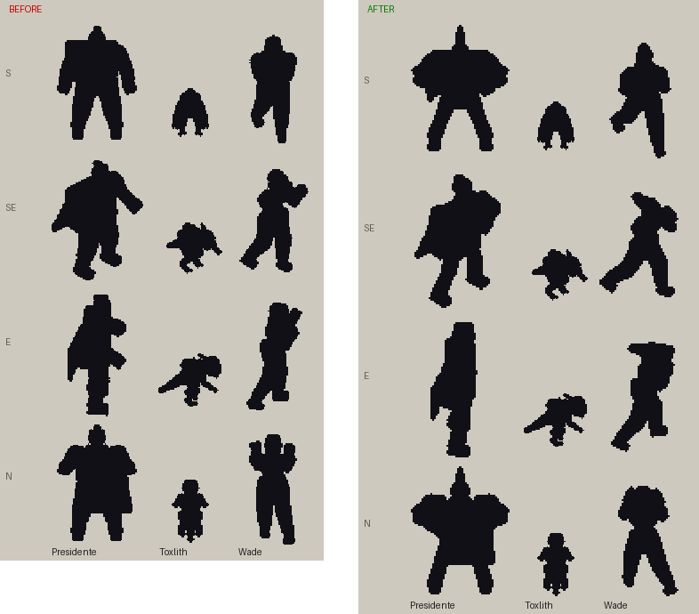
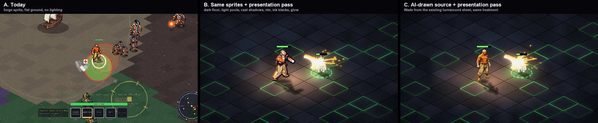
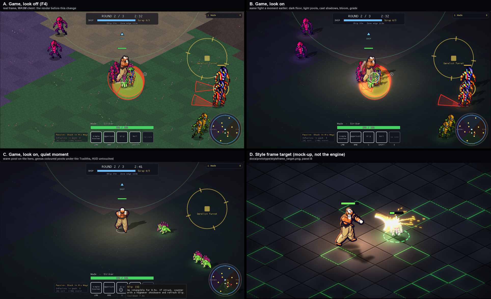
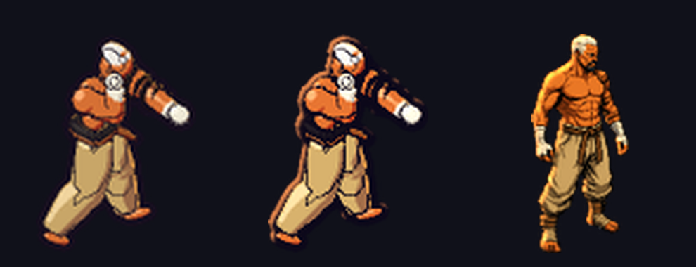
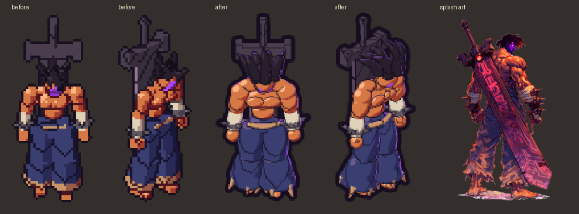
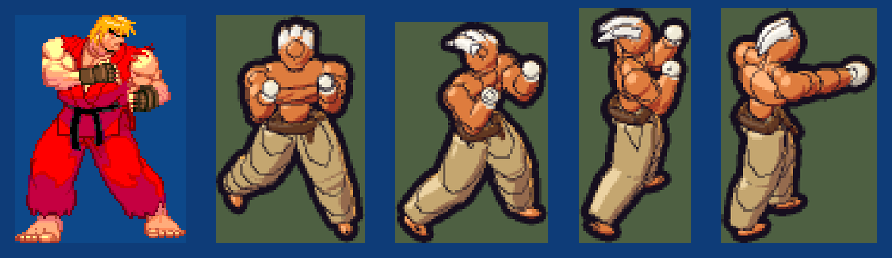
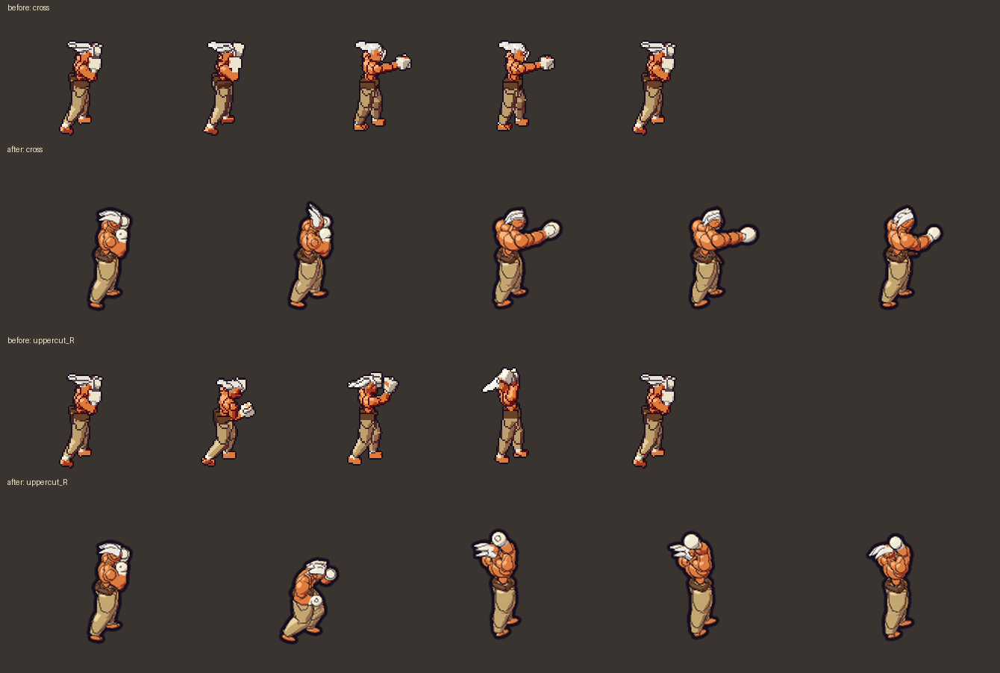
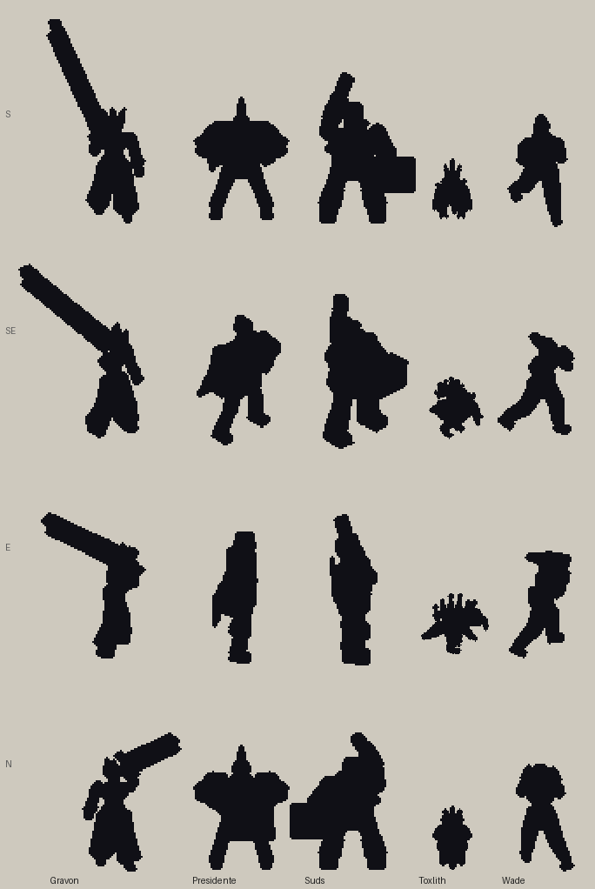
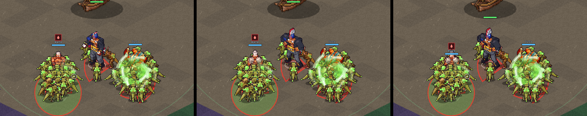

# Art direction: silhouettes first

From the team's "On-Ramp: Art" doc: **clarity over all things.** Every new
character, enemy, particle effect or obstacle must pass the "who's that?"
test: black it out and you still know instantly what it is. Alien Arena
asks for split-second decisions, and it is extremely frustrating to make
the wrong one because you didn't know what you were looking at.

## The look: inked heroes on a dark world

The splash art is the promise: comic-book inking (heavy black shadow
shapes, hard edges, hatching), hot saturated colour, neon accents, on
black. The game keeps that promise with three layers, each with one job.

*A mock-up composited in Python from the game's real sprites
(`tools/sprite_forge/styleframe.py`), not the engine. A is the game today.
B is the same sprites with the presentation layer. C swaps in Wade from
his AI-drawn turnaround.*

| Layer | Job | Rules |
| --- | --- | --- |
| **World** | stay out of the way | Dark, cool and low in contrast: floor values in the bottom fifth of the range, slate blue-violet, detail in seams and cracks, not in texture. Genus colour arrives as light and glow (toxic green leaking from Venoxarid ground), never as bright floor tiles. |
| **Characters** | carry identity | The brightest, most saturated things on screen. Warm key light, cool shadows, shadow cores filled with solid ink ("spot blacks"), a thick ink contour, a rim light in the character's signature colour. |
| **Effects** | carry the action | Additive light with bloom. Every hit, cast and telegraph glows against the dark floor and lights the ground around it. Animation and effects sell the feel more than character detail does: characters are about 100 px tall. |

Value is what makes it read: dark world, mid-to-bright characters, effects
brighter than both. If a floor tile is brighter than a hero's shadow side,
it is wrong. This serves **Clarity** before anything else: at a glance you
see who is where and what is about to hurt you.

**Built so far:** the character layer's shading (the forge's `ink`
style), and the world and effects layers in the engine: dark floor, light
pools, cast shadows, bloom and a colour grade. Every strength is a named
constant in `include/config/LookConfig.h`; F4 switches the look off and
on in game.

*Real frames from the WASM client (A to C) and the style frame (D).*

**Not built:** a rim light or outline on enemies, seams and leaking genus
glow in the floor (the tileset is flat colour), and true additive effects.
`DECISIONS.md` has the full list.

### Where the drawing comes from

Code cannot draw. A body built from blobs and tubes in Python comes out as
a clay figure whatever the shading, and after many passes it still did not
match the splash art. So:

- **The design comes from the concept art.** Each character's splash and
  turnaround go through an image-to-3D tool to make a textured model
  (`art/models/<Name>.glb`, see `art/models/README.md`). Its shape and
  texture carry the face, the muscle, the costume and the line work.
- **Code does motion, ink, light and consistency.** The forge puts that
  model on its skeleton, animates it with fighting-game timing, shades
  every character with the same ink rules and bakes eight directions.

*At game size (shown 3x): the code-built Wade, the same with ink blacks,
and the AI-drawn Wade. The third is the target for the model route.*

The steps are in the `/character-art` skill. This is how Hades was made
too: 3D models with painted textures, rendered to sprites.

## Style target

Inspirations: **Street Fighter III: 3rd Strike / Marvel vs Capcom 2**,
**Hades**, **Risk of Rain 2**, **Battlerite**. What we take from each:

| From | We take |
| --- | --- |
| 3rd Strike / MvC2 | heroic exaggeration: huge hands and forearms, broad shoulders, narrow waists, tapered limbs; expressive poses with anticipation and follow-through |
| Hades | bold dark ink outlines, high-contrast cel shading, saturated colour, a coloured rim light that pops characters off the ground |
| Risk of Rain 2 | simple, bold forms and clean colour blocks; every survivor has their own body plan and reads from far away |
| Battlerite | top-down readability: chunky proportions, oversized weapons and heads, clear colour coding |

**No pixel art.** Characters are 3D models rendered by the forge:
- anti-aliased edges;
- a lit tone, a cool shadow tone and solid ink in the shadow cores
  (`STYLE = "ink"`; the older `toon` style has three soft cel bands and no
  blacks);
- bold ink outlines;
- a rim light in the hero's signature colour (`RIM`).

Bodies are generated models (above). The four actors built before that
decision (Wade, Presidente, Suds, Toxlith) are still code-built
from `tube`s and blobs in the `toon` or pixel style. They are placeholders
until each gets a model; their poses and clips carry over.

**Still open:** pre-rendered sprites versus real-time 3D. At full
resolution a pre-rendered hero costs a lot of texture memory (Gravon's
sheet is about 200 MB of GPU memory). Generated models make real-time
rendering more attractive later, since the mesh, skeleton and clips
already exist. See `DECISIONS.md`.

## Proportions and motion: what "feel" is made of

The 3rd Strike / MvC2 feel lives in proportions and movement more than
in rendering detail. Every hero uses the **heroic skeleton**
(`tools/sprite_forge/actors/_body.py`, and `skin.HUMANOID` for generated
models): a real spine (hips, abdomen, chest, neck, head), shoulders,
elbows, wrists, hips, knees, ankles. For a generated model the
proportions come from the concept art, so the targets below go into the
image prompt and the choice of which generation to keep. For the older
code-built bodies they are `Build` parameters.

Animation follows fighting-game principles. The forge supports each of
them directly:

| Principle | How |
| --- | --- |
| Anticipation, snap, hold, recoil | key poses with `ease="out"` into the strike and a held impact key |
| Overlapping action (hips lead, fist arrives last) | `Clip(..., overlap=seconds per joint depth)` |
| Smear / squash and stretch | six-value joint poses scale a limb: `(rx, ry, rz, sx, sy, sz)` |
| Secondary motion (hair, sashes, capes) | `FOLLOW = {joint: (drive, gain, stiffness, damping, drag)}` springs |
| Weight and rhythm in idles | knee bend, bounce and shoulder roll driven together |

**Toes point where the body travels.** Turned-out feet look natural in a
stance or idle, but in a run, walk, dash or any travelling move they read
as a waddle. Generated models usually stand with the feet turned out (Isaac:
28°), and joint-angle clips inherit that, so turn the legs in at the hip
during the move until the toes face the direction of travel. Measure it
rather than eyeballing it: the toe direction is the ankle's rotation applied
to the fit's ankle-to-toe vector.

Twists add up down the spine. Keep the sum of hips + abdomen + chest
rotations about a move's real twist (about ±30° for a punch), or the
torso spins sideways.

**Proportion target: 3rd Strike, not DBZ.** Think Ken:
- **Height:** about seven heads tall, with long legs (about half his
  height) in a wide stance, knees bent out.
- **Torso:** squared, capped shoulders spreading past the hips over a
  real waist; a trapezoid, not a barrel, and not balloon muscle.
- **Arms:** long, with solid upper arms; fists that read but are not
  oversized mitts.
- **Posture:** per character. Ken is upright and proud; a boxer like Wade
  tucks in behind his guard. Take the proportions from the reference, not
  the stance.

In the body kit that means a modest `deltoid` and `pecs`, a `square`
clavicle bar, longer `arm_length` / `leg_length`, and a flatter
`chest` depth. Our camera sits 30° above, so legs read a little shorter
and heads a little bigger than in a side-on fighter; build slightly long
in the legs to compensate.

## Rules for every in-game asset

1. **Shape before detail.** What identifies a character must be in the
   outline, not inside it. A mask, a belt or a tattoo vanishes in
   silhouette.
2. **One dominant shape and one signature piece** that breaks the outline
   from every direction. The camera is high, so things above the head and
   things sticking out sideways read best; anything in front of the torso
   disappears.
3. **No shared skeletons by default.** Proportions are identity. Start from
   the character's own shape, not from another actor scaled up.
4. **Pose with personality, not just attitude.** Read the character's
   entry in the Character Concepts doc and pose who they are: weight on one
   leg, head angle, where the hands rest. A pose built only to break the
   outline (an arm stuck up like a torch, a lunge held forever) reads as
   distinct but weird.
5. **Let the silhouette tell the lore** where it can. Gravon *is* the
   sword (Soulblade: the blade and its host have separate health), so at
   rest his whole outline reads as a sword.
6. **Size is a cue, not the only cue.** Two characters with the same shape
   at different sizes still read alike in a fight.
7. **Detail level:** about 64 art pixels for an average character
   (DD-AA-007). Forge actors use `PIXEL_SCALE = 1.35`: chunkier pixels,
   same size on screen.
8. **Check it.** Run `python3 tools/sprite_forge/silhouette.py` after every
   bake and look at the lineup. The `/design-review` skill asks for it on
   art changes.

## Shape briefs

Write one before modelling a character. Keep it to a few lines.

**El Presidente: the inverted triangle.**
Boulder shoulders and a trapezius that buries his neck, on sturdy legs
planted wide. A tall red-and-white crest on the mask is the top of his
outline from every side. The showman: his idle is a power pose, chest out,
chin up, fists on hips and elbows flared, so there are gaps between arms
and body. From behind, the flag cape is a
solid banner.

**Wade: the Old Head's guard.**
A no-nonsense veteran boxer: a tight, short white crop (never spiked),
a full dark beard and hard brows, and bold black tiger stripes from his
left shoulder down to the wrist. White wraps run up his forearms, he wears
a brown belt over baggy khakis, and his lower legs are bandaged. His guard
is a peek-a-boo (Tyson) guard:
- gloves up at the cheeks, forearms near vertical;
- elbows pointing down, tucked just in front of the ribs;
- chin tucked behind the gloves, a slight forward crouch, knees bent,
  bladed feet about shoulder width.

Arms hang off the chest, so leaning forward tips them back. Solve the
shoulder and elbow angles by measuring joint positions (wrist height
against the head joint), not by eye.

**Nolan: the firebender's kick.**
The hype anime foil to Wade: lean, bare-chested, a tall crest of electric
blue hair that tops his outline from every side, white baggy trousers
gathered into heavy boots, a dark sash. He fights with his legs only, in
the way Zuko firebends: low and wide, grounded, a hand on the floor, the
legs drawing big arcs. His stance is bladed and sunk, lead palm out in
front and the rear hand chambered at the ribs. Each move has its own
shape: a leg scything the floor, a leg out flat through a full spin, a leg
straight up before it comes down. He never throws a punch.

**Nyx: the woman with a TV on her shoulder.**
A Playmaker made of nanites. Her signature piece is the cream CRT riding
her right shoulder, held by the hand at her ear with the elbow out: it is
the highest, squarest thing on her outline from every side, and nobody
else in the cast has a box on their silhouette. Below it, a long magenta
coat slipping off both shoulders, a bandeau, cream trousers, orange skin
crazed with plate lines. She is always fraying: square pixels in the
coat's magenta, the screen's cyan and her skin's orange leave the coat's
edges and hem and drift away (a runtime effect, not in the sheet). Her
idle is unhurried, hip cocked, the free hand loose; the swarm does the
work. As a swarm she has no body, only a cloud of those pixels (magenta
on a foe, cyan on a friend), and the CRT stays on the floor where she set
it down until she comes back for it.

**Suds: the barrel and the cooler.**
A wide barrel of a torso in a blue Hawaiian shirt, on red armoured legs. A
big white cooler juts out at his left hip. The life of the party: his idle
is a toast ("Round's on me!"), can raised beside his grin, belly out,
leaning back with his weight on one leg. His moves (toss, belch, a volley
of brews, chug-and-flex) all come from the can arm.

**Gravon: the blade.**
Gravon is the sword; the man is its host. The blade is massive, 2.4 m
against his 2.0 m, and worn on a diagonal across his back as in the splash
art: the pommel over his left shoulder, the crossguard at head height and
the point past his right calf. From behind, the runed blade covers him; from
the front, the guard and grip stand over his shoulder and the point juts out
by his right leg. The host slumps under it, shoulders rounded and arms
hanging heavy, with his head bowed only a little so the violet face still
reads. Everything about him is heavy. To fight he drops his left shoulder and
heaves it off his back one-handed; then it stays out, both hands on the
grip, braced over it with the point on the floor, or dragged behind him on
the run with the point scraping. He swings it flat, through the whole
half-circle in front of him, the body turning after it. Ravager's Edge
throws him off his feet after it, flat in the air, and he has to haul it
out of the floor and onto his shoulder. Left alone a few seconds, he puts
it back. Without a host the blade stands alone,
point in the floor and taller than anyone in the arena (`GravonBlade`), or
rides an ally's back on the same diagonal.

**Isaac: the lantern on his back.**
A brawler's body that never makes a fist. A rack of glowing amber
canisters rides his right shoulder and a ragged white cape trails off his
left, so his outline is lopsided from every side. He is the team's light:
tall and calm, chin level, open palms held out from his sides. Everything
he does comes out of open hands: a two-handed push of light (Ray), a hand
held out on a rope of light while he leans back against it (Lifeline), a
raised hand that comes down in blessing (Blessing), arms flung wide as he
arrives (Flash). He moves big and deliberately, never twitchy.

**Terrain: inked stone.** Rocks are dark, cool grey blocks with chipped
octagonal tops and a solid ink outline, quieter than any character. They
are drawn in code for now (`ArenaView::drawRock`) as a stand-in until
there is concept art for terrain. When you play Isaac, rocks in Lifeline
reach get a faint amber rim, and the one you are bonding to pulses.

**Toxlith: the warty toad.** (No longer spawned: Venoxarid now fields the
thugs described under Enemies. The actor is kept as a creature example.)
Squat and wide: lumpy acid-green skin, a crest of magenta spines with
glowing venom beads on the tips, red eyes and a long pink tongue. Low and
wide, the opposite of every hero; the spiky crest is its top edge from any
side.

**For the rest of the cast**, start from their concept art; most of it
already has strong outline hooks:
- Zephyr: a ragged, flowing cloak.

## Enemies

Each genus needs its own body plan, and small, medium and large must
differ in shape, not just scale. A starting point:

| Genus | Body plan |
| --- | --- |
| Venoxarid | upright street thugs: crests, open vests, baggy striped pants (built, see below) |
| Cerebrian | floating, swollen brain bulbs |
| Frigidariant | angular, crystalline, blocky |
| Magnarok | hunched, rocky, heavy |

The eleven old enemy sheets are one alien recoloured and rescaled. They
fail the test, as the on-ramp doc already says.

**Venoxarid is the first genus on the simplified roster** (decision log,
2026-11-15): one grunt and one elite, both generated models, both in the
genus colours of acid green skin and purple cloth.

- **Grunt: the thug.** As tall as an average hero. A swept-back green
  crest tops the outline; an open purple vest over a white shirt and baggy
  purple track pants with a white stripe make the middle. Idle is a
  slouch with the chin down and the hands loose in front.
- **Elite: the enforcer.** One and a half times the grunt and twice as
  wide. Spiked leather shoulders and gauntlets square off the outline; the
  glowing venom tank on his back, with its hose, is the signature piece
  and shows over his shoulder from every side.

They differ from heroes by colour first (no hero is acid green on purple)
and from each other by size and the tank. The crowd problem below is worse
with hero-sized enemies and is still open.

## Beyond silhouettes: finding yourself in a crowd

When a swarm piles onto a player, enemy bodies cover their outline whatever
its shape. The crest keeps Presidente findable; Wade, half his height,
gets buried. Silhouettes tell you *which character*, but two more things
are needed:

- **A per-player colour rim or outline** that draws over enemies.
- **Distinct ring shapes for effects** (spiky poison, a turning crown for
  Empowered), not only colours.

Neither is built yet.
