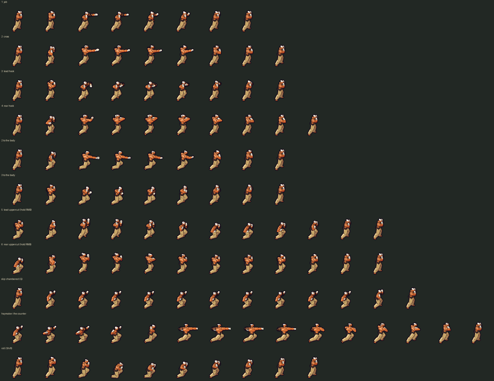

# Design decision log

Every decision that changes how the game plays, looks or feels gets an entry
here: mechanics, tuning, UI, content, art direction. This is how humans who
did not see the work can review it. Pure engine or tooling changes do not
need an entry.

Newest first. Use this format:

```
## YYYY-MM-DD: <short title>
- **Decision:** what was decided (and the numbers, if any)
- **Pillars:** which pillars it serves, and any it trades against
- **Why:** the reasoning, including alternatives rejected
- **Status:** Proposed | Built, needs review | Accepted (by whom) | Reverted
- **Where:** files, PR
```

Leave the status at **Built, needs review** until a human accepts it. When a
decision goes against a pillar or a design doc, say so plainly in **Why**.

---

## 2026-11-27: Enemy roles: each enemy asks one archetype's question (proposal)
- **Decision** (ideas and skill identities from a human in the design
  session; rules and numbers are first guesses; nothing built in the game):
  `specs/enemy-roles.md`. Archetype skills: Playmaker clutch, Striker
  uptime, Winger vision and decisions then defensive clutch, Defender
  knowing your limits. Roster: Diver (ignores damage and effects, dies to
  any control), Channeler (interruptible 3 s rally), Warden with prisoners
  (it moves its debuffs onto them; healing or buffing a prisoner frees it),
  Hex totem (cleanse destroys it, purify turns it into a buff zone),
  Juggernaut (regenerates unless hit constantly), Behemoth (body-block it
  or it smashes the ship), Bruiser (only Defenders can stand in front of
  it), plus genus twists (burning Magnarok enemies quenched and made
  Brittle by water).
- **Pillars:**
  - **Comradery** decided it: every archetype has moments only it handles
    well, so crews need each other.
  - **Crunch:** serves; enemies force quick, weighty choices instead of a
    pile to grind through.
  - **Creative Builds:** serves; builds now make an archetype's answer
    bigger instead of giving it a second job.
  - **Clarity:** weakens unless every question has its own telegraph (cast
    bar, leap warning, chains, totem range); the spec asks for them.
- **Why:** in the Presidente Sandbox, against a uniform horde, an idle
  Playmaker cost his crewmate almost nothing and his build lost to his bare
  kit. With Divers and Channelers added (3 min each, autopilot): idle,
  Mina went down 8 times (was 4); bare kit 4 downs, 364 kills; full build
  2 downs, 427 kills and more setup credit than the bare kit.
- **Status:** Proposed
- **Where:** `specs/enemy-roles.md`

## 2026-11-26: Playmakers are credited for plays; Gather replaces Hot Potato (proposal)
- **Decision** (option A chosen by a human in the design session; nothing
  built in the game): a Playmaker's value is the setup the crew cashes in.
  Proposed in `specs/infusion-builds.md` ("Playmaker feel"): setup credit
  in the score (teammates' damage on enemies you moved or controlled in the
  last 3 s), "PLAY MADE" callouts, the Setup talent making displaced enemies
  Vulnerable ×3, Gather (displaced enemies take the debuffs off whatever they
  hit) replacing Hot Potato, and Outbreak copying the full pile.
- **Pillars:**
  - **Comradery** decided it: individual skill shows as the team's
    result, and the top-score infusion stops excluding Playmakers.
  - **Creative Builds:** serves; Gather is built on general actions
    (displacement) and the effects system, not on one character.
  - **Crunch:** serves; the throw path and which enemy to carry become
    the decision.
  - **Clarity:** serves; the payoff is named on screen. Risk: full-pile copy
    plus Stoke clears packs instantly.
- **Why:** in a browser sandbox the build's own damage was dwarfed by the
  Striker's, which `ARCHETYPES.md` intends (Playmaker DMG Very Low), so the
  scoring, not the damage, had to change. Option B (Striker-level damage for
  the build) was rejected as breaking the archetype.
- **Status:** Proposed (direction accepted by a human; numbers untested
  with players)
- **Where:** `specs/infusion-builds.md`

## 2026-11-25: Cores become genus verbs; archetypes get multipliers and signature talents
- **Decision** (requested by a human in the design session, revising the
  infusion-builds proposal below; nothing built):
  - **Cores are the genus's effect verb.** Venoxarid Outbreak (copy the
    most-debuffed enemy's debuffs to the area), Cerebrian Inversion
    (corrupt enemy buffs, purify ally debuffs), Frigidariant Stasis (freeze
    effect timers; Doomed/Anchored), Magnarok Cauterize (kept; allies' Mend
    now resolves as a heal). Toxic Miasma, Mind Flay and Diamond Fortress
    are retired. The Genealogy column is rewritten to modify any core.
  - **Archetype identity:** infusion output is scaled per trait by the
    archetype's maximum (x1.25 Very High to x0.25 Very Low), and every
    tree's tier 3 gets a third, archetype-only signature talent (16).
  - **Crown part accepted.** The 18 builds were rebuilt so every core is
    part of its build's engine (was 7 of 17), using the full Character
    Concepts roster.
- **Pillars:**
  - **Creative Builds** decided it: the cores now read and combine with
    everyone's effects instead of being a ticket to a genus.
  - **Comradery:** serves. Cores and signature talents read what
    crewmates applied; cores chain across players (Stasis keeps time on
    the Wound Cauterize detonates).
  - **Crunch:** neutral.
  - **Clarity:** weakens. Multipliers hide numbers unless tooltips show
    your own; more verbs on screen.
- **Why:** three of the four old cores did one fixed thing and were mostly
  chosen for their genus. **Against the Genera and Infusion doc** (Drive):
  replaces three of its four cores; approved by the human. Also: Nolan is
  a Playmaker in the Character Concepts doc but a Striker in the code.
- **Status:** Accepted (requested by a human) for the cores and archetype
  direction; the rest Proposed. Review copy: the Claude doc "Infusion
  Builds Spec".
- **Where:** `specs/infusion-builds.md`

## 2026-11-25: Infusion builds designed backward from 18 end states (proposal)
- **Decision** (proposed in a design session with a human; nothing built):
  `specs/infusion-builds.md` picks 18 end-state builds, each with a proven
  Risk of Rain 2 ancestor, and works back to what each infusion layer must
  supply. Main proposals:
  - **Parts become kit buttons:** Talon = LMB hits, Eye = RMB charge, Sinew
    = SHIFT, Hide = being struck, plus a new **Crown** part that fires when
    a nearby enemy gets the genus status *from anyone*. Each genus delivers
    one status, one escalation, one buff (Venoxarid Poison / Weakened /
    Haste, Cerebrian Expose / Confused / Sharpened, Frigidariant Slow /
    Snared / Fortified, Magnarok Wound / Vulnerable / Empowered).
  - **Part grades:** one Refined rule (reaches allies or more enemies) and
    one Exalted rule break per part, the same for every genus (Echo, Heavy
    Hand, Reset, Backlash Aura, Throne).
  - **Nine new talents** (five are team converters) and a Hybrid Vigor
    rework; rework Avalanche, the one capstone no build uses.
  - **Rules:** archetype multipliers on what infusions produce (question
    for a human), proc depth 1 with echoes that never retrigger, cooldown
    floors, a per-player visual budget.
- **Pillars:**
  - **Creative Builds** decided it: items gain triggers that combine with
    kits, other items and other players, and a wide build (Chimera) is
    designed to compete with Ascension so neither is the dominant one.
  - **Comradery:** serves. Crowns listen to teammates' effects, Refined
    rules hand buffs to allies, and the builds are designed as setup and
    payoff pairs.
  - **Crunch:** serves. Genus is steered by territory (costs time), part
    is random, and choosing which part to combine onto is a real choice.
    Courier is a build against dead time.
  - **Clarity:** weakens. 20 items, part rules and archetype multipliers
    add rules; answered with one rule per part, one buff colour per
    genus, tooltips showing your own number, and a visual budget.
- **Why:** the playtests show builds not forming. Parts are flat stats,
  genus effects mostly use their own statuses instead of the shared
  effect vocabulary, nothing touches RMB charge (why every RMB is
  charged), damage items are near-dead on Playmakers and Wingers, and
  nothing listens to teammates. **Against docs:** the effects spec's
  Iceborn Crown gives Empowered on Slow (here Frigidariant's buff is
  Fortified); several end states break the archetype maxima unless
  multipliers are approved.
- **Status:** Proposed (needs a human: five open questions at the end of
  the spec)
- **Where:** `specs/infusion-builds.md`

## 2026-11-25: Field stations: the suit opens at a wild camp for 8 scrap
- **Decision:** At night, a player camped away from the ship can spend 8
  carried scrap to set up a **field station** at their camp. Until dawn,
  every living crewmate within 500 px of it (the camp-sharing radius) can
  install and combine infusions exactly as at the ship. One station per
  player per night; it can't be built at the ship or inside another
  station, and the price is taken from the builder's own carried scrap
  (never the bank or a teammate). It stays if the builder leaves. It is
  gone at dawn, at the finale and at the end of the match. Ship upgrades,
  the full heal and banking stay at the ship. The camp panel says why the
  suit is locked and offers "SET UP FIELD STATION - 8 scrap (you carry N)
  [V]", or says how to fix it next time when you carry too little. The
  station draws a faint green ring of its reach and a small marker.
  New client-to-server packet `BuildFieldStation` (id 32); match state
  carries the night's stations.
- **Pillars:** Strategic Crunch serves: no more sitting through a long
  night with nothing to do while the crew upgrades, and "carry scrap out
  or bank it at home" becomes a real choice. **Trade-off:** it weakens
  the pull back to the ship and competes with turret repairs and ship
  tiers for scrap; the price is the brake. Comradery serves: one player
  pays, the whole camp benefits. Creative Builds serves: wild campers can
  act on infusions they just found. Clarity serves: the panel names the
  rule ("the ship or a field station") and the fix.
- **Why:** Issue #45. Numbers (8 scrap, 500 px, until dawn) approved by
  a human on 2026-11-25. 8 matches a turret repair and is under the
  10-scrap heavy load. Rejected: free field access (removes the ship's
  pull) and a client-only unlock (the server gates every install and
  combine, and now also checks the station on each request).
- **Status:** Accepted (requested by a human)
- **Where:** `include/ArenaData.h` (`FIELD_STATION_*`),
  `src/MatchDirector.cpp` (`onBuildFieldStation`, `atFieldStation`,
  `canWorkOnSuit`), `NetworkProtocol`, `src/ArenaHud.cpp`
  (`drawCampPanel`, `localAtFieldStation`), `src/ArenaView.cpp`,
  `tests/test_camping.cpp`, `tests/test_network_protocol.cpp`,
  `specs/infusion-grades.md`

## 2026-11-25: Snow lies on the fir's ledges, not along its outline
- **Decision:** Snowy conifers no longer have pale slivers down both
  outer edges of each tier. Each tier now carries a band of snow across
  its face on the ledge just under the tier above (36 to 62% of the tier's
  height), with four small lumps draping over its lower edge and a thin
  ink line under it; the top tier has a cap on its tip. Lit on the left
  (0.62 of the snow colour), shaded on the right (0.44), like the
  foliage. Snow colour unchanged (cool, dim).
- **Pillars:** Clarity serves: snow reads as snow, not as a rim light or
  a glowing outline that competes with heroes and effects (playtest
  2026-11-22, #55). Others neutral.
- **Why:** Snow settles on what faces up and toward the camera, so the
  ledges carry it. A first try at full brightness bloomed through the
  post-process and made every tree glow, which breaks "the world is dark,
  heroes are the brightest things" (ART_DIRECTION.md); it was dimmed.
  Checked in a rendered frame of the arctic coast (N tour).
- **Status:** Built, needs review
- **Where:** `src/ArenaWorld.cpp` (`snowOnTier`)

## 2026-11-25: Leaving to the main menu leaves the match; Rejoin or Abandon
- **Decision:** The pause menu's "Main Menu" is now "Leave to Main Menu".
  It takes you out of the fight on the server (the existing
  return-from-menu rules: carried scrap dropped, and if you come back the
  same round, abilities start on cooldown and a downed hero comes back
  down), and on your client the match stops: the world is no longer
  drawn, every sound still ringing fades out in 0.12 s, new match sounds
  are ignored, and the match music fades out. The main menu then says
  what your crew is doing ("Your crew is out in round 2 without you") and
  offers **Rejoin** (pick the same character again: back at the ship) and
  **Abandon** (give up your place; back to character select). The match
  keeps running for everyone else. When the last player abandons and
  nobody else is playing or away, the match resets to the lobby, so a
  solo player who abandons starts fresh. New client-to-server packet
  `AbandonMatch` (id 31).
- **Pillars:** Comradery serves: one player leaving never ends or pauses
  the crew's match, and Rejoin keeps the door open. Clarity serves: the
  menu says plainly that the match is still running and what each button
  does, and the game is no longer heard behind a menu. Strategic Crunch
  is protected: the menu is no free cooldown reset or escape from being
  downed (rules unchanged). Creative Builds is neutral.
- **Why:** Issue #52: the old button sent you to character select while
  the match kept playing audibly, with no way back except picking again.
  Rejected: keeping the avatar in the world while away (it would be a
  free target or a free body-blocker, and needs new server state), and
  pausing the server (shared by the crew). Rejoin works while this client
  stays connected; rejoining after a disconnect would need a resume token
  and is not built. Rejoining in round 1 may restart First Contact music
  (the music director resets at the menu).
- **Status:** Built, needs review
- **Where:** `src/UISystem.cpp` (pause and main menus), `src/SfxSystem.cpp`,
  `src/MusicSystem.cpp`, `src/RenderSystem.cpp`, `include/GameState.h`,
  `src/MatchDirector.cpp` (`onAbandon`, `away`), `NetworkProtocol`,
  `tests/test_character_swap.cpp`, `tests/test_network_protocol.cpp`

## 2026-11-25: Objectives cover the whole map; the land ends in a coast
- **Decision:** Two map-generator changes, regenerated into
  `assets/maps/planet.tmx`:
  1. **Coverage (#49).** After each landing site's near/mid/far rings, the
     generator adds "fill" objectives in the biggest empty stretches until,
     for every landing site, no walkable spot is more than 3,000 px (~12 s
     at hero speed, straight line) from an objective in play. Fill
     objectives are in play every match. 36 were needed (cap 40). In play
     per match: 63 to 70 (was 28 to 34). The worst spot is now 2,987 px
     from an objective; it was over 10,000 px (~40 s) for landing sites 1
     and 3, which had no city objectives at all. Each fill objective is
     the errand its biome is known for. The city gets three of its own,
     on existing mechanics with smaller pads that fit a crossroads:
     "transit depot" (scrap haul), "clinic cache" (clear camp, open the
     med pod) and "plaza" (wipe the camp and its enforcer).
  2. **Map edge (#50).** The continent keeps its shape and size in world
     px, but the tile grid grows from 720 to 800 so the land that used to
     run into the grid's edge now ends in a natural coast with drawn sea
     beyond. A guaranteed sea belt keeps every walkable tile at least
     800 px from the edge (it was 14 px). The default camera sees about
     610 px past the hero square to the edge, so the edge stays out of
     sight. Walkable area, biomes and the four landing sites are unchanged.
  Also: enemies whose network state has not changed are re-sent at 5 Hz
  instead of 60 Hz, so twice the camps cost less bandwidth than before
  (ArenaSim, 4 bots: 142 KB/s before, 284 KB/s with the new camps and no
  change, 51 KB/s now).
- **Pillars:** Strategic Crunch serves: the playtest walked through whole
  biomes and found nothing, and "dead time feels very bad". Creative
  Builds & Dynamic Play serves: far places are worth going to, and the
  city has its own errands. Clarity serves: the world has no visible
  edge, only a coast. Comradery is neutral.
  **Trade-off:** about twice the objectives and camps (peak enemies alive
  in ArenaSim: 78 before, 158 now) mean more infusions on offer per match.
  Time still limits how many a crew can reach, but this is an economy
  change a human should check in play. `COVER_GAP` is the dial: 3,000 px
  was chosen over 2,500 (48 fills, still not fully covered) because it
  cost a quarter fewer camps for nearly the same 95th-percentile gap.
- **Why:** Whole-map coverage needs about 70 objectives in play however
  it is done: the rings cover only the half of the map near each site.
  Rejected: activating every ring objective in every match (still leaves
  gaps where no ring reaches, and makes ring sizes meaningless) and simply
  raising the reach (no coverage guarantee, and does not fix the city's
  street fit). For the edge, rejected: pushing land down near the edge
  (cost 15 to 30% of the land and a landing site, and made the continent
  a diamond) and an invisible wall. City blocks still reject the bigger
  objective pads; the city kinds have smaller ones. Not done: brand new
  objective mechanics per biome (these are new names and placements on
  existing mechanics), and path-distance coverage (straight line only).
- **Status:** Built, needs review
- **Where:** `tools/maps/generate_planet.py` (`fill_coverage`,
  `FILL_KINDS`, `COVER_GAP`, `CONTINENT_TILES`, `border_sea`),
  `assets/maps/planet.tmx`, `src/ServerGameState.cpp` (enemy resend),
  `src/ArenaHud.cpp` (N tour visits the coasts),
  `tests/test_planet_map.cpp`, `docs/design/MAP_PIPELINE.md`

## 2026-11-25: Lifeline bonds to the map's trees, cacti and ruins
- **Decision:** Isaac's Lifeline (RMB) can now bond to decorative props
  from the map's Props layer, not only to solid rocks and the hull. Each
  tree, cactus, boulder, sea stack, ruin, monolith, spire, ribcage,
  freighter wreck, lamp and sign gets a trunk-sized anchor box (for
  example 36 x 18 px for a conifer at scale 1, bigger for bigger props).
  The boxes block nothing: players and enemies still walk through
  scenery as before. Ground cover (grass, reeds, flora, debris, bones,
  craters) holds nothing. A solid shape wins a tie with a prop. On the
  planet map that is 1,960 new anchors. Pull speed, range, arc, release
  and cooldown are unchanged.
- **Pillars:** Creative Builds & Dynamic Play serves: forests become
  Isaac's travel network, which was the intent of #54 ("feel like flying
  around the map"). Clarity serves: what looks like something to grab
  can be grabbed, and the existing valid/invalid preview ring shows it
  before the press. Strategic Crunch serves: less dead walking for a solo
  Isaac. Comradery is neutral.
- **Why:** The earlier #54 patch made all solid props anchors, but the
  generated planet's trees are visual only, so in play almost nothing
  outside rocks worked. Making the trees solid would have blocked
  movement across every forest. A separate anchor list keeps collision
  as it was. City blocks are not anchors yet: they block as terrain
  cells (an isometric footprint, not a box) and need their own query.
  Still open for a human playtest: whether the pull feels fluid (speed,
  arc, keeping momentum on release), and what a solo Isaac does besides
  move (raised in the 2026-11-24 Lifeline entry).
- **Status:** Built, needs review
- **Where:** `include/CollisionSystem.h`, `src/CollisionSystem.cpp`
  (`setAnchors`, `anchorForProp`, `terrainNear`), `src/ServerGameState.cpp`,
  `tests/test_lifeline_anchors.cpp`, `tests/test_isaac_kit.cpp`

## 2026-11-24: Browser build fills the window, has fullscreen, and no Quit
- **Decision:** The web page scales the game (still drawn at 1280x720) to
  fit the browser window at 16:9, letterboxed in near-black, with a small
  Fullscreen button in the top-left corner and a plain loading bar; logs
  go only to the browser console. Quit is gone from the title screen, the
  main menu and the pause menu in the browser build; the pause menu's
  Main Menu is the way out of a match. Native builds are unchanged.
- **Pillars:** Clarity (a bigger picture, no dead button). Neutral on the
  others.
- **Why:** A tab cannot close itself, so Quit only stopped the game loop
  and left a frozen frame, which read as a crash. The button sits top-left
  because the scoreboard owns the top-right. Upscaling 1280x720 is a
  little soft on large screens; rendering at the real screen size would
  need the engine to handle a resizable window, which it does not yet.
  In fullscreen, Esc still pauses in Chrome and Edge (hold Esc to leave
  fullscreen); in Firefox and Safari the first Esc leaves fullscreen.
- **Status:** Accepted (requested by a human)
- **Where:** `web/shell.html`, `CMakeLists.txt`, `src/UISystem.cpp`

## 2026-11-24: The I screen is a quick look at the infusion pack
- **Decision:** In the arena, I no longer opens the legacy 20-slot
  consumable/weapon/armor inventory. It opens a small "PACK" window over
  the live HUD: one 44px square per infusion (genus colour, part initial,
  grade pips, count), then an "IN YOUR SUIT" row of what is installed.
  Hovering a pack square shows the same tooltip as the suit's pack.
  "OPEN SUIT TO INSTALL [B]" (or B) swaps to the suit. Away from the ship,
  the window says installing and combining only work beside the ship.
  Opening I closes a B suit screen. In intermission at the ship, the suit
  already holds the pack, so I does nothing there. The legacy screen
  stays only for the non-arena client.
- **Pillars:** Creative Builds serves: infusions are the one item and
  build system, and there is no second build system with no effect.
  Clarity serves: a quick check reads the whole build at a glance, with
  details on hover and no talent-tree screen. Strategic Crunch serves:
  checking the pack is fast and leaves the world visible. Comradery is
  neutral.
- **Why:** Issue #41. A playtester did not know what the I screen was
  for. In the arena it showed demo items seeded at spawn
  (`ServerGameState.cpp` "test items ... for demonstration"). Weapon and
  armor stats are never read by combat, and nothing in the arena adds to
  that inventory: infusion pickups go to the pack and medkits heal on
  pickup. The human direction was to keep a quick inventory view, behind
  the single item system, as small squares with hover text and a button
  to open the suit. The suit stays the talent-tree view. Rejected:
  relabelling the old screen ("Items & Equipment"), which kept items that
  look meaningful but do nothing, and removing I entirely. Not done here:
  the server still seeds the legacy demo items and the legacy
  UseItem/EquipItem packets remain. Retiring them is a separate engine
  cleanup.
- **Status:** Built, needs review. Type-checked only: a full build and
  visual check were not possible in this environment. Check in a match
  that the window fits and the tooltips read well, and that I, Esc and B
  each switch screens.
- **Where:** `src/ArenaHud.cpp` (`drawPackScreen`, shared
  `packItemTooltip`), `include/ArenaView.h`, `src/ArenaView.cpp`,
  `src/UISystem.cpp` (`renderArenaInventory`), `include/UISystem.h`,
  `PLAYTEST.md` (controls). This matches the infusion spec
  (`specs/genera-and-infusion-system.md`: hovering infusions in your
  inventory explains what slotting them gives).

## 2026-11-24: Hero sprite sheets load when a hero first appears
- **Decision:** Load each hero's actor sheets (with its extra parts, e.g.
  JeffTreads, KadeMirror) the first time that hero is drawn, not all 20 at
  startup. Enemies, the ship and props still load up front. Art is
  unchanged: full resolution, no downscaling.
- **Pillars:** Strategic Crunch and Clarity serve on the web: the browser
  build holds ~300 MB of actor textures instead of ~1.06 GB, so weaker
  machines stall less. Trades against both, slightly: the first time a hero
  appears (your own at the intro fade-in, a teammate joining or swapping),
  that frame pauses while the sheet decodes. Enemies stay preloaded so
  that pause never lands mid-fight on a spawn.
- **Why:** Requested by a human (web build was very slow). Rejected:
  half-resolution web sheets (softer heroes, against the inked-hero look in
  ART_DIRECTION.md); loading only the picked hero (a teammate's hero would
  still have to load when they join, so first use covers both).
- **Status:** Accepted (requested by a human); the first-appearance pause
  needs a look on a slow machine.
- **Where:** `src/ArenaView.cpp` (`actorFor`, `loadHeroSheets`), PR

## 2026-11-24: Lifeline target preview, refusal and solid-prop anchors
- **Decision:** Share Lifeline selection between its idle preview, cast gate
  and initial bond. Show the local Isaac a valid ring or invalid crossed ring
  with a label, using the server's replicated target. An empty/out-of-range
  selection cannot begin charging or spend cooldown. Extend anchor queries
  to all currently solid rectangular collision props, retaining active hull
  tier/site filtering. Do not change pull speed, arc, release or healing.
- **Pillars:** Clarity serves: the same selection drives the preview and cast
  eligibility; shape and text supplement colour. Creative Builds & Dynamic
  Play serves: existing solid props join mirrors/allies as mobility anchors.
  Strategic Crunch neutral: no mobility range/cooldown tuning. Comradery in
  Competition neutral: no ally healing or damage rules change.
- **Why:** Issue #54. Previously an empty hold animated and spent a partially
  refunded cooldown. The query only accepted enemy-blocking rocks/hulls,
  overlooking other player-solid rectangles. Scope is explicit: decorative
  trees in the generated map's visual-only Props layer are NOT collision
  shapes and remain unsupported, as do TerrainGrid-only cells and polygons.
  Do not silently make scenery solid to claim full tree support. This is a
  partial implementation, not closure of #54. Snapshot latency and marker
  clutter need visual review; no rendered fluid-feel claim is made.
- **Open human design question:** Isaac has no ally to support when solo.
  Should mobility alone be his solo loop, or should another solo interaction
  be added while keeping the Winger's no-base-damage identity? Defer this and
  flight-feel tuning to a human playtest rather than invent combat buffs.
- **Status:** Built, needs review
- **Where:** `src/CharacterKits.cpp`, `src/ArenaView.cpp`,
  `include/CollisionSystem.h`, `src/CollisionSystem.cpp`,
  `tests/test_isaac_kit.cpp`, `tests/test_lifeline_anchors.cpp`

## 2026-11-24: Minimap follows exploration by zooming out; mirrors are targets
- **Decision:** Keep the ship-centered minimap and existing minimum/zone
  range, expanding it to include the local hero and every active Kade mirror
  with 15% margin. Draw mirrors as hollow cyan panes, distinct from filled
  objectives and pickups. Kade's Shift over the map uses the inverse of the
  same transform, without world-camera zoom, terrain lift or aim-height bias.
- **Pillars:** Clarity serves: the hero and mirrors no longer disappear beyond
  the fixed ship circle, and map aiming agrees with marker positions.
  Strategic Crunch is neutral: no travel costs or cooldowns change.
  Comradery in Competition is neutral: team markers grant no denial mechanic.
  Creative Builds & Dynamic Play is neutral: mirror rules and kits are unchanged.
- **Why:** Zooming preserves the ship/zone/quadrant anchor and global mirror
  targeting without duplicating coordinate math. Enemy/terrain discovery rules
  remain unchanged. Trade-off within Clarity: distant targets compress nearby
  detail; dense-marker readability still needs rendered review. Focused C++
  transform tests pass; full build/tests are blocked by missing CMake, and no
  rendered verification was possible without a native/WASM client build.
- **Status:** Built, needs review
- **Where:** `include/ArenaMinimap.h`, `src/ArenaHud.cpp`,
  `src/ClientPrediction.cpp`, `include/ClientPrediction.h`, `src/ArenaView.cpp`,
  `tests/test_arena_minimap.cpp`

## 2026-11-23: End the run's music at game over
- **Decision:** Victory and defeat fade the current music out over the existing
  1.5 s playlist fade. Cancel queued transitions and forget the old run's
  playlist, radio clock/channels and First Contact state. A new run starts
  First Contact from the beginning, even if it follows game over directly.
  Individual knockdowns during an ongoing co-op run retain party mood music.
- **Pillars:** Clarity serves: the soundtrack marks the end of a run instead
  of sounding like play continued. Strategic Crunch neutral: no extra wait
  is imposed before restarting. Comradery in Competition neutral: a teammate
  going down does not silence the survivors' soundtrack. Creative Builds &
  Dynamic Play neutral: no builds or music-selection variety are changed.
- **Why:** Playtest issue #53 requests a fade and fresh tracks on a new run.
  This intentionally replaces MUSIC.md's old victory/defeat carry-on rule.
  Use authoritative match end rather than local death so revives and co-op
  mood changes keep working. No pillar is weakened. Audio-only review:
  focused director tests pass; full client/listening and visual verification
  are blocked by missing CMake/dependencies and no WASM build.
- **Status:** Built, needs review
- **Where:** `src/MusicSystem.cpp`, `src/MusicDirector.cpp`,
  `include/MusicDirector.h`, `tests/test_music_director.cpp`,
  `docs/design/MUSIC.md`

## 2026-11-23: Mirror Step requires a live mirror and preserves its destination
- **Decision:** Keep Mirror Step gated on an existing live mirror. A refused
  attempt now shows "CAN'T CAST" above Kade without spending cooldown or
  creating a mirror. At the three-mirror cap, keep the destination and replace
  the oldest other mirror with the one dropped at his departure point.
- **Pillars:** Strategic Crunch serves: placing a mirror remains a prerequisite
  for mobility. Comradery in Competition neutral: no teammate rules change.
  Creative Builds & Dynamic Play serves: teleporting uses the existing mirror
  network consistently. Clarity serves: refusal is visible and the chosen
  destination remains in the world. No pillar is weakened.
- **Why:** Issue #47's requested rules are already implemented at the base
  revision, but refusal was silent. Preserve those rules rather than rewrite
  them; add explicit feedback and regressions for dead mirrors and each target
  position at the cap (including eviction order and departure placement).
  No art, tuning, or balance values change. Runtime/visual validation is
  blocked locally by missing CMake and SDL2 headers; no claim of visual review
  or ArenaSim results is made.
- **Status:** Built, needs review
- **Where:** `src/CharacterKits.cpp`, `include/NetworkProtocol.h`,
  `src/ArenaClient.cpp`, `tests/test_kade_kit.cpp`

## 2026-11-24: Read before readying; a longer but bounded night
- **Decision:** Raise the intermission hard cap from 40 s to 90 s. Keep the
  existing immediate next-tick start when every selected player is ready,
  and start at the cap even if someone never readies. Both the ship's suit
  screen and the wild camp panel show `2/4 ready` beside the existing
  READY UP / READY [R] button and explain the all-ready shortcut.
- **Pillars:** Strategic Crunch weakens slightly: 50 s more potential night
  time reduces reading pressure and can lengthen an AFK wait. This explicit,
  reversible trade buys informed decisions, not extra combat time; the hard
  cap and all-ready shortcut bound dead time. Comradery in Competition
  serves: one AFK cannot hold the crew forever, and a ready crew need not
  wait out the cap. Creative Builds & Dynamic Play serves: players have
  time to understand unfamiliar infusions. Clarity serves: readiness count,
  button, shortcut and deadline are visible in both night screens.
- **Why:** Issue #43 asks for decision pressure rather than a reading test.
  90 s is a first tuning pass, not a required wait. All-ready, R toggling,
  clickable buttons and timeout already existed; preserve that server flow
  rather than adding another ready protocol. Spectators with no selected
  character are excluded from the displayed quorum, as on the server.
  No claim of runtime visual or pacing verification: CMake and SDL headers
  are absent, no client/WASM build is available. Human playtest needed.
- **Status:** Built, needs review
- **Where:** `include/ArenaData.h`, `include/MatchReadiness.h`,
  `src/ArenaHud.cpp`, `tests/test_match_readiness.cpp`,
  `tests/test_camping.cpp`, `CMakeLists.txt`

## 2026-11-23: Infusion ground labels one step larger
- **Decision:** Increase dropped infusion part-name text from 13 to 14 px;
  keep its position, colour, outline, bob and all other pickup labels unchanged.
- **Pillars:** Clarity serves: slightly larger text targets the playtest
  readability feedback (#42). Strategic Crunch is neutral: no timing or loot
  rules change. Comradery in Competition is neutral: access to loot is
  unchanged. Creative Builds & Dynamic Play is neutral: no infusion effects
  or drop variety change.
- **Why:** A one-pixel local increase is the smallest size step; changing the
  shared text helper would enlarge unrelated UI. No pillar conflict identified;
  larger labels could overlap in dense loot, so rendered review is still needed.
  `make build` and `make test` are blocked by missing CMake. Visual testing
  is blocked by no native client or WASM build; no visual result is claimed.
- **Status:** Built, needs review
- **Where:** `src/ArenaView.cpp` (`ArenaView::drawPickup`)

## 2026-11-24: Crash intro shows the planet's pink-cracked side
- **Decision** (requested by a human, issue #46, playtest 2026-11-22): the
  intro planet is turned so the side with the glowing pink cracks faces the
  camera, just left of the disc's centre on the day side (rotation
  X -5°, Z 353°, was X 15°, Z 200°). The light, rim, framing and the ship's
  impact point (lower right, night side) are unchanged.
- **Pillars:** Clarity / tone: the first frame of a match reads as an alien
  world, not an Earth clone. No other pillar is affected.
- **Why:** The cracks are one small patch of the Meshy texture; the old
  rotation put them on the far side. They were placed on the lit side
  rather than near the impact point, because the impact is on the night
  side where they would be lost in shadow. The patch is small, roughly 60 to 100 px
  across on a 1440 x 810 screen, so it reads but is subtle. If it should
  read more strongly, a follow-up could boost the pink in the bake or add a
  glow; that was left alone here because the issue asked for orientation
  only.
- **Status:** Accepted (requested by a human)
- **Where:** `tools/cutscene/render_intro.py`, `assets/cutscene/planet.png`

## 2026-11-23: Infusion grades step 2: the 32 Refined and Exalted effects
- **Decision** (requested by a human: "move to step 2" of issue #44): every
  genus now has a Refined and an Exalted effect in every tree, as tabled in
  `specs/infusion-grades.md` section 3. Raw builds something, Refined pays
  it off, Exalted changes how you play. Numbers are first guesses.
  Differences from the tables (listed in the spec under "Built as"):
  - **Rupture** pops at 10 poison stacks (the poison cap is 30, which play
    never reaches) and **Flashpoint** at 5 burn stacks (burns refresh
    their time instead of adding to it, so a 10 s burn never happens).
  - **Puppeteer** doubles the confused enemy's already-doubled hits on its
    friends and gives you the kill. **Ghost Step** hides you from
    targeting. **Phantom** is contact damage only: nothing body-blocks
    players already. **Supernova** is a 300-radius blast plus the molten
    field on every third cast, since the four cores differ too much for
    "double radius".
  - Cryo Sanctuary does not fire on the blow Last Stand catches (the
    overlap the spec flagged).
- **Pillars:**
  - **Creative Builds:** serves; this is what step 1 was waiting for. Deep
    builds now play differently (Glacier plants you, Phantom wants you in
    the crowd, Avalanche wants you moving), and several cross genera:
    Brittle and Corrosion help any teammate, Splinter and Diamond Heart
    feed on any freeze, Fuel feeds a Magnarok core's Cauterize. Risk: some
    effects may dominate; nothing is balance-tested yet.
  - **Strategic Crunch:** serves. Combining now buys a real new effect, so
    wide vs deep is a real choice instead of "deep is a trap".
  - **Comradery:** serves. Corrosion, Symbiote, Psychic Link, Brittle and
    Cryo Sanctuary help the crew; none hurts or blocks an ally. Puppeteer
    gives you kills your confused enemies make, which were nobody's before;
    it takes nothing from a teammate.
  - **Clarity:** weakens slightly. Each effect shows with existing effect
    visuals (rings, bursts, beams, zones, status icons), but Miasma Heart
    pulses a ring every second and several Exalted auras stack around one
    player; that may be busy with four ascended players. Not checked on
    screen in this step.
- **Why:** Alternatives rejected: changing burns to add duration (would
  change the Raw effect and the Cauterize core, out of scope);
  per-core "double radius" Supernovas (four special cases for one
  effect).
- **Verified:** one test per effect plus the Last Stand overlap in
  `test_infusions` (Debug, asserts on); full suite passes. `ArenaSim
  --suits` (new: bots start with every item at every grade) ran two full
  matches in a Debug build with each bot ascending a different genus, no
  crashes. Balance is not measured: the sim's bots do not play well
  enough to judge it.
- **Status:** Accepted (requested by a human); numbers Built, needs review
- **Where:** `src/Infusions.cpp` (effects), `include/Player.h`
  (`gradeTimer`, `gradeCounter`, `dominateTarget`), `include/Infusions.h`
  (`onEnemyDied`, `puppeteerOf`), `src/AbilitySystem.cpp`,
  `src/EnemySystem.cpp` (Puppeteer), `src/ArenaData.cpp` (text),
  `tests/test_infusions.cpp`, `tests/arena_sim.cpp` (`--suits`),
  `specs/infusion-grades.md`

## 2026-11-23: Infusion grades: combine to go deep; deeper effects differ and lock you in
- **Decision** (issue #44; full text in
  `specs/infusion-grades.md`):
  - **Grades.** Drops are Raw (I). Two infusions of the same genus and
    grade combine into one of the next grade at the ship: Raw → Refined
    (II) → Exalted (III). The target item's part survives; part stats
    scale with the Raw inside (×1, ×2, ×4), so combining moves stats but
    never loses them. Nothing splits back.
  - **Depth needs grade.** Tree tiers 1 and 2 take any grade, tier 3
    needs Refined, tier 4 needs Exalted. A full tree costs 8 Raw (was 4).
  - **Different effects per grade.** Each genus × tree gets a Refined and
    an Exalted effect (32 new effects) on top of today's Raw effect.
    Raw builds something (stacks, a status), Refined pays it off in a new
    way (a burst, a team effect), Exalted changes how you play (Plague
    Carrier, Phantom, Glacier, Inferno Heart...).
  - **Lock-outs.** Combining is permanent. The first Refined in a tree
    attunes it to that genus (only that genus after). The first Exalted
    slotted makes you that genus's Ascendant: one capstone genus per
    match.
  - The round depth cap (2 / 3 / 4) stays for the first build, to be
    removed if sims show it never binds.
- **Pillars:**
  - **Creative Builds** decided it (main pillar of the issue): builds now
    form over the match instead of all being open the whole time, and
    Exalted effects make a deep build play differently, not just hit
    harder. It trades a little of the 2026-11-17 freedom to mix genera:
    a tree's deep half is now one genus. The shallow suit stays mixed, so
    Purebred vs Hybrid Vigor is still a real fork.
  - **Strategic Crunch:** serves. Every pair of infusions is wide (two
    slots, two talents) vs deep (one slot, a tier-3 node, a new effect),
    and Ascension is a one-way door with a confirm step.
  - **Comradery:** serves. Five of the new effects help the team
    (Corrosion, Symbiote, Psychic Link, Brittle, Cryo Sanctuary); none can
    hurt or block an ally. The Ascendant title shows off a player's build.
  - **Clarity:** weakens slightly. Grades and attunement are two more
    rules on the suit screen; the spec answers with one pip language
    everywhere, a "why is this blocked" tooltip and a confirm before
    Ascension. 32 new effects need hit feedback of their own when built.
- **Why:** Playtest 2026-11-22: upgrades came too fast; with one slot per
  drop a player fills 13 to 17 of 17 slots in a match (estimate from the
  drop code; the sim could not be built here). Rejected: 3 → 1 recipe
  (an Exalted would cost 9 Raw, so almost nobody would reach a capstone);
  locking the whole suit to one genus at the first Refined (kills mixed
  builds); starving drops instead (makes exploring less rewarding, against
  the camping decision of 2026-11-19). **Against the Genera and Infusion
  doc:** the doc's scaling is "more infusions of the genus, a stronger
  effect" and the doc never mentions grades or lock-outs; this keeps that
  rule for Raw effects and adds grades on top. Pacing numbers are
  estimates and must be measured with ArenaSim once built. Four open
  questions are listed at the end of the spec.
- **Built (step 1, 2026-11-23):** grades, combining (drag an item onto a
  twin in the pack, or press C), the depth requirements, attunement,
  Ascension with a confirm step, grade dots on every item and slot, the
  "why is this blocked" tooltips, an Ascension flash plus a banner the
  whole crew sees, and the Ascendant title on the scoreboard and suit
  summary. F6 now gives one of every item at every grade. Checked in the
  running client (slot, block reasons, combine by key and by drag,
  Ascension, banner, scoreboard) and in `test_infusions`.
  - **Step 2** (the 32 Refined and Exalted effects) is built: see the
    entry above.
  - **Differs from the spec:** the Ascendant title is not drawn over the
    health bar at night (scoreboard, suit and banner only). An Exalted or
    Refined item in a shallow slot also attunes that tree (the rule is
    "the first Refined-or-better in a tree"); the slot tooltip warns.
  - **Pacing still unmeasured.** ArenaSim bots now combine when nothing
    else fits, but they only collect 1 to 9 infusions a match (they do not
    chase loot or objectives), so the sim cannot judge pacing. One bot
    reached tier 3 in a seed-11 run; none ascended. Needs a human
    playtest.
- **Status:** Accepted (spec approved by a human, 2026-11-23); step 1
  Built, needs review
- **Where:** `specs/infusion-grades.md`; `include/ArenaData.h`,
  `src/ArenaData.cpp` (grades, `slotBlock`, attunement, Ascension, graded
  text), `include/Player.h`, `src/Infusions.cpp` (`combineInfusions`,
  grade-aware `slotInfusion`), `include/NetworkProtocol.h`,
  `src/NetworkProtocol.cpp` (`InfusionCombinePacket`, grades on the
  wire), `src/MatchDirector.cpp`, `src/ServerGameState.cpp`,
  `src/ArenaHud.cpp` (suit screen, scoreboard, banner),
  `tests/test_infusions.cpp`, `tests/test_network_protocol.cpp`,
  `tests/arena_sim.cpp`

## 2026-11-22: Scrap is a counted currency; turret repairs cost scrap
- **Decision:** Scrap is a count, not one heavy piece.
  - Every kill can drop a little: swarmers 35% for 1, casters 50% for 2,
    brutes always 3, elites always 4.
  - A scrapyard pays a bundle of 10.
  - Carried scrap is banked by walking into the ship's ring, as before.
  - Carrying 10 or more slows you; less is light.
  - Going down drops your whole pile as one pickup.
  - Units went up tenfold: ship tiers cost 30 and 50 (were 3 and 5), the
    hull repairs 18 per scrap (was 180 per piece), score is 10 per scrap
    banked.
  - A derelict turret repair costs 8 carried scrap and takes 1 s (was
    free and a 10 s channel). The cost is checked when you start and paid
    when you finish, so walking away costs nothing.
  - Anyone who goes down, leaves or disconnects now stops working on an
    objective, before its timer ticks.
- **Pillars:** Strategic Crunch serves: every kill moves you toward a
  choice, and scrap in hand is a live trade-off (repair a turret now,
  carry it home for the ship, or stay light). The 10 s sit-and-channel was
  dead time, and is gone. Clarity serves: the carry prompt says how much
  you hold and the crew's progress toward the next tier ("ship 18/30"),
  the turret says its price, and drops are labelled "SCRAP +n".
  Comradery: neutral; scrap is per carrier, banked for the crew.
- **Why:** Playtest (#37, #38). Kill income is tuned to match the old one:
  a thug pack used to pay about 5 units (a 10-unit piece at 50% from the
  elite) and now pays about 5.75. Turrets now compete with the ship for
  scrap, so ship tiers come a little later if the crew buys turrets. The
  heavy-load slow keeps the old "the haul home is the cost" for big loads
  without punishing pocket change. **Trade-off:** the repair noise's pack
  used to arrive mid-repair (fight while you channel); it now arrives
  after a 1 s repair, so you fight it on the way home. Bots in ArenaSim
  kill too little to measure the economy; it needs a playtest.
- **Status:** Built, needs review
- **Where:** `include/ArenaData.h` (Tuning, PickupId::scrap),
  `src/MatchDirector.cpp`, `src/ServerGameState.cpp`, `src/ArenaHud.cpp`,
  `tests/test_points_of_interest.cpp`

## 2026-11-22: Derelict turrets are the roof turret, broken; scrap has a model
- **Decision:**
  - The derelict turret objective draws the roof turret's own sprites,
    dimmed. The gun slumps on its mount with the barrel tipped down,
    smoking and sparking. Once repaired, only the empty mount is left (the
    gun is on the ship's roof).
  - Scrap pickups and big carried loads use a new baked sprite from the
    team's Meshy model (`art/models/Scrap.glb`, fetched free and cut from
    3 million to 20,000 triangles with `shrink.py`; actor
    `tools/sprite_forge/actors/scrap.py`). The pile grows with the amount
    and sits in a soft amber glow.
- **Pillars:** Clarity: one turret look to learn, broken and then fixed on
  the roof; loot reads on the dark ground.
- **Why:** Playtest (#39): the objective had its own code-drawn gun that
  looked nothing like the turret it becomes. The scrap model was supplied
  by a human.
- **Status:** Accepted (requested by a human)
- **Where:** `src/ArenaView.cpp` (`drawDerelictTurret`, `drawPickup`),
  `src/ArenaWorld.cpp`, `assets/sprites/actors/Scrap.png`

## 2026-11-22: Esc always closes whatever is on top
- **Decision:** Esc closes the top-most thing on screen before it does
  anything else, in this order: the settings panel, the suit screen (B),
  the inventory (I), the pause menu. With nothing open, it pauses. The
  intermission suit screen is the night itself, so Esc there still opens
  the pause menu. On the title screen, Esc with settings open closes them
  instead of moving on to character select.
- **Pillars:** Clarity: one key always gets you out, with no menu that
  traps you (playtest, issue #40).
- **Why:** In playtest, Esc did nothing on the inventory screen, and with
  the suit screen open it paused the game behind the suit. Each system that
  draws an overlay closes its own (`UISystem::closeTopOverlay`), and
  `InputSystem` asks it first, so the input code doesn't need to know
  every panel.
- **Status:** Accepted (requested by a human)
- **Where:** `src/InputSystem.cpp`, `src/UISystem.cpp`, `src/ArenaHud.cpp`,
  `tests/test_inputsystem.cpp`

## 2026-11-20: Crash intro between character select and the first round
- **Decision:** When the whole crew has picked, the match plays a 16.8 s
  crash intro (new `MatchPhase::Intro`) in place of the 3 s lobby count-in:
  - 0 to 7 s: the planet from space, fading up out of black over 3.5 s,
    still, letterboxed; distress sirens far off behind the camera, getting
    closer.
  - About 7 s: the ship (ShipPatched, the intact RV, before it crashes)
    bursts past the camera from the lower right on fire, hull burning and
    boosters streaming flame, and falls away into the planet over 5.5 s.
    The siren and fire roar peak, sweep across the speakers and drop in
    pitch (Doppler).
  - 12.5 s: a flash where it hits. 12.7 s: cut to black, the crash.
  - 13.3 to 16 s: the world fades in on the burning wreck; every player
    gets up off the ground (their death clip played backwards).
  - 16.8 s: round 1 starts and control unlocks. No count-in.
  - Between confirming a character and the intro starting, the screen holds
    black (the lobby used to flash for a frame while sprites loaded).
  - **Hold Space 0.6 s to skip**, for the whole crew. Skipping jumps to the
    fade-in, so everyone still sees the crew get up.
  - The server owns the clock; every client draws the same moment, and the
    round timer only starts after the intro. **First Contact starts with
    the intro** (under the sirens) and plays on into round 1 without a
    break, as the landing's music.
  - First playtest (2026-11-20): 12 s felt rushed and jarring; lengthened
    to 16.8 s with a slower fade-up and a slower fall.
- **Pillars:** Clarity: it shows where you are (a planet), why (you
  crashed) and that the burning wreck is your ship, before the HUD asks
  anything of you. Comradery: one shared moment for the crew, and one
  skip for everyone, so nobody waits on anyone. It trades against
  **Strategic Crunch**: 16.8 s of no decisions at the start of every match.
  To limit that, it is short, skippable by anyone, replaces the old 3 s
  count-in, and the round clock does not run during it.
- **Why:** Requested. The art is not hand-painted. The planet is the Meshy
  model "Earthlike Planet" (fetched free, cut down with `shrink.py`, no
  credits spent) and the ship is ShipPatched, both rendered by
  `tools/cutscene/render_intro.py`. The planet's day/night line and rim are
  computed, not lit in Blender, so they can be placed exactly. Flames,
  smoke and glow are drawn live by the game (effects are light, per the art
  direction). The soundtrack is synthesised (`make_intro_audio.py`), so
  nothing needs crediting; it is the weakest part and a recorded siren and
  crash would improve it. Rejected: a pre-rendered video (big, and it
  cannot cut to the live world for the get-up); skip by Esc (Esc opens the
  pause menu); a skip vote (slower, and the intro is short).
  Known shortcut: the get-up is the death clip reversed, not a real
  get-up animation; a proper `getup` clip per character would read better.
- **Status:** Accepted (requested by a human)
- **Where:** `src/ArenaIntro.cpp`, `MatchDirector::startIntro`,
  `SfxSystem::onMatchState`, `MusicSystem`, `Arena::Intro` in
  `include/ArenaData.h`, `tools/cutscene/`, `assets/cutscene/`

## 2026-11-19: Playtest round two: readable ground, drops, pacing, probe, turrets, music
- **Decision:** The rest of the same playtest's notes.
  - **Walls and water read as walls and water.** Impassable ground that is
    not water (peaks, and land the generator seals off as unreachable) was
    painted with the walkable "high" ground, so it read as a gentle shaded
    slope you could not climb. It now has its own dark, cracked `cliff`
    tile. In game every walkable/blocked edge gets a rim: pale rock with an
    ink shadow on walls, a cyan foam line on water.
  - **Ground colours:** the PNW forest floor ("moss") was a dark blue-teal,
    close to the lakes; it is now a dark green. Damp ground by water is
    earthy instead of blue-grey. Lakes and sea keep the blue and get
    brighter glints.
  - **Infusion drops** are a dark token ringed in the genus colour with the
    genus's mark inside (Venoxarid a venom drop, Cerebrian an eye,
    Frigidariant a snowflake, Magnarok a flame), a pillar of the genus's
    light, and the part's name. Picking one up shows a banner ("+ VENOXARID
    EYE / Infusion! Slot it into your suit at the ship") and the mark
    bursts out of the hero in a ring; a burst of pickups shows one banner.
  - **Suit depth is paced by the match:** tree tiers 1 and 2 can be filled
    from night 1, tier 3 from night 2, tier 4 from night 3. Locked-by-round
    slots show dimmed with "Tier N opens on night M".
  - **Derelict turrets** are a hold: 10 s (was 4 s) in a 110 px circle (was
    70), and starting a repair draws one pack (4 bodies, +1 per extra
    crewmate) from 650 px out on the side away from the ship, once per
    turret.
  - **Crashed probes scan instead of being hauled.** Dig it out (4 s) and
    it boots where it lies: the land within 3,000 px is mapped for the
    whole crew (objectives there appear on the map and minimap), plus the
    usual score and infusion. Scrap is still the one thing you haul.
  - **A crash site** around every landing: ash ground with a ragged edge to
    about 1,300 px, cleared of plants, strewn with wreckage. The landing
    music plays there: it starts inside 1,300 px and holds out to 1,700 px
    (was a plain 2,000 px circle, which cut across biomes).
  - **Music is a radio.** Every place playlist is a channel that keeps
    playing on the match clock. Moving between places is a 0.6 s fade, and
    the channel picks up where its song would be now; a channel first heard
    mid-match joins a song partway in.
- **Pillars:**
  - **Clarity** decided most of it: invisible walls, water that looked like
    ground, a drop that did not look like loot, and a pickup with no
    feedback were all things the playtest could not read. The rims are a
    line per edge and can look busy in a maze of blocked tiles (the edges
    are tile steps, so they zigzag on diagonals).
  - **Creative Builds:** serves. With objectives paying one or two
    infusions, one tree filled in round 1; capping depth by round keeps
    early luck going wide across trees, so builds form over the match.
    Trades a little Crunch: an early lucky run can no longer cash in.
  - **Strategic Crunch:** serves. A turret is now a defend-the-point
    trade-off (time and a fight for a permanent ship gun) instead of a
    free 4 s tap next to the ship. The probe's scan is a time-for-intel
    choice that suits the explore-and-camp rounds; it no longer plays the
    same as a scrapyard.
  - **Comradery:** serves. A turret repair goes best with someone guarding;
    a probe's map is shared by everyone.
- **Why:** Alternatives rejected: starving infusion drops (would make the
  map less rewarding to explore, against the camping change); making the
  probe a second haul with a different reward (still the same verb as
  scrap); true overlapping crossfades (SDL_mixer plays one music stream;
  would need decoding to sound channels). Not verified by playing: the
  music was only unit tested (no audio device here); the other three
  genus marks were not seen on screen (only Venoxarid spawns now); the
  turret pack and probe scan are covered by tests and logs, not a live
  look. The rims, the crash site, drops and the pickup banner were checked
  in the running client.
- **Status:** Built, needs review
- **Where:** `tools/maps/generate_planet.py` (materials `cliff`, `ash`,
  crash site, turret props, probe text) and the regenerated
  `assets/maps/planet.tmx` / `planet_tiles.png`; `src/ArenaView.cpp`
  (`drawBlockedEdges`, `drawPickup`, `onLocalPickup`), `include/ArenaDraw.h`
  (`drawGenusGlyph`), `include/ArenaData.h` (`suitTierCap`, turret and
  probe tuning), `src/ArenaData.cpp`, `src/Infusions.cpp`,
  `src/ArenaHud.cpp`, `src/MatchDirector.cpp` (`onRepairNoise`),
  `src/ServerGameState.cpp`, `src/TiledMap.cpp`, `src/FogOfWar.cpp`,
  `src/ArenaClient.cpp`, `include/NetworkProtocol.h` (`Reveal`),
  `src/MusicDirector.cpp`, `src/MusicSystem.cpp`, `docs/design/MUSIC.md`,
  `docs/design/MAP_PIPELINE.md`; tests in `test_infusions`,
  `test_roof_turrets`, `test_music_director`

## 2026-11-19: No Blue Zone; the crew camps where night finds it
- **Decision:** A round has no zone. The planet is open, nothing hurts you
  for being far out, and nobody is teleported home or killed at nightfall.
  Night falls where each player stands, and nobody can move until dawn.
  - **At the ship** (inside its safe radius): full heal, carried scrap is
    banked, the suit opens, and the ship's next tier can be bought (only by
    someone camped there).
  - **In the wild:** heal 40% of max health, +20% per crewmate within
    500 px (one camp). Scrap stays in hand. The suit stays shut.
  - **The downed:** carried into a crewmate's camp if one is within 500 px
    (revived there at the camp's heal); otherwise they wake at the ship at
    full health and lose any scrap they carried.
  - **Dawn:** the next round starts where everyone camped. Each wild camp
    (crewmates within 500 px count as one) gets an ambush 420 px away: a
    pack of size 4 at dawn 2 and 5 at dawn 3 (a thug genus fields about two
    thirds of that). Nothing comes for the ship's camp. The first morning
    and the boss fight still start at the ship.
  - **The finale keeps its shield** (950 px, deadly outside), shown as
    before. Banners now say "DAYBREAK", "NIGHT IS FALLING" (25 s left) and
    "NIGHT"; the HUD shows distance to the ship instead of to the zone edge.
    Away from the ship the night shows a camp panel (who is in camp, the
    heal, the dawn threat) instead of the suit screen.
  - The debug skip-phase key no longer sends everyone home.
- **Pillars:**
  - **Requested by a human (Noah) after a playtest:** the zone felt small,
    even in round 3, and the run home every night cut exploration short.
  - **Strategic Crunch:** trades. The closing zone was the round's main time
    pressure and is gone. In its place, every nightfall is a decision with a
    real cost on both sides: walk home (dead time, but full heal, banked
    scrap, suit, ship tier) or camp out (keep your position and the time,
    pay with a thinner heal, unslotted infusions and a dawn fight). Removing
    the forced walk home also removes dead time.
  - **Comradery in Competition:** serves. Camping together heals more and
    is the only way a downed crewmate wakes where they fell; a split crew
    faces more ambushes. Nobody is punished for a teammate's choice.
  - **Creative Builds & Dynamic Play:** serves. Runs differ by where the
    crew ends each day; mobile kits can range farther.
  - **Clarity:** neutral. The rules are new, so the night panel and banners
    spell them out. The ship's ring still marks the safe camp.
- **Why:** Requested. The alternative (keep the zone, widen it) kept a
  pressure that worked against the isolation and exploration the playtest
  asked for. Risks to watch:
  - The rounds may feel slack without a closing edge. If so, add pressure
    that grows with distance from the ship (stronger packs far out) rather
    than bringing back a wall.
  - The ship takes raids while the crew is away; that is part of the
    trade-off.
  - Bots in `ArenaSim` still head home at dusk; a full match runs to
    victory, but bot camping behaviour is not simulated.
  - The numbers (40%, +20%, 500 px, ambush size) are first guesses.
  - **Not yet playtested.**
- **Status:** Accepted (requested by a human) for removing the zone and
  camping in place; the heal, ambush and downed rules are built, need review
- **Where:** `src/MatchDirector.cpp` (`makeCamp`, `dawnAmbush`,
  `updateRound`, `updateZoneDamage`), `include/MatchDirector.h`,
  `include/ArenaData.h` (camp tuning), `include/AbilitySystem.h` and
  `src/AbilitySystem.cpp` (night movement lock), `src/ArenaHud.cpp`
  (`drawCampPanel`, HUD line, minimap), `src/ArenaView.cpp`,
  `src/ArenaClient.cpp` (banners), `tests/test_camping.cpp`, `PLAYTEST.md`

## 2026-11-19: Playtest fixes: stuck objectives say what they want; Jeff stands up to harvest
- **Decision:** From a playtest where four objectives could not be
  finished:
  - **Crashed Probe** drops off at the ship where this match landed. The
    drop-off was the ship's spot when the map loaded, so after "every match
    lands somewhere new" it pointed at an empty site.
  - **Outpost / Med Pod**: a camp guard counts for its camp wherever it
    dies, even after it was provoked into chasing someone out (it used to
    count only where it fell). A camp cleared by fighting, with nobody
    pressing F, now pays the player who landed the last kill (score, loot,
    camp spawns off); before, it completed with no payout.
  - **Guarded Gate**: killing the guardian opens the gate. Pressing F at the
    gate still opens it early and enrages him (Berserk x5), as before.
  - **Prompts**: each objective says what it wants: outpost and med pod show
    guards down (n/m); the med pod says when it is unlocked; the gate names
    both ways to open it; frogs say catch, carry, release, with a POND ring
    and label drawn while a frog is carried; the probe says "dig out".
  - **Jeff**: pressing Acquire Biomass on treads stands him back up on legs
    (dropping the treads' Haste) and harvests, instead of being greyed out.
- **Pillars:** Clarity (the main one: the game state did not say what to
  do, and the player was told "hold your ground" at a gate that needed a
  key press). Comradery: fighting a camp clear pays the team, not nobody.
  Strategic Crunch: no dead time standing at a finished objective. Jeff's
  change trades a little of the treads' commitment (Creative Builds:
  choosing a mode had a cost) for one less disabled button.
- **Why:** These were bugs or missing feedback rather than tuning. For the
  gate, opening on the guardian's death was chosen over a "[F] open" prompt
  after the kill because the player had already done the hard part. The
  remaining playtest notes (zone and night return, landing-zone biome,
  music, terrain readability, drops, offence-track pace, turret and probe
  design) are open questions, not decided here.
- **Status:** Built, needs review. Not yet checked in a live match.
- **Where:** `src/ObjectiveSystem.cpp`, `include/ObjectiveSystem.h`,
  `include/Objective.h`, `src/TiledMap.cpp`, `src/ServerGameState.cpp`,
  `include/Enemy.h`, `src/EnemySystem.cpp`, `src/ArenaHud.cpp`
  (`drawPrompts`), `src/ArenaView.cpp`, `src/CharacterKits.cpp` (JeffKit),
  `src/ArenaData.cpp`, `tests/test_points_of_interest.cpp`,
  `tests/test_jeff_kit.cpp`

## 2026-11-19: Audio settings in the Esc menu
- **Decision:** Esc > Settings shows Master, Music and Sound effects
  sliders (percent) and Mute all. Changes apply live while dragging and are
  saved to `settings.ini` on release; no Save or Cancel. Slider levels are
  squared (50 % is about -12 dB), master multiplies both channels. The M
  key and the checkbox are one mute, now saved. The panel's Graphics
  fields (window size, fullscreen, VSync) and its controls list were
  removed from it: nothing applied the Graphics fields, and the controls
  list was out of date (it said Space attacks). They stay in
  `settings.ini`.
- **Pillars:** Clarity: you hear each change as you make it, the mute
  state is visible, and the panel no longer offers settings that do
  nothing. Strategic Crunch: in a match the pause menu is a quick in and
  out; live apply with no Save step keeps it short, and Esc can't throw
  changes away.
- **Why:** The sliders already existed but were not connected to any
  audio, and mute was a separate per-session toggle in each system. The
  committed `settings.ini` had `muted=true` (someone's saved file), which
  would have muted everyone once mute was saved and applied; it is now
  `muted=false`. A squared curve was chosen over linear because linear
  amplitude sounds almost unchanged across the top half of the slider.
- **Status:** Accepted (requested by a human) for the sliders; the live
  apply, the curve and removing the Graphics fields are built, need review
- **Where:** `src/UISystem.cpp` (`renderSettingsPanel`), `include/Settings.h`,
  `src/MusicSystem.cpp`, `src/SfxSystem.cpp`, `include/EventBus.h`,
  `tests/test_settings.cpp`, `docs/design/SFX.md`

## 2026-11-19: Every ability sounds like what it draws
- **Decision:** Ability casts make sounds, built from what the cast draws
  rather than picked per ability. The shape (slash, cone, burst, ring,
  beam, projectile, lob, zone, dash, tether, shield, or a generic blip for
  a cast that draws nothing) gives the main sound. The theme (Holy, Optic,
  Fire, Nanite...) adds a tint at 55 % volume, so a theme always sounds the
  same, as it always has the same colour. Your casts play up front (basic
  attack 60 %, the rest 90 %); teammates' play at 40 % of that, fading
  with distance and panned. A cast with nothing drawn yet waits up to
  450 ms and sounds when its shape appears (wind-ups). Shapes no cast
  claims (enemy attacks, ship effects, delayed blasts) stay silent. The
  clips are CC0 placeholders from four Kenney packs. The per-ability
  result is the table in `docs/design/SFX.md`.
- **Pillars:** Clarity: every cast is heard and tells you its kind (beam,
  dash, blast) and its theme, with yours distinct from your teammates'.
  Creative Builds: new kits, infusion core casts and theme combinations
  sound with no extra work, and themes keep one identity. Comradery:
  teammates' casts are audible nearby but never cover yours. Trades
  against Clarity in one way: with four players there is more sound, so
  every shape and tint has gaps and voice caps. Enemy telegraphs still have
  no sound, so for now nothing guarantees an enemy wind-up cuts through.
  Trades against character identity ("characters should play differently,
  not just look different"): kits that share a theme and shape sound alike
  (Isaac's and El Presidente's Holy cones, Wade's and Jeff's Steel), which
  signature sounds per character should fix.
- **Why:** About 50 abilities across 12 kits; hand-picking each from stock
  packs would be slow and would not survive kit changes. The shape and
  theme are already in the events the client gets. Alternatives rejected:
  one sound per slot (says nothing about the ability), and per-ability
  picks now (left for signature sounds). Four abilities send no cast event
  when tested without their setup and stay silent until they do. Your own
  casts sound when the server confirms them, so online they lag by the
  round trip.
- **Status:** Accepted (requested by a human) for having ability sounds;
  the rules and numbers above are built, need review
- **Where:** `include/AbilitySounds.h`, `src/AbilitySounds.cpp`,
  `src/SfxSystem.cpp`, `assets/sfx/ability/`,
  `tools/sfx/make_ability_sounds.py`, `docs/design/SFX.md`

## 2026-11-19: Placeholder hit sounds
- **Decision:** Hits make sounds. A short punch when an enemy is hit
  (louder for bigger hits), a heavier impact on a crit, and a grunt when
  your own hero is hit. Teammates being hit and damage-over-time ticks
  are silent. Enemy hits fade with distance from your hero (silent past
  1,400 px) and pan with where they land. Each sound has three pitch
  variants, a minimum gap (35 / 60 / 250 ms) and a voice cap (4 / 2 / 1).
  The clips are CC0 placeholders from Kenney's Impact Sounds pack.
- **Pillars:** Clarity: every hit now has sound as well as a flash and a
  number, and your own hurt sound stands apart from everyone else's hits.
  Gaps, caps and silent ticks keep a four-player fight readable rather than
  loud. Comradery is traded a little: you don't hear a teammate getting
  hit. That keeps the mix clean, but a later "teammate in trouble" cue
  could fill the gap.
- **Why:** The user asked for hit feedback from a free library to get
  started. Kenney's site was unreachable from the build environment, so the
  clips came from an npm package that bundles Kenney's CC0 packs (credited
  in `assets/sfx/CREDITS.md`). These are generic clips, not sounds made for
  this game's inked-heroes-on-a-dark-world look; replace them when real
  sound design starts. Enemy attack telegraphs are the next sound Clarity
  needs. Known gap: your own hits on enemies sound the same as your
  teammates' hits, because the server's Damage event does not say who
  dealt the hit. Adding the attacker to that event would let your hits be
  crisp and up front and theirs quieter, which serves both Clarity and
  Comradery (your contribution is audible).
- **Status:** Accepted (requested by a human) for having hit sounds; the
  rules and numbers above are built, need review
- **Where:** `include/HitSounds.h`, `src/HitSounds.cpp`, `src/SfxSystem.cpp`,
  `assets/sfx/`, `tools/sfx/make_hit_sounds.py`, `docs/design/SFX.md`

## 2026-11-18: Every match lands somewhere new; objectives are fixed places
- **Decision:** The planet has four landing sites; each match lands on a
  different one (random, never the last), so the storm, the zone and the
  run home move with it. The ship brings its own: its hull, player spawns
  and the two derelict turrets. Objectives and their camps are fixed places
  on the planet, the same every match; one is in play when the ship lands
  within 9,000 px of it, so neighbouring sites share ground. Each site's
  near ring is its own; its mid and far rings are filled to their usual
  counts, counting what neighbours already put there. A match has 28 to 34
  objectives in play (one site had 32 before) and peaks at about 74
  enemies (85 before). The zone's size, the round times and the return to
  the ship are unchanged.
- **Pillars:** serves Creative Builds & Dynamic Play (each run lands among
  a different mix of biomes, genus ground and objectives; across four
  sites, all eight biomes are in play) and keeps Strategic Crunch (the zone
  and the return home are as tight as before; the bigger planet adds no
  running). Fixed objectives serve the "learn the planet over months" idea:
  places are known, which ones matter changes with the landing. Neutral for
  Comradery and Clarity.
- **Why:** The designer asked whether the zone and the return to the ship
  were too limiting on the bigger map. They were not: the limit was one
  fixed landing, which left most of the planet (and half the biomes and
  their music) out of play. First built with each site carrying its own
  objectives; the designer asked for objectives in fixed places with only
  the ship's own (the turrets) coming with the landing, which is what this
  is. A first fixed version over-shared (81 objectives at one site); the
  ring quotas fixed that. Not built: the crew choosing the landing (a vote
  would add a decision), a flight between sites (the ship jumps at the end
  of a match). The unused sites' crash trenches stay on the ground as old
  scars.
- **Status:** Built, needs review
- **Where:** `tools/maps/generate_planet.py`, `src/ServerGameState.cpp`
  (`chooseLandingSite`), `src/MatchDirector.cpp` (`moveShip`),
  `src/CollisionSystem.cpp` (hull per site), `src/TiledMap.cpp`,
  `src/ClientPrediction.cpp`, `tests/arena_sim.cpp` (`--matches`),
  `tests/test_planet_map.cpp`; ctest `PlanetMatches`

## 2026-11-18: Music follows the match, the party and the biome
- **Decision:** The designer's music rules are built (`docs/design/MUSIC.md`,
  `MusicDirector`): the intermission/character select song in the lobby and
  between rounds; First Contact from landing until it ends; the landing
  zone's two songs in the ship's home ring (2,000 px); the biome's songs
  elsewhere; the ship biome's boss music in the boss fight (any boss music
  if it has none). Mood: Confident while everyone stands (always, solo),
  Alone for the last one, Weakened between. Decided with the designer: 3 of
  4 alive is Weakened; the landing zone is the home ring, not the small
  crash basin; boss music comes from the ship's biome. Added by me: a new
  place needs 5 s of standing in it, a worse mood 1.5 s, a better one 6 s,
  and a biome without music keeps what plays; tracks shuffle and crossfade
  over 1.5 s. 31 tracks imported (133 min of playlist time, 96 MB of OGG at
  -16 LUFS) with `tools/music/import_music.py`.
- **Pillars:** serves Strategic Crunch (the music turns as the crew falls,
  pressure you hear) and Clarity (the party's state is audible: Weakened
  and Alone tell you without looking at the HUD). The holds trade a little
  Clarity (the music lags a death by 1.5 s) for steadiness; without them a
  revive or a trip home flips the track.
- **Why:** The designer's spec, with the three open points asked and
  answered. First Contact (4.4 min) is longer than round 1 (2.5 min): it
  fades out as the intermission starts, accepted by the designer. Short of six minutes: every Tidal
  category (no boss track), PNW Alone, City Boss. The web build preloads
  every asset, so it now downloads 96 MB more before it starts; streaming
  music on demand there is a follow-up.
- **Status:** Accepted (requested by a human) for the rules; Built, needs
  review for the holds, crossfade and fallbacks
- **Where:** `include/MusicDirector.h`, `src/MusicDirector.cpp`,
  `src/MusicSystem.cpp`, `assets/music/`, `tools/music/import_music.py`,
  `tests/test_music_director.cpp`

## 2026-11-18: Genus territories actually load; biome dressing is drawn
- **Decision:** (1) Fixed the map loader reading every land tile as
  region 15: the generator paints regions with row 1 of `terrain_data`
  and the loader ignored the row. Since planet v1 the whole planet has
  been one territory each match (one genus everywhere); now its 15
  territories each get their own genus as designed. (2) The engine reads
  the Biome layer (`TerrainGrid::biomeAt`, `include/Biome.h`). (3) Code
  placeholders for the biome dressing: fir 9 to 14 m, snowy fir 8 to 11 m
  with snow on the bough tips, rainforest tree 6 to 9 m trunk under a 6
  to 9 m canopy, moss-hung cypress 6 to 10 m, palm 6 to 9 m, saguaro 3 to
  5 m, grass 0.7 m, reeds 1.2 m, sea stacks 6 to 15 m. All dark and
  inked, with a slight sway; everything taller than a hero thins to a
  ghost with a hero behind it.
- **Pillars:** serves Creative Builds & Dynamic Play (the genus patchwork
  now differs every match, so drops, camps and infusions vary by where you
  go, as the region design intended) and Clarity (each biome reads by its
  silhouettes, heroes stay the brightest thing and are never hidden by
  trees). Trades a little against Clarity: forests add screen clutter
  around fights; the dressing stays off pads and trails, and density can
  be lowered in `VEGETATION`.
- **Why:** Asked to make the biomes visible in game and readable by the
  engine for music. The region bug was found while adding the biome layer
  and is fixed in the same place; `tests/test_planet_map.cpp` guards it.
  The client was not run here; the loader and the dressing code were
  compiled and checked outside the game.
- **Status:** Built, needs review
- **Where:** `src/TiledMap.cpp`, `include/TerrainGrid.h`, `include/Biome.h`,
  `src/ArenaWorld.cpp` (`drawVegetation`), `tests/test_planet_map.cpp`

## 2026-11-18: The planet is laid out in earth-like biomes
- **Decision:** The planet is a continent of eight biomes laid out like a
  compressed North America: Pacific Northwest on the west coast, Arctic as
  its colder, higher northern part, a mountain spine down the continent
  with the desert in its rain shadow, the tidal coast (San Diego) south of
  where the spine meets the sea, with a Baja-like peninsula, plains through
  the middle, the city on the north-east shore, swamp around the east bay
  and jungle in the hot south-east. Genera do not drive biomes: up to 15
  genus territories sit inside biomes and are still dealt per match.
  Numbers: 720 x 720 tiles (about 840 m by 420 m, ~3.6 times the old
  tiles); biome shares 6% (tidal) to 28% (plains); a straight sprint
  through a biome takes 17 to 28 s at the median; a match's storm covers
  two to four biomes. The ship sits on crash site 0 (plains, PNW, desert);
  two more candidate sites are written to the map. Each biome has its own
  ground (same low value, different hue), relief, water (walkable ice,
  marsh and tide pools; deep lakes block) and dressing kinds. The city
  grows from 9 to 23 buildings. Objectives also weigh biome (frogs and
  gas by the swamp, scrap and med pods in the city).
- **Pillars:** serves Clarity (each biome reads at a glance by ground
  hue; the spine is a readable wall with four passes) and Creative Builds
  & Dynamic Play (crash sites at different junctions give different biome
  mixes, once the game picks one per match). Trades against Strategic
  Crunch: the land is bigger, and most of it sits outside a match's storm
  until crash sites vary per match; the objective rings around the ship
  are unchanged, so a match's travel is not longer. The spine adds detours
  to reach the far side; trails go through its passes.
- **Why:** The designer asked for biomes big enough that music (three
  categories, at least six minutes each) does not switch every few
  seconds, and for the layout to feel real and natural. The first layout
  put the tidal coast west of the forest (San Diego on the Oregon coast),
  let snow meet grassland directly, and had mountains that did not explain
  the climate. The spine and the wet/dry sides fixed all three. Kept small
  on purpose: the ground is one draw batch without culling, so a much
  bigger map needs renderer work first. The tidal coast, PNW and Arctic
  are the smallest (17 to 18 s straight runs). Snow is the one light
  ground and pushes the dark-world rule; it is kept cool and below the UI.
  Not done: biome props are not drawn by the engine yet (no placeholders),
  the engine does not read the Biome layer, music does not follow biomes,
  and the genus deal ignores biology. The map was not loaded in game here
  (no build environment).
- **Status:** Built, needs review
- **Where:** `tools/maps/generate_planet.py`, `assets/maps/planet.tmx`,
  `docs/design/MAP_PIPELINE.md` ("Biomes"),
  `docs/prototype/planet_overview_biomes.png`

## 2026-11-18: Scenery at real scale against the heroes
- **Decision:** Everything the planet draws is sized in real metres
  against a 1.8 m hero (1 m = 55 world px, `Config::World::METRE`, same
  constant in `generate_planet.py`). Reference sizes are in
  `MAP_PIPELINE.md`, "Scale". Highlights:
  - **Town:** 8 m streets around 14 m blocks (half split by a 2 m alley),
    buildings two storeys at the edge to five in the middle (3.5 m each),
    with 2.2 m doors and a window per storey. The city region now holds 9
    buildings instead of 158 toy blocks. Lamps are 4.5 m, about one per
    15 m of street; signs hang 2.5 to 4.2 m up.
  - **Set pieces:** the outpost is a watchtower with its hut on a deck 6 m
    up, on legs a hero stands between. The scrapyard has a 9 m crane, and
    its heaps stay below waist height and behind the zone. Med pod 1.3 m,
    probe 1.9 m, turret 2.5 m, gate 6 m.
  - **Landmarks:** monolith 14 m, spire 24 m, ribcage 24 m long, freighter
    28 m long. Their cleared pads and solid cores grow to match.
  - **Wilds:** boulders 0.7 to 1.5 m, ruin columns 1.5 to 4.5 m, flora about
    2.2 times bigger, crash wreckage ~2 m pieces at half the old count with
    room to walk between them.
  - The buildings' fade-to-ghost now also covers the monolith, spire, crater
    shard and freighter (`ArenaView::ghostAlpha`).
- **Pillars:** serves Clarity (scale reads at a glance; objectives read as
  places; heroes are never hidden by scenery). Neutral for Crunch, Comradery
  and Creative Builds: no rules, timings or zone radii changed. Trades
  slightly against Clarity: taller scenery covers more of the screen, and
  an *enemy* behind a building or landmark is still hidden.
- **Why:** The human playtest found the hero "the size of a kaiju" next to
  the town, lamps and outposts: lamps were 58 px (about 1 m), towers two
  heroes high, a tile 0.65 m. Asked for real scale. The tallest things
  were kept below "real city" heights on purpose: five storeys at most,
  so a building stays on screen and the ghost fade can cover it. Sprawl was
  not kept: at real scale the city region fits only a few blocks, so it
  now reads as the city's outskirts. That trades against `MAP_PIPELINE.md`'s
  "streets and towers"; a denser city needs a bigger city region. The
  scrapyard heaps were first drawn up to 1.6 m and hid heroes walking past,
  so they were cut to waist height. Terrain height (peaks under 5 m) and
  the ship (~11 m) were left alone and are noted as known gaps.
- **Status:** Accepted (requested by a human: real scale). The exact sizes
  are Built, needs review.
- **Where:** `include/config/WorldScale.h`, `src/ArenaWorld.cpp`,
  `tools/maps/generate_planet.py`, `assets/maps/planet.tmx`,
  `docs/design/MAP_PIPELINE.md`

## 2026-11-18: The planet replaces the arena: a place, not a training room
- **Decision:** The default map is now a generated planet
  (`assets/maps/planet.tmx`, from `tools/maps/generate_planet.py`), built
  against the first-pass "SPEC: Map Design" and "On Setting" docs. The
  prototype arena stays loadable with `--map`.
  - **Bigger and not round:** an island in a dark sea, about 2.2 times the
    arena across (380 tiles), with fingers and a bay. The storm's radii
    scale with the map (`zone_scale` 1.75: 3,500 / 4,375 / 5,075 by round),
    and so does the "far objective" distance (3,325). Some far places sit
    in fingers past round 3's storm.
  - **Elevation:** terraced hills and ridged mountain ranges, drawn as a
    lifted, slope-shaded ground mesh. Gameplay-neutral as the spec defines
    elevation: free to climb, attacks unaffected. Peaks, lakes and the sea
    are impassable and shape the routes; passes are carved so all land
    connects to the ship.
  - **Discovery:** the compass of genus quadrants is gone. The planet has a
    fixed zone template (a crash basin, seven wild regions, the city) and
    the server deals the four genera to the regions in shuffled hands
    **every match**. Drops, camps and objective rewards follow the region.
    The minimap shows only explored land, tinted by the genus that holds
    it. Unvisited places and landmarks glow through the fog as columns of
    light (amber for far places).
  - **Objectives are places:** each type has a set piece instead of the
    reticle (outpost watchtower, med pod, scrap heap and crane, probe in a
    dent, frog pond, spore vents, sealed gate, turret). Their ring is faint
    until you are close or it is in play. Placement follows context: frogs
    and spores by water, outposts on high ground, scrap in the crash field
    and the city. 30 places in three rings (8 near, 12 mid, 10 far), 73
    camp guards.
  - **Rhyme and reason:** a scorched crash trench, trails from the ship to
    every place (merging into roads home), five landmarks on sight lines,
    the city's outskirts on the north-east shore with neon in the district
    genus's colour and the real city's skyline past the shore, and about
    1,900 props (flora dressed per genus, boulders, ruins, bones, debris,
    lamps, signs) kept off pads and trails.
  - **Rocks** (Isaac's Lifeline anchors) keep their rules and spacing but
    are drawn as broken outcrops instead of cut octagonal blocks.
  - **Asset slots:** every prop kind, landmark and objective type draws
    real art from the sprite manifest if it exists (`Prop_<kind>`,
    `Prop_flora_<genus>`, `Objective_<type>`), else a code placeholder.
  - **N** jumps a free camera between the city and the landmarks, for
    reviewing the scenery.
- **Pillars:**
  - **Clarity** and **Creative Builds & Dynamic Play** decided it. The
    human's problems: flat, tiny, round, the genus layout given away, every
    objective the same reticle, no reason to the layout, "a dead training
    room". Objectives now say what they are by silhouette (Clarity), and
    the per-match genus deal means no two runs route alike (Dynamic Play).
  - **Strategic Crunch serves and weakens.** Serves: far places beyond the
    storm are a real gamble, and the genus deal makes "where do we go for
    the build we want" a fresh decision each match. **Weakens:** the
    2026-11-15 decision kept places 600 to 900 px apart to limit dead
    time; on the planet they are at least 850 px apart and often 1,200 or
    more, with trails, props and beacons along the way but no fights. Watch
    walking time in playtests; the fixes are more places per ring, patrols
    on trails, or traversal (zip lines, Lifeline-style tools).
  - **Clarity, small costs:** city towers can hide a hero behind them (they
    fade to a ghost when one is); mountain faces do not fade yet. The fog
    image is drawn flat, so its edge sits a little low on high ground.
  - **Comradery in Competition:** neutral; a bigger map makes splitting up
    a stronger option.
  - **Art direction:** the world stays dark and low in value, with genus
    colour arriving as light (flora glow, neon, landmark pools), as
    `ART_DIRECTION.md` asks. The placeholders are inked prisms, not the
    comic look; real art comes through the slots. The old PixelLab tiles
    and WFC generator (pixel art) are not used.
- **Why:** The human asked to fix the map's feel now and be set up to
  layer in art in parallel, AI-first, with Tiled kept as an option for hand
  fixes. A generator gives a whole planet from rules in one command, so
  improving a rule improves every place at once. Verticality (cliffs that
  block melee but not shots) was not built: enemies have no pathfinding and
  would snag on cliffs. Per-match objective site selection and several
  seeds per map are the next steps for variety. Checked: full bot matches
  on the planet finish (god mode reaches Victory; a normal match finishes),
  unit tests pass, frames from the WASM client reviewed.
- **Status:** Built, needs review
- **Where:** `tools/maps/generate_planet.py`, `assets/maps/planet.tmx`,
  `include/TerrainGrid.h`, `src/TileRenderer.cpp` (height mesh),
  `src/ArenaWorld.cpp` (scenery, set pieces, beacons), `src/ArenaView.cpp`
  (`toScreen` lift, rings, rocks), `src/ArenaHud.cpp` (minimap, N tour),
  `src/MatchDirector.cpp` (region deal, zone scale), `src/CollisionSystem.cpp`
  (blocked cells), `docs/design/MAP_PIPELINE.md`

## 2026-11-18: Jeff (G3F-0427, the Recycler Bot), a ranged Striker
- **Decision:** Jeff is playable, with the kit as the human specified it.
  Prototype numbers: 260 health, 240 speed.
  - **Biomass Reactor (passive):** +3% move speed and +5% damage per
    Resonance stack, up to 10. Resonance fades 20s after the last harvest.
  - **LMB, Thermal Disassembly:** a beam that hits the first enemy in line
    (470 reach, 12 damage every 180ms). Each shot adds 7 heat; at 100 it
    overheats into a 1.6s reload. Heat drains at 45/s once he has not fired
    for 0.3s.
  - **RMB (hold), Acquire Biomass:** every enemy that dies, killed by
    anyone, leaves a pile of remains for 12s. Releasing vacuums up every
    pile within 90 to 280 reach (growing with a 1.4s hold), +1 Resonance
    each. With nothing in reach, most of the cooldown comes back.
  - **Q, Reverse of Installation:** a wide (46 half-width), 620-long
    piercing beam. It discharges all Resonance first, then deals 40 + 16
    per stack to everything in the line (200 at 10 stacks); the passive
    does not count the discharged stacks a second time.
  - **LSHIFT, They See Me Rollin':** toggles tank treads: double base run
    speed and +2 Haste, but no Acquire Biomass. Pressing it again returns
    the legs and removes that Haste. He goes back to legs on death and at
    round start.
- **Pillars:**
  - Strategic Crunch: serves. Heat makes every burst a choice of when to
    stop. Resonance is a trade-off: keep the stacks for speed and damage,
    or cash them in on Q. The remains rot in 12s, so harvesting is urgent,
    and treads trade the harvest for speed.
  - Comradery in Competition: serves. Anyone's kill feeds Jeff, so the
    team's fight is his fuel ("when I win, we win"). Only Jeffs use the
    remains, so no one is denied anything.
  - Creative Builds: serves. His damage scales with stacks, so it combines
    with every damage infusion, and the tread Haste works with Haste-based
    talents.
  - Clarity: serves, with one risk. The remains glow cyan and pulse when
    about to rot, the vacuum's reach is drawn while RMB is held, and heat
    shows beside him and on the LMB button (red and steaming while
    venting). The risk: in big fights the remains add clutter on the floor.
  - **Against ARCHETYPES.md (flagged):** Strikers have mid mobility.
    Treads (x2 speed and +2 Haste, x1.4) with 10 Resonance (x1.3) come to
    about 3.6x base speed, faster than any Playmaker or Winger. Built as
    requested. If it proves too much, cap the Resonance speed on treads or
    lower the tread multiplier.
- **Why:** this is the kit from the character design; the numbers are
  first-pass tuning. The engine gained two generic kit hooks: an enemy
  died anywhere (Jeff's remains), and a multiplier on all the damage a
  player deals (Resonance).
- **Art:** two generated bodies, `Jeff.glb` (legs) and `JeffTreads.glb`,
  fetched from Meshy and shrunk locally (no credits spent). Each is its
  own sheet, and the game swaps them on the toggle. The nozzle arm makes
  the model lopsided, so each actor sets its centre line by hand
  (`CENTRE_X`, as Isaac does). The joint fits are waiting on a human,
  and the sheets are not baked yet.
- **Status:** Built, needs review
- **Where:** `src/CharacterKits.cpp` (JeffKit), `src/ArenaData.cpp`,
  `src/ArenaView.cpp`, `src/ArenaHud.cpp`, `tests/test_jeff_kit.cpp`,
  `tools/sprite_forge/actors/_jeff_body.py`, `jeff.py`, `jeff_treads.py`


## 2026-11-18: Isaac's Lifeline anchors to Kade's mirrors
- **Decision:** Kade's mirrors (anyone's) count as terrain for Lifeline.
  Isaac bonds to whichever rock, hull face or mirror is nearest the
  cursor (an ally near the cursor still comes first), heals as he would
  from a rock, and on release is pulled to the mirror's glass, stopping
  against it. If the mirror goes while he is bonded (Kade sets a fourth
  one down, or the round ends), the bond breaks and there is no pull.
- **Pillars:**
  - Creative Builds: serves. A cross-kit combo: Kade places anchors
    where Isaac needs them, in open ground with no rock.
  - Comradery in Competition: serves, with a small risk. It rewards the
    two players working together, but Kade replacing his oldest mirror
    can break Isaac's bond mid-cast. That is a side effect, not a way to
    grief, but watch for it in playtests.
  - Clarity: slightly weaker. As with the ship, mirrors in reach are not
    rimmed for Isaac the way rocks are.
- **Status:** Accepted (requested by a human)
- **Where:** `src/CharacterKits.cpp` (IsaacKit), `tests/test_isaac_kit.cpp`

## 2026-11-18: Isaac's Lifeline anchors to the ship
- **Decision:** The ship's hull counts as terrain for Lifeline: aim at
  the ship and Isaac bonds to the nearest face of its current tier's
  footprint, heals, and is pulled there on release, exactly as with a
  rock. Only the current tier counts.
- **Pillars:**
  - Strategic Crunch: serves. A Lifeline to the ship is a fast way home
    at the end of a round, and cuts dead time walking back.
  - Creative Builds: serves. Isaac's mobility now works with the match's
    home base, not just with rocks.
  - Clarity: slightly weaker. Rocks in reach are rimmed for Isaac; the
    ship is not. Its size makes it an obvious anchor, but add a hint if
    playtesters miss it.
- **Status:** Accepted (requested by a human)
- **Where:** `src/CollisionSystem.cpp` (terrainNear),
  `tests/test_isaac_kit.cpp`

## 2026-11-18: Scrap upgrades the ship: dug out, then a fort
- **Decision:** Scrap delivered to the ship still repairs 180 hull, and
  now also goes into the crew's bank. Between rounds (intermission only)
  anyone can spend the bank on the ship's next tier: the UPGRADE SHIP
  button on the suit screen, or U. Tier 1, "dug out and loosely patched"
  (`art/models/ShipPatched.glb`), costs 3 scrap; tier 2, the fort
  (`art/models/ShipFort.glb`), costs 5 more. Each tier:
  - raises max hull 1500 / 2000 / 2600 and repairs it fully;
  - widens the safe zone 420 / 480 / 560 and its healing 4% / 5% / 6% of
    max health a second;
  - makes the roof turrets hit harder and reach further (75 / 95 / 115
    damage, range 560 / 620 / 680);
  - swaps the ship's look and its collision footprint (Tiled types
    `hull`, `hull1`, `hull2`; only the current tier's is solid). The new
    hull stands on the crash site, level, facing the same way. Anyone
    left standing inside it is moved out in front.
  After an upgrade the suit screen stands aside for 3.5 s and a "SHIP
  UPGRADED" banner plays, so the crew sees what it built. A new tier
  is repaired in full, so its fires are out until raiders hurt it again.
  The old 3-scrap reward (an invisible 14-damage gun at the ship's
  centre, "SHIP TURRETS ONLINE") is removed.
- **Pillars:**
  - Strategic Crunch: serves. Every haul home is now worth twice
    (repair now, upgrade later), which makes the "one more objective or
    head back" choice weightier. Higher tiers ease late pressure (more
    hull, bigger safe zone), which the later rounds' bigger raids are
    meant to offset; watch whether a fort makes round 3 too safe.
  - Comradery in Competition: serves. The bank is shared and anyone
    can spend it, and the hauler still scores 100 per scrap.
  - Clarity: serves. The ship's look says its tier at a glance, the HUD
    shows "Scrap n/cost" in green with [U] when an upgrade is affordable,
    and the removed invisible gun was the least readable thing about the
    ship.
  - Creative Builds: neutral. Upgrades are a fixed path, not a choice of
    build.
- **Why:** Requested by a human, who supplied both models and picked the
  rules (upgrades at intermission, all four kinds of perk, costs 3 then 5,
  remove the old scrap gun). The numbers for each perk are first guesses.
  The fort's look hints that the crew may never leave the planet; how
  that plays into a match ending is an open question.
- **Status:** Accepted (requested by a human); the per-tier numbers need
  playtesting
- **Where:** `include/ArenaData.h` (SHIP_TIER_*), `src/MatchDirector.cpp`
  (onShipUpgrade), `src/CollisionSystem.cpp` (hull tiers),
  `assets/maps/arena.tmx`, `src/ArenaView.cpp` (SHIP_TIER_LOOK,
  WRECK_SPOTS), `src/ArenaHud.cpp`,
  `tools/sprite_forge/actors/ship_patched.py`, `ship_fort.py`,
  `tests/test_roof_turrets.cpp`

## 2026-11-18: The match opens just after the crash, with the hull at 35%
- **Decision:** The ship starts every match at 35% hull (525 of 1500),
  heavily damaged and burning, instead of at full health. Each scrap
  banked still repairs 180, so about five hauls bring it back to full.
- **Pillars:**
  - Strategic Crunch: serves. The hull is in danger from the first raid,
    so hauling scrap home competes with exploring from the start.
  - Clarity: serves. The opening shot is a smoking, burning wreck, which
    tells the story, and the fires die down as the crew repairs it.
  - Comradery: neutral. Creative Builds: neutral.
- **Why:** Requested by a human ("the ship has just crashed and is
  heavily damaged"). 35% is a first guess. Risk: a raid early in round 1
  can now end the match (the ship being destroyed is a loss). The bot
  simulator cannot judge this, because its bots neither bank scrap nor let
  raiders reach the hull; 5 seeds all ended in victory with the hull
  untouched. Playtest the first raid.
- **Status:** Accepted (requested by a human); the 35% needs playtesting
- **Where:** `include/ArenaData.h` (SHIP_START_HEALTH),
  `src/MatchDirector.cpp` (resetMatch)

## 2026-11-18: Repaired Derelict Turrets become roof turrets on the ship
- **Decision:** Each Derelict Turret objective the crew repairs stands up
  one cannon on the ship's roof (two mounts; the human's Meshy model
  "RV Spaceship Roof Cannon", `art/models/ShipTurret.glb`). Nothing stays
  at the objective; the old 3-second Wound aura there is gone. A roof
  turret swivels on its round base to the nearest enemy within 560 of its
  mount (300 deg/s, 16 drawn headings), fires once it is within 12 deg,
  and deals 75 a shot every 1.1 s (a grunt, 70 health, in one shot). It
  kicks back and flashes at the muzzle. A kill goes to the player who last
  hit the enemy (score, kill count, loot, on-kill infusions); an enemy no
  player touched dies with no credit. Turrets fire during rounds and the
  boss fight and come down with the next match. Banner: "ROOF TURRET
  ONLINE".
- **Pillars:**
  - Comradery in Competition: the turret never steals a kill. It finishes
    what a player started and the credit is theirs, so it backs up fights
    near home instead of competing with the crew.
  - Clarity: the guns are visible on the roof, turn toward their target
    before firing and recoil with a flash; the hit shows a damage number.
  - Strategic Crunch, slightly weakened: two guns at 68 DPS each make
    the ship much safer against raids and make fighting near home easier.
    The trade-off is the time spent repairing them instead of scavenging.
    Watch whether players camp by the ship once both are up.
- **Why:** Requested by a human ("high damage", kill credit to the last
  player to hit). 60 damage was tried first and does not one-shot the
  grunts on the arena map, so it went to 75. The older scrap reward
  ("SHIP TURRETS ONLINE" after 3 scrap) was removed on 2026-11-18 when
  scrap started buying ship tiers.
- **Status:** Accepted (requested by a human); the numbers (75 damage,
  1.1 s, range 560, turn rate) are first guesses and need review
- **Where:** `src/MatchDirector.cpp` (onTurretRepaired, updateRoofTurrets),
  `include/ArenaData.h` (ROOF_TURRET_*), `src/ArenaView.cpp`
  (drawRoofTurrets), `tools/sprite_forge/actors/ship_turret*.py`,
  `tests/test_roof_turrets.cpp`. Playtest cheat: F2.

## 2026-11-18: The crashed ship is solid, and it burns
- **Decision:** The hull has a collision footprint: 11 stepped boxes
  ("ShipHull_*", Tiled type `hull`) following the lower body of the
  hull as drawn, from the rubble at the nose to the rockets. Players and
  enemies are blocked; raiders now attack the nearest face of the hull
  instead of walking to its centre. Anything standing south of the
  footprint is drawn in front of the whole ship. Spawns and the "bring
  everyone home" spot moved to open ground in front of the hull. The
  wreck smokes and burns: the cab and a rocket nozzle always smoulder
  (it crashed), and as hull health drops the smoke thickens and up to four
  more spots catch fire (at 25%, 45%, 65% and 80% damage).
- **Pillars:**
  - Clarity: the ship's health can be read at a glance from how much of it
    is on fire, and you can no longer walk over the hull.
  - Strategic Crunch, slightly weakened: going around the 11 m hull is
    a few seconds' walk. The drop-off and safe rings still reach past it,
    so delivering scrap is no slower.
- **Why:** Requested by a human; the previous entry flagged the missing
  collision as the next fix. The footprint follows the hull image rather
  than the model's true ground contact: the rockets point up into the air,
  so the true contact is only the nose and a strip of empty-looking
  ground below the hull, which would block where nothing is drawn.
- **Status:** Accepted (requested by a human); the footprint shape and
  the fire thresholds need review
- **Where:** `assets/maps/arena.tmx`, `include/CollisionSystem.h`,
  `src/EnemySystem.cpp` (shipPoint), `src/ArenaView.cpp`
  (drawShipWreckage, depth sort), `src/MatchDirector.cpp`
  (bringPlayersHome)

## 2026-11-17: The ship is a crashed RV with rockets, at true scale
- **Decision:** The ship is now the human's model (`art/models/Ship.glb`, a
  crashed RV-turned-spaceship nose down in rubble). It is baked by the
  sprite forge at the heroes' scale: about 11 m bumper to nozzles, some
  510 px on screen, against heroes under 2 m. The old flat sprite was a
  192 px sailing ship and stays only as a fallback. The ship's radii grow
  to reach past the bigger hull:
  - enemies attack it within 240 (was 110);
  - drop-off within 300 (was 190);
  - "inside for the night" within 420 (was 300).
- **Pillars:**
  - Clarity: home base is unmistakable and in the same inked style as the
    cast.
  - Strategic Crunch, slightly weakened: the bigger safe and drop-off
    circles make the trip home a little shorter. Revisit the numbers if
    rounds feel loose.
- **Why:** The human said the ship was far too small and the wrong kind of
  ship, and supplied the model. The radii had to grow, or drop-off would
  sit inside the hull's image. Nothing blocks movement yet: players and
  enemies walk over the hull, which reads worse now that it is big. That
  needs a collision footprint next.
- **Status:** Built, needs review
- **Where:** `tools/sprite_forge/actors/ship.py`,
  `assets/sprites/actors/Ship.png`, `src/ArenaView.cpp` (drawShip),
  `include/ArenaData.h` (SHIP_* radii), `tools/sprite_forge/forge.py`
  (one-row sheets for big props)

## 2026-11-17: Kade's mirrors: held placement, out-of-the-glass reflection, Full Release, Mirror Step
- **Decision:** The rest of Kade's kit.
  - **Mirrors (passive):** person-high (1.9 m, his height) panes that stand
    until replaced, 3 at most; a 4th replaces the oldest. Each faces one
    of 8 ways. Anything that strikes one leaves **straight out of its
    glass**: his beams (RMB and Q) and allies' projectiles. Each mirror
    turns a beam once.
  - **LMB, Refraction Wall:** held. The press pins a blue hologram of the
    mirror at the cursor (reach 240), and circling the cursor around it
    turns the glass, snapped to 8 ways. A floor arrow shows where struck
    things will go. On release he dashes (150 ms) to arm's length, slaps
    the floor, and the mirror swings up out of it.
    - The new mirror joins his previous one with a beam (push 160) that
      stays as a barrier between consecutive mirrors, oldest to newest.
      Crossing it gives Knockback 120 and +1 Expose, at most once per
      enemy every 0.9 s.
    - **Charges, not a cooldown** (the human's call): 3 charges, one per
      mirror, with a 350 ms lockout between drops, so three can go down
      almost at once. A spent charge comes back after 5 s, one at a time.
      With 3 mirrors standing, the next drop replaces the oldest, but only
      once a charge is back. He moves slowly while aiming.
  - **Q, Full Release:** a 3 s beam that follows the cursor at 200°/s,
    reach 620. After each mirror it turns, at least 320 is left. Stuns
    whatever it touches (0.8 s, refreshed every 0.5 s). He moves at 30%
    while it runs and can cast nothing.
    - Then he is **spent** for 1.2 s: rooted, hunched over his knees,
      violet smoke curling off him. Cooldown 16 s.
  - **LSHIFT, Mirror Step:** needs a mirror. He leaves a mirror where he
    stands (facing the way he went) and comes out just past the mirror
    nearest the cursor. That mirror is never the one replaced. Cooldown
    8 s.
  - **HUD:** three charge pips on the LMB box. A lit pip is a charge
    ready, and the next charge fills from the bottom as it comes back. With
    none left, the box greys out with a countdown. While he aims a 4th
    mirror, the one it will replace flickers in the world.
  - A mirror Kade is standing in does not catch his own beam as it leaves
    him; the human's playtest showed that confusing.
- **Pillars:**
  - Creative Builds: mirror angles make a geometry puzzle. Beams can be
    routed round corners and allies' shots bounced. The barrier, the Q and
    the step all depend on where the mirrors stand.
  - Comradery: teammates' projectiles use his mirrors too, so placing them
    for the team is "when I win, we win".
  - Clarity: the hologram, the facing arrows, the slot pips and the
    "next to go" flicker. The Q telegraphs its whole bent path.
  - Strategic Crunch: the spent window is a real cost after the Q, and
    Mirror Step spends a mirror slot.
- **Why:**
  - **Pinned by the human:** reflection out of the glass, the held
    hologram with 8 facings, the slot indicator, the dash-and-slap, the
    mirror's height, and the Q's recovery with smoke.
  - **Trade-off, flagged:** the slap puts the mirror where his hand lands,
    so placement reach dropped from 380 to 240 and placing moves him
    toward it. That is less safe and less far, and takes him toward
    danger. Raise MIRROR_RANGE in KadeKit if it feels cramped; the dash
    lengthens to match.
  - **My calls, not asked for:**
    - the barrier joins consecutive mirrors whatever their facing;
    - enemy projectiles pass through mirrors (only the players' turn);
    - mirrors cannot be destroyed yet, although the passive says "until
      destroyed";
    - a mirror whose Kade is down keeps standing, but its barrier stops.
  - **Replaced:** my first Q relayed light through every mirror,
    nearest-next. The human's facing rule is predictable and gives the
    player control, so it replaced that.
  - Numbers are prototype tuning.
  - **Checks:**
    - `silhouette.py --legacy` flags no look-alike for the mirror.
    - It does flag Kade himself against VenoxaridGrunt (0.85), Wade and
      old Presidente. That comes from his idle pose, not this change, and
      weakens Clarity until his idle gets a stronger shape.
    - ArenaSim's bots do not play Kade, so there is no balance run.
- **Status:** Built, needs review
- **Where:**
  - `src/CharacterKits.cpp` (KadeKit), `src/AbilitySystem.cpp`
    (findZone/endZone, mirror-turned projectiles),
    `include/ArenaData.h` (KadeMode, mirrorFacing), `src/ArenaData.cpp`;
  - `src/ArenaView.cpp` (mirrors, hologram, barrier, smoke, clips),
    `src/ArenaHud.cpp` (pips), `src/ArenaClient.cpp`;
  - `tests/test_kade_kit.cpp`, including the human's mirror-to-mirror
    bounce;
  - sprites from `tools/sprite_forge/actors/kade.py` (slap, release_hold,
    spent, step, all code-posed, for the human to polish) and
    `kade_mirror.py` (model `art/models/KadeMirror.glb`);
  - `docs/prototype/kade_kit.gif`.

## 2026-11-17: Kade joins the roster with Focused Blast (RMB) only
- **Decision:** Kade (the Prism) is playable as a **Playmaker** (240 HP,
  255 speed), with the human's kit text on the HUD. Only **Focused Blast**
  works: hold up to 1.5s, release an optic beam from the visor along the
  aim. Reach 200 to 430, half-width 16 to 46, push 70 to 240, all growing
  with the charge; a full charge also Stuns for 1s. Cooldown 6s. No
  damage (Playmakers deal none); hits still count for on-hit infusions.
  Refraction Wall, Full Release and Mirror Step are listed but refuse to
  cast ("Not in the game yet"), as is the passive (mirrors). (Since built:
  see "Kade's mirrors" above.)
- **Pillars:** Clarity: the charge reads at a glance (his pose follows
  the charge level, a dashed ring builds round his head, the visor
  brightens, arcs crackle) and the beam shows its reach and width before
  it pushes. Strategic Crunch: a 6s cooldown and a 1.5s hold make the
  full-charge stun a commitment. Creative Builds / Comradery are **weak
  until the mirrors exist**: the kit's identity (beams reflecting off
  mirrors, barriers) is not built, so today he is a pusher with a stun.
- **Why:** The human asked for the RMB in the game first. "Blast radius"
  follows the KADE RMB reference sheet: a wider, longer beam, not an
  explosion at the cursor. Playmaker because the kit is all crowd control
  (knockback, stun, barriers), per ARCHETYPES.md. The numbers are
  prototype tuning. A new effect colour, Optic (VHS blue, magenta
  streaks), keeps his light distinct from Wind and Ice.
- **Status:** Built, needs review
- **Where:** `src/CharacterKits.cpp` (KadeKit), `src/ArenaData.cpp`,
  `src/ArenaView.cpp` (clips, charge effects, optic beam),
  `include/NetworkProtocol.h`, `include/ArenaDraw.h`; sprite
  `assets/sprites/actors/Kade.png` (poses posed by hand in the pose
  editor; run, hit and death are code-built stand-ins);
  `docs/prototype/kade_focused_blast.gif`

## 2026-11-17: Kade's rig gets collarbones and closing fists (opt-in)
- **Decision:** The sprite forge's skin can add finger joints (hands that
  close into fists) and collarbones (shoulders that shrug and roll) for an
  actor that asks for them. Only Kade uses them; no other actor changes.
- **Pillars:** Clarity: fists and shoulder posture read in the silhouette
  (a clenched charge, a hunched brace).
- **Why:** The human could not pose Kade's release key without moving the
  shoulders, and asked for fists that close as the move charges.
- **Status:** Built, needs review
- **Where:** `tools/sprite_forge/skin.py`, `tools/sprite_forge/actors/_rig.py`,
  `tools/sprite_forge/pose_editor.html`

## 2026-11-17: Infusions are items; the suit is a core plus four tiered trees
- **Decision** (requested by a human, from the Genera and Infusion doc):
  - **Items.** An infusion is a genus plus a body part: Talon (+6%
    damage), Hide (+12 max health), Eye (abilities recharge 6% faster),
    Sinew (+4% move speed). Drops roll the part at random; the genus still
    follows the territory. The part's effect applies wherever the item is
    slotted (core or tree), per copy. Items in the pack do nothing yet.
  - **Core.** The first infusion must go in the core and gives that
    genus's core ability (E), as before. Permanent for the match.
  - **Trees.** Offense, Defense, Mobility and Genealogy are each four tiers
    deep. Tier 1 is one slot (the "leg" out of the core); tiers 2 to 4 are
    two options each, and taking one closes the other. A tier opens once
    the tier above is filled. Every slot gives its **talent** plus the
    infusion's **genus effect for that tree**; each infusion of the same
    genus in the same tree raises that effect's level. Different genera can
    now share a tree (both effects run); nothing is ever overwritten.
    Slots are permanent for the match (no respec).
  - **28 talents** (`SUIT_NODES` in `src/ArenaData.cpp`): Offense: Killer
    Instinct; Opening Strike / Relentless; Affliction / Executioner;
    Bloodlust / Focus Fire. Defense: Plating; Second Wind / Regrowth;
    Guardian / Thorns; Last Stand / Share the Load. Mobility: Light Frame;
    Quick Recovery / Slipstream; Hit and Run / Tailwind; Blitz / Escape
    Artist. Genealogy: Bloodline; Purebred / Hybrid Vigor; Overcharge /
    Shared Gift; Apex Mutation / Feedback Loop. Numbers are first guesses.
  - **Built to grow.** The layout is one data table; adding options to a
    tier (width) or tiers to a tree (depth) is a table row plus the
    talent's code. Up to 64 nodes fit without changing the network format.
  - **Suit screen** follows the doc's sketch: core in the middle, each tree
    growing into its own corner, pack on the left, a "your suit" summary on
    the right. Hovering a pack item shows the doc's tooltip (the item's own
    effect, then the genus effect for each tree with its next level).
- **Pillars:**
  - Crunch: serves. Each tier is a permanent either/or, and with about 0
    to 6 tree slots filled per match in the bot sims, where to spend
    scarce infusions is a real choice.
  - Comradery: serves. Five talents pay off for the team (Focus Fire,
    Guardian, Share the Load, Tailwind, Shared Gift); none can hurt an
    ally. Share the Load can bring its owner down, by their own choice.
  - Creative Builds: serves, with a caveat. Genera now mix inside a tree,
    and Purebred vs Hybrid Vigor makes mono-genus vs mixed suits a real
    fork. But a third of the talents are flat numbers (Plating, Light
    Frame, Killer Instinct, Bloodline...), and the doc asks for talents
    "really impactful like League runes": those are the first to replace.
  - Clarity: mostly serves on the suit screen (open slots pulse in the
    selected item's colour; closed options grey out). In combat, the
    damage talents (Opening Strike, Executioner, Affliction, Relentless,
    Blitz) have no hit feedback of their own yet, and Share the Load's
    beam borrows the ice colour.
- **Why:** The doc decided "BOTH" (talent plus genus effect per slot) and
  showed per-item stat lines; the earlier build had neither. Against the
  doc: (1) the doc's example items carry specials (Talon: on-hit
  Lacerate; Eye: reveal a key location; Hide: on-hit 5% effective health)
  that are not built; parts are stats only. (2) Two options per tier, as
  in the doc's "pick 1 of 2" diagram (the paper sketch shows three).
  (3) The doc does not say whether items help while still in the pack; we
  chose slotted-only so the ship trip stays the moment you power up.
  Rejected: one talent tree per genus (too many trees to read); free
  respec (removes the weight of each pick).
- **Status:** Accepted (requested by a human); talent list and numbers
  Built, needs review
- **Where:** `include/ArenaData.h`, `src/ArenaData.cpp` (items, layout),
  `src/Infusions.cpp` (rules, talents), `src/ArenaHud.cpp` (suit screen),
  `tests/test_infusions.cpp`

## 2026-11-17: Terrain on the arena; Isaac's Lifeline anchors to it
- **Decision** (requested by Noah, who picked Isaac to force terrain in):
  the arena has terrain: 51 rock outcrops (rectangles of Tiled type
  `terrain` in a new "Terrain" layer of `arena.tmx`, 70 to 150 by 45 to 95
  units). They are about 560 apart, inside the round-3 zone, clear of the
  ship's ring, every objective circle and every spawn; 6 sit inside the
  boss ring. `tools/maps/place_terrain.py` places them from a seed.
  Players collide with them (they load as collision, so dashes and
  prediction agree), and enemies slide off them. Lifeline now needs an
  anchor: an ally within 120 of the cursor, else the rock nearest the
  cursor (within 140), and either must be within 520 of Isaac (to the
  rock's nearest face). Release pulls him to the ally or against the rock.
  A rock still heals Isaac more than an ally bond (7 vs 4 per pulse). With
  no anchor the hold does nothing, a small spark marks the cursor, and the
  cooldown drops to 1.5 s instead of 8 s. The "anywhere on the ground"
  anchor is gone. Rocks are drawn in code as inked stone; when you play
  Isaac, rocks in reach get a faint amber rim and the one you bond to
  pulses.
- **Pillars:** Strategic Crunch serves: crossing explored open ground is
  dead time, and Isaac now chains rock to rock across it. The 560 spacing
  is just under Lifeline's reach on purpose, so each pull is a choice of
  route, not a free teleport. The rocks also give everyone cover and
  corners to fight around. Creative Builds serves: terrain is a new system
  other kits can use later (knock foes into rocks, perch on them). Clarity
  serves: the reach rim and the bond pulse show what Lifeline will do
  before you commit. Small trade against Crunch: the miss refund takes the
  sting out of a wasted Lifeline; without it, misreading the rim would cost
  8 s.
- **Why:** The kit says "an ally or terrain", and the map had none. Rocks
  are collision rectangles because the map, the server, the client
  prediction and the dashes already share that system: no network changes.
  Simplifications to review:
  - Rocks block bodies but not projectiles or sight.
  - Enemies slide off them with no pathfinding. Rocks are kept small and
    apart so nothing gets trapped.
  - The rocks are code-drawn stand-ins, against ART_DIRECTION's rule that
    drawing comes from concept art. They need terrain concept art.

  Bots (Wade, Nolan, Nyx, Isaac; seeds 1 to 3) won every full match with
  and without terrain (559 to 566 s with rocks, 573 to 601 s without), so
  the rocks do not stall the enemy flow or the match. The sim bot now aims
  Lifeline at the rock nearest its fight, else an ally.
- **Status:** Accepted (requested by a human); placement and tuning need
  review
- **Where:** `assets/maps/arena.tmx` (Terrain layer),
  `tools/maps/place_terrain.py`, `src/CollisionSystem.cpp` (`terrainNear`,
  `pushOutOfTerrain`), `src/EnemySystem.cpp`, `src/CharacterKits.cpp`
  (`IsaacKit`), `src/ArenaView.cpp` (`drawRock`), `include/ArenaData.h`
  (`LIFELINE_RANGE`), `tests/test_isaac_kit.cpp`, `tests/arena_sim.cpp`,
  `docs/prototype/isaac_lifeline_rock.png`

## 2026-11-17: Isaac's body and motion
- **Decision:** Isaac's in-game sprite comes from his generated model
  (`art/models/Isaac.glb`, shrunk from 3.2M to 40k triangles for free), on
  joints Noah placed. His motion is a brawler's body that never makes a
  fist (shape brief in ART_DIRECTION.md):
  - idle: an open-palmed stance;
  - Ray: a two-handed push from the chest;
  - Lifeline: a hand out on the rope while he leans back, then pulled
    off his feet on release;
  - Blessing: a hand raised, then brought down toward the target;
  - Flash: hands meet at the heart, then he arrives arms flung wide.
  The run turns his legs in so the toes point where he goes (Noah's
  correction; the rule is now in ART_DIRECTION.md). His cell is 184 by 184
  with the feet higher in it, so his fall stays inside it.
- **Pillars:** Clarity serves: each ability has its own outline. The
  canister rack and cape make him lopsided from every side, and the
  open-handed pose reads as a healer at a glance. Silhouette check:
  Isaac/Suds was flagged at 0.73 facing south-east. Opening his stance
  brought it to 0.72, exactly at the limit, so it passes, but only just.
- **Why:** He needed real art to be playtested. His sheet is 4968 px
  square, over the ~4096 guideline but smaller than Wade's and Gravon's.
  Model-level problem: the weights use the distance fallback, because the
  mesh's holes defeat automatic weighting; the cape follows his left
  shoulder and hip and has not torn in any preview.
- **Status:** Built, needs review
- **Where:** `tools/sprite_forge/actors/isaac.py`, `art/models/Isaac.*`,
  `assets/sprites/actors/Isaac.png`, `src/ArenaView.cpp` (`actionClip`,
  `lifeline_charge`), `tools/sprite_forge/skin.py` (`centre_x`)

## 2026-11-17: Isaac's Ray of Benevolence deals no damage; archetype rules checked in
- **Decision** (requested by Noah): Ray of Benevolence no longer deals 9
  damage per enemy. It still slows (+1) and heals allies per enemy hit, and
  each enemy it touches still counts as a hit for on-hit infusions, through
  a new zero-damage `AbilitySystem::touchEnemy`. The conclusions of
  DD-AA-003 (character archetypes) are now in `docs/design/ARCHETYPES.md`.
- **Pillars:** Creative Builds serves: Wingers have no base damage, so an
  on-hit damage infusion on a slowing cone cannot steamroll from minute
  one, and Isaac's damage now comes only from his build. Comradery, mixed:
  Isaac's score in ArenaSim fell from about 820 to 275 (Wade, Nolan, Nyx,
  Isaac; 8 minutes; seeds 1 to 3), because healing scores far less than
  damage. The team result did not change (round 3 in every run). A Winger
  who heals well should not be last on the scoreboard. That is a scoring
  question for all Wingers, left open. Clarity, slight trade: Ray hits
  no longer pop a damage number. The light cone and the Slow remain the
  feedback.
- **Why:** The kit broke the Winger rule "no DMG in the base kit". Going
  through the damage path with 0 damage would have skipped infusions, which
  only fire on damage above 0. Zephyr and El Presidente (Playmakers) also
  deal base damage, which goes against the same doc; they are not changed
  here.
- **Status:** Accepted (requested by a human)
- **Where:** `src/CharacterKits.cpp` (`IsaacKit`), `src/AbilitySystem.cpp`,
  `include/AbilitySystem.h` (`touchEnemy`), `docs/design/ARCHETYPES.md`

## 2026-11-16: Heroes face where they walk, and turn to the cursor to cast
- **Decision** (requested by Noah): a hero's sprite faces their movement
  direction in 8 ways (W = N, W+A = NW, A = W, ...). While an ability is
  casting or charging they face the cursor instead. Standing still keeps the
  last facing. Before, heroes always faced the cursor. Visual only: aim and
  ability direction on the server are unchanged.
- **Pillars:** Clarity serves: you read where a hero is going from the
  sprite, and the turn to the cursor at cast time shows what an attack is
  aimed at. Small trade against Clarity: an idle hero no longer shows where
  their player is aiming between casts.
- **Why:** Human direction. Movement and aim are separate inputs, and the
  body following the cursor while walking the other way read as sliding.
- **Status:** Accepted (requested by a human)
- **Where:** `src/ArenaView.cpp` (`drawPlayer`), `include/ArenaView.h`

## 2026-11-16: Main menu lets you pick a new character mid-match
- **Decision:** Pause → Main Menu now takes you out of the fight on the
  server (character 0). Your next pick is accepted and you drop in at the
  ship like a late joiner. Leaving drops any scrap you carry and clears
  your effects. Picking again in the same round starts the new kit with
  every ability on full cooldown, and if you left while down you come back
  down where you fell, waiting for a revive (the death is not counted
  twice). Picks are still locked in the fight
  otherwise. Before this, the server ignored the new pick and snapped you
  back to your old character (a bug).
- **Pillars:** Creative Builds (you can try a different hero without
  restarting the match). Trades a little against Strategic Crunch: a
  living player can still use the menu to leave a bad spot and reappear at
  the ship. The price is full cooldowns and the walk back out; the
  down-stays-down rule closes the worst escape (skipping a revive).
- **Why:** Requested fix: the menu offered a character select that did
  nothing. Rejected: only allowing swaps in the lobby/intermission (the
  menu would still lie mid-round).
- **Status:** Built, needs review
- **Where:** `src/MatchDirector.cpp` (`leaveToMenu`, `onCharacterSelected`),
  `src/ClientPrediction.cpp` (`resetCharacterSelection`),
  `tests/test_character_swap.cpp`

## 2026-11-16: Hitstop on every melee hit, and Titan's Slash sweeps through a crowd
- **Decision** (requested by Noah; numbers mine):
  - **Hitstop:** every melee hit (DamageFlag::Melee, not procs or damage
    over time) holds both sides for a beat:
    `min(250, 60 + 2 × power) / (1 + 0.3 × Haste stacks)` ms, where power
    is the hit's damage after crit and Empowered, before armour. Wade's
    punch (15) holds 90 ms, 36 ms at 5 Haste; Gravon's slash (38) 136 ms,
    heave (46) 152 ms, a crit slash 192 ms; capped at 250 ms. (First
    built at roughly half this; Noah could barely see it in play.)
  - **The attacker:** cooldowns, the action lock and channel rhythm stand
    still, the attack clip freezes on the client, and so does the swing's
    slash trail (which also now sweeps the way the blade does). Your own
    hits kick the camera a little (2-3.5 px). Movement does not
    stop (stopping it would fight client prediction). Several targets hit
    in the same instant hold once, not once each.
  - **The target:** frozen in place: AI, windup, knockback and air time all
    wait, then resume. On the client it freezes, shudders and stays lit
    for the whole hold. The boss
    holds a quarter as long, so four players cannot pin it.
  - **Titan's Slash** no longer hits the whole cone at once. The blade
    crosses the half-circle in 120 ms, centred on the old impact time,
    and meets each enemy in order (forehand and run heave right to left,
    backhand and back heave left to right), holding on each: a crowd goes
    boom, boom, boom. The swing's slow lasts as long as the holds.
- **Pillars:**
  - Clarity serves: every hit lands with weight, and heavy hits read as
    heavier than light ones.
  - Creative Builds serves: Haste now changes the feel of a melee kit,
    not just its numbers (Wade accelerates from boom-pause to
    bap-bap-bap as he stacks it).
  - Crunch serves slightly: a sweep through a crowd is a longer
    commitment.
  - Comradery: neutral to watch. Enemy hold is short (max 250 ms, and 25%
    on the boss), but four melee players chain-holding regular enemies
    could stun-lock them.
- **Why:** Gravon lacked hit feedback. Holds make melee DPS fall
  slightly, because cooldowns wait out each hold. A crowd costs Gravon
  most (a 3-enemy slash adds ~450 ms). Wade's rhythm early in a fight
  slows ~24% before Haste. ArenaSim (at the first, shorter numbers) (Gravon, Wade, Suds, Zephyr, seeds
  1-3) won all runs before and after. Wade's score fell (avg 1639 → 986)
  but the sim varies a lot between runs, so it needs more runs before
  anyone tunes on it. Not yet checked in a running client.
  Rejected: holding per target at the same instant (stacks into
  long freezes on wide hits); freezing the attacker's movement (rubber
  bands against prediction).
- **Status:** Built, needs review (playtest the feel; watch Wade's damage
  and enemy stun-lock with several melee players)
- **Where:** `include/ArenaData.h` (HITSTOP_*), `src/AbilitySystem.cpp`
  (`hitStop`, `damageEnemy`), `src/EnemySystem.cpp`,
  `src/CharacterKits.cpp` (Gravon sweep), `src/ArenaClient.cpp`,
  `src/ArenaView.cpp`

## 2026-11-16: Gravon made heavy: the blade out, a flat half-circle, a slam that throws him
- **Decision** (requested by Noah; numbers mine):
  - **Slow:** base speed 205 (it was 255; the cast is 250-260), and 15%
    slower again with the blade out (174). 35% speed through every swing.
  - **Blade out or on his back:** any attack draws it; after 4 s without
    one (counted once a swing or landing ends) he puts it back. Out, he
    stands braced over it with both hands on the grip and the point on
    the floor ("guard"), and runs dragging it behind him in one hand, the
    point scraping sparks ("drag_run"). The game plays "sheathe" when it
    goes back.
  - **Titan's Slash** is one flat 180-degree arc (half-angle 90, range
    135), the blade parallel to the floor, 1 s cooldown. The first swing
    depends on where the blade is: from his back, he drops his left
    shoulder and heaves it off one-handed into a backhand (420 ms, 46
    damage); out of a run (0.25 s on the move with it out), he heaves it
    up from the drag into a forehand (380 ms, 46). After that, two hands,
    back and forth (300 ms, 38), each swing the other way from the last.
  - **Ravager's Edge** release is two motions: he throws it over with his
    feet planted, then its weight pulls him over his planted left foot,
    head below his waist and right leg high, as it slams down flat ahead.
    The server moves him a 15 px lurch (after playtest round 2: 70 px read
    as jumping), the slam landing 300 ms after release on a spot 110 px
    ahead (shown with a violet circle). Then he is rooted and cannot act until 1.2 s after
    release, on his knees behind it, hauling it out of the floor and onto
    his shoulder. Damage unchanged.
- **Pillars:** Clarity and the character's identity (a hero who looks and
  plays heavy; the slam lands where the circle says, and the 1.2 s
  recovery is a window enemies and allies can read). Crunch on the
  attacks: every swing and slam is a commitment. **Trades against
  Crunch's "dead time":** 205 speed makes crossing explored ground slower
  for him than anyone, and every swing slows him to a crawl. Blade Rush
  is his only fast move. If it feels bad in a playtest, the first lever
  is the 0.85 drag multiplier, not the swings.
- **Why:** asked for directly. The heave-first combo makes sheathing a
  real state (opening from the back is slower than opening drawn), so
  keeping the blade out has a cost (speed) and a benefit (quicker swings).
  **Balance check** (ArenaSim, Gravon + Wade + Nyx + Suds, seeds 1-3):
  Gravon 1,575 to 2,230, second in two of three, 1 to 5 deaths. The last
  version was first in two of three, with 1 death each.
- **Art:** the actor now solves the arms with two-bone IK from where the
  hands and blade should be, so both hands are on the grip in every
  two-handed pose (within 8 cm; 10 cm in the stab's chamber). After
  Noah's first look ("he's gesturing with his hand"), the body drives every
  move: in a swing the hips and chest turn first and the blade trails
  them, he coils low on the back leg, lunges and leans into the cut, his
  arms pulled straight by the blade, and the follow-through drags him on
  past it. In the slam he swings about the grip, not his feet, so the blade
  pulls him off the floor. The stab chambers at the hip during the slide,
  then drives through in a deep lunge. The guard hunches lower and heaves;
  the drag run hauls. Swing keys sit on frame times, so no frame blends two
  blade angles. Playtest round 2: the idles are a still power stance that
  only breathes (they swayed like a bowling pin); at rest with the blade
  out, it stands point-down beside him under his right hand. Everything he
  swings he holds in both hands, the heave from a run included; the swings
  start lower and drive from the legs, the back leg straightening, the
  side crunching into the pull. Blade Rush slides two-handed; in the beat
  he sinks into a low stance with the blade raised level with his
  shoulders, hands by his right cheek, and thrusts it straight out at
  shoulder height (round 3). Round 3 also: running (sheathed or with the
  blade out) the legs turn in at the hip so his toes point where he runs
  (the model's feet turn out about 17 degrees, right for the stance only);
  the sheathed run is the same hard, leaning run as the drag, arms
  pumping clear of his sides.
  **Bug fixed (round 3):** the host dying to damage over time ended a
  solo match with the blade still whole: the match director judged the
  team before the kit turned him into the blade. AbilitySystem now settles
  deaths (every kit's lethal hook) at the start of each server tick, before
  the director runs; a match test covers it.
  New clips: guard, drag_run, sheathe,
  heave, heave_run, slash_f, slash_b, hit_drawn, and a 12-frame ravager.
  The sheet bakes at pixel scale 1.55 in a taller cell, to fit the slam's
  reach toward the camera.
- **Status:** Built, needs review
- **Where:** `src/CharacterKits.cpp`, `include/ArenaData.h`
  (GravonMode::DrawnBit, GravonForm), `src/ArenaData.cpp`,
  `src/ArenaView.cpp`, `tests/test_gravon_kit.cpp`,
  `tools/sprite_forge/actors/gravon.py`

## 2026-11-16: Gravon rebuilt: the blade is the hero, the host is its body
- **Decision:** Gravon (id 3, Striker, 240 HP, 255 speed) rebuilt from the
  kit sheet; the earlier prototype is replaced, not extended.
  - **Soulblade (passive):** the blade and the host have separate health.
    The host has the kit's 240; the blade 120, kept between falls and shown
    as his meter while the host stands. When the host falls the player *is*
    the blade: it stands point-first in the floor where he fell, exposed
    (enemies target and hit it), and cannot move or act. After 15 s, 1 s
    less per enemy that dies within 450 px, it raises the host where it is,
    at 60% health, and becomes untargetable again. Any ally who walks over
    it (55 px, after 0.6 s) picks it up and carries it on their back, where
    nothing can touch it; if the carrier falls it drops. If the blade
    breaks, Gravon is down like anyone else and is revived as the host.
    **Interpretations:** no once-per-round limit (the sheet gives none), so
    every fall is a blade phase; carrying costs the carrier nothing; a
    death from damage over time also leaves the blade (the death hook now
    fires for every kit, not only on hits).
  - **LMB Titan's Slash** (0.95 s): a 260 ms wind-up (he moves at 35%
    speed through the swing), then 38 damage and a short knockback in a
    150-degree arc out to 135 px. Alternates backhand and forehand clips.
    Cancelled if the host falls mid-swing.
  - **RMB Ravager's Edge** (hold up to 1.5 s, 5 s): **roots him** while it
    builds. On release the blade slams down 95 px ahead: 35 to 150 damage
    in a 110 to 160 px circle. At full charge, +1 Sharpened and a
    guaranteed crit (so 300 at full, about 8 times a slash).
  - **Q Fury of the Blade** (14 s): +1 Empowered and +1 Haste for 6 s.
    While either is on him, each hit takes 0.7 s off Blade Rush. Dark
    violet ooze runs off him while it lasts.
  - **Shift Blade Rush** (7 s): two beats. A 190 px slide (170 ms,
    through enemies), a 90 ms beat, then a 45 px lunge and a stab of 62 to
    the first enemy within 140 px ahead.
- **Pillars:** Comradery (the carry: picking him up is a way to help that
  only an ally can give, and it is drawn on them for everyone to see);
  Crunch (a heavy slash and a rooted charge are commitments; the slash's
  wind-up and slow make positioning matter); Creative Builds (Fury's
  refunds and the full-charge Sharpened feed crit and Haste builds);
  Clarity (the blade is the tallest thing on the field, with a ring that
  fills as the host returns). **Trades against Crunch:** the 15 s blade
  phase is waiting with little to decide for Gravon's own player. Kills
  nearby shorten it and being carried keeps him in the fight, but it is
  dead time; watch it in playtests.
- **Why:** built from the kit sheet and the request ("slow weighty arcing
  strike", "a charge that locks him in place... a large slam", purple ooze
  on Q, "two distinct chunky motions" on Shift). The blade as its own
  sheet follows Nyx's CRT. Rejected: drawing the host's body at the fall
  spot for the whole phase (he would then rise somewhere else when the
  blade has been carried away); the body sinks into violet smoke instead
  and the host re-forms at the blade.
  **Balance check** (ArenaSim, Gravon + Wade + Nyx + Suds, seeds 1-3):
  Gravon scored 2,762 to 3,296, first in two of three, with 1 death each
  game. Host falls are not counted as deaths, so that number hides how
  often he goes down. He may be strong; the open questions are the
  missing once-per-round limit and the free carry.
- **Art:** body from the Meshy host model, on the joints Noah placed in the
  fit editor. The model was shrunk locally (1.24M to 40k triangles), and
  the wrist chains were cut out (`tools/sprite_forge/cut.py`): they hang
  straight down in the A-pose and the forearms swung them through his legs.
  The blade (Meshy, 20k triangles) is 2.4 m long against his 2.0 m, worn on a
  30-degree diagonal per Noah's reference. The sheet bakes at pixel scale
  1.25 to fit the reach of the blade in a reasonable sheet.
- **Status:** Built, needs review
- **Where:** `src/CharacterKits.cpp` (GravonKit), `include/ArenaData.h`
  (GravonMode, GravonForm), `src/ArenaData.cpp`, `src/AbilitySystem.cpp`
  (the death hook), `src/ArenaView.cpp`, `tests/test_gravon_kit.cpp`,
  `tools/sprite_forge/actors/gravon.py`, `gravon_blade.py`,
  `tools/sprite_forge/cut.py`, `art/models/Gravon*`

## 2026-11-16: Nyx, the Hive Mother: a nanite swarm, a CRT she sets down
- **Decision:** Nyx (id 13) is playable as a Playmaker, 230 HP, 258 speed,
  built from Noah's ability sheet. Her body and CRT are Noah's Meshy models
  (`art/models/Nyx.glb`, `NyxCRT.glb`, shrunk locally for free).
  - **Hive Mother (passive):** her swarm rides one target. On an enemy it
    reapplies Silenced each second; Silenced's existing secondaries add +1
    Dulled and +1 Weakened. On an ally it reapplies Focused, whose
    secondary adds +1 Sharpened. The swarm holds the status (1.4 s) and
    does not bank time on it. If the status is gone (cleansed, purged, or
    blocked by Inspired or Cursed), or the host dies, the swarm flies home.
    It also flies home if Nyx is more than 760 px from it. Area abilities
    go off from both Nyx and the swarm, and area core abilities (Miasma,
    Mind Flay, Cauterize) go off a second time at the swarm. Diamond
    Fortress is armour on her, so it does not repeat.
  - **LMB Nanite Swarm** (0.45 s): sends the swarm up to 560 px, at
    900 px/s, to the cursor. It attaches to the enemy or ally whose body
    is within 70 px of the cursor. Enemies entering it gain +1 Slow, once
    per pass.
  - **RMB Plague Bringer** (hold up to 0.9 s, 6 s): a wave of 150-260 px
    from Nyx and from the swarm. Enemies gain +2 Weakened, allies
    (Nyx included) +1 Empowered. Up to 3 debuffs on each swarm host, the
    largest stacks first, are **contaminated** onto every enemy hit: they
    are copied, with an Effect Spread bolt from host to victim. On an enemy
    host this is the swarm's own Silence, Dulled and Weakened, so Plague
    Bringer spreads the infection. **Interpretation:** an ally host loses
    the debuffs it passes on; an enemy host keeps them.
  - **Q Nanite Cloud** (9 s): every target a swarm rides becomes Marked
    (enemy) or gains Stealth (ally). Refused, with no cooldown spent, if
    nothing is attached.
  - **Shift Become the Swarm** (8 s): she picks an enemy or ally within
    460 px of her and 70 px of the cursor. She sets the CRT down (0.28 s),
    flies there as a cloud (1500 px/s, untouchable), and rides the target.
    While riding she can still cast but cannot be hit directly, and she
    takes half of every hit on her host: an ally is spared that half, an
    enemy still takes all of it. Recast, host death, or a cleanse sends
    her streaming back to the CRT, where she reforms and lifts it (0.45 s).
    If she dies riding, she falls beside the CRT. **Interpretation:** she
    counts as a swarm on her host, so the passive applies to her too.
  - **Not built:** the Miles clauses (Plague Bringer contaminating every
    debuff off a possessed target, Nanite Cloud's Stun), because Miles has
    no kit yet.
  - **Look:** a forge actor from her model on a joint fit Noah placed in
    the fit editor (`art/models/Nyx.fit.json`). The CRT is a rigid prop on
    two mounts (shoulder, hand); the carry and heave arm poses are solved
    numerically for that fit, and the drop's crouch keeps her feet on the
    floor. Clips: idle, run, swarm, plague_charge,
    plague, cloud, drop, lift, hit, death. A NyxCRT sheet shows the set on
    the floor where she left it. At runtime she frays into square pixels in
    her palette (coat magenta, screen cyan, skin orange) from the coat's
    edges and hem. Swarms are pixel clouds, magenta on a foe and cyan on a
    friend, joined to her by a thread of pixels. As a cloud, she draws no
    body. New VfxTheme `Nanite`.
- **Pillars:**
  - **Creative Builds** serves: the kit is all interactions. It spreads
    and stacks existing effects, combos with any Cleanse, Purge or
    Contaminate in other kits, and echoes infusion cores from a second
    origin. It plays like no other kit.
  - **Comradery in Competition** serves: Focus, Sharpened, Empowered and
    Stealth land on allies, and riding an ally soaks half their damage.
    **Trades against it:** she deals no damage, and score here comes from
    damage and heals. In an 8-minute ArenaSim (Nyx, Wade, Nolan, Isaac)
    she scored 45 against 728-1195. Her help is invisible on the board
    until support contribution scores. Needs a decision.
  - **Strategic Crunch** serves: the CRT is a real anchor. Riding far from
    it costs a long, untouchable trip home, and the swarm's leash forces a
    choice between staying near the fight and covering the host.
  - **Clarity** serves, with a risk: the swarm's colour says enemy or
    ally, the thread says whose it is, and the CRT on the floor says where
    she will reappear. The steady pixel dissolve adds screen noise. Watch
    it in a crowded fight.
- **Conflicts with the sheet (not changed, need a human):**
  - Dulled and Sharpened are on/off crit modifiers engine-wide (max 1
    stack), so "up to 5 stacks" of each cannot happen. Weakened does reach
    5. Raising their caps changes every character's crits.
  - Marked on an enemy and Silenced on an enemy do little today. Enemies
    have no abilities to silence, and per the effects spec Marked means
    "nearby enemies will attack this target", which is not built for
    enemies. The Dulled and Weakened from Silence do work.
- **Known art issue:** automatic (bone-heat) weighting fails on this mesh,
  so it falls back to distance weights and the long coat's hem follows
  her legs. The fix, if it shows in play, is a model without the long coat,
  with the coat added in code on springs (a new Meshy generation: credits).
- **Why:** built as the sheet says where it is unambiguous. The two
  interpretations above are the readings that keep the ally side helpful
  (Comradery). Prototype numbers. Covered by `tests/test_nyx_kit.cpp`
  (13 cases) and an 8-minute ArenaSim match with no asserts. **Not
  playtested by a human; the client effects are checked by build only.**
- **Status:** Built, needs review
- **Where:** `src/CharacterKits.cpp` (`NyxKit`), `src/ArenaData.cpp`,
  `include/ArenaData.h` (`NyxMode`), `src/AbilitySystem.cpp`
  (`shareDamage`, `onCoreCast`, `kitAnchored`), `include/NetworkProtocol.h`
  (`PlayerState` kit point, prop, mode; `VfxTheme::Nanite`),
  `src/ArenaView.cpp` (Nyx drawing), `tools/sprite_forge/actors/nyx.py`,
  `nyx_crt.py`, `docs/design/ART_DIRECTION.md`

## 2026-11-15: The scrap haul reads, and banking it pays off
- **Decision:** Salvaging a scrapyard finishes the objective and puts the
  scrap in your hands; you bank it by walking into a ring around the ship.
  - **Carrying:** a scrap crate bobs over the carrier's head (all players
    see it), and the carrier is Slowed until the scrap is banked. A
    "SCRAP SALVAGED" banner says to haul it home. You cannot salvage a
    second piece with your hands full, and a downed carrier drops it.
  - **Getting home:** while you carry anything, the drop-off ring around
    the ship (190 px) glows and pulses with ticks sweeping inward, and a
    chevron at your feet points to the ship.
  - **Delivering:** step inside the ring: no button. The scrap is lobbed
    onto the hull, which flares (burst and rings), a green "+180" repair
    number rises over the ship, and the "SCRAP DELIVERED" banner shows.
    Crashed probes deliver the same way.
  - **Bug fixed:** the old drop-off was a 70 px circle around the ship's
    centre, mostly inside the solid hull, and needed a button press there.
- **Pillars:**
  - **Clarity** decided it: requested by Noah after a playtest found no cue
    for hauling, for being in range or for success. Every step now has a
    cue that reads at a glance, for teammates too.
  - **Strategic Crunch** serves: the Slow makes the haul a real cost (a
    slowed player far out is exposed), and choosing who carries is a team
    decision.
  - **Comradery in Competition:** serves slightly; teammates can see who
    is carrying and escort them.
- **Why:** The haul is the scrapyard's whole gameplay, so it has to read.
  Scrap uses the match director's carry state (as scrap dropped by elites
  already did) instead of the objective's separate deposit step, so there
  is one way to carry scrap. Covered by `tests/test_points_of_interest.cpp`;
  **not playtested**.
- **Status:** Built, needs review
- **Where:** `src/MatchDirector.cpp` (`startCarryingScrap`, `bankScrap`),
  `src/ObjectiveSystem.cpp` (`deliverOnArrival`), `src/ServerGameState.cpp`,
  `src/TiledMap.cpp`, `src/ArenaView.cpp`, `src/ArenaHud.cpp`,
  `src/ArenaClient.cpp`

## 2026-11-15: Points of interest replace the horde; the zone holds until late
- **Decision:** A round is now about choosing where to go, not surviving
  a stream of enemies.
  - **No roaming spawns in a round.** Enemies live in camps at points of
    interest and stay dead once cleared, for the whole match. Raids on the
    ship (every 45 s) are the only other pressure. The boss fight keeps
    its top-up.
  - **21 points of interest in three rings** around the ship (about 900,
    1,550 and 2,350 px out), each on a pale clearing that stands out of the
    dark ground: scrapyards, med pods and outposts behind camps, crashed
    probes, frogs, toxic spores, and gates watched by a sleeping elite
    (Little John). The far ring has bigger camps with elites, and any
    objective 1,900 px or more from the ship pays two infusions. 44 camp
    guards in all.
  - **The map is bigger** (176 tiles, from 120) and the **zone is wider
    and holds longer:** start radius 2,000 / 2,500 / 2,900 by round (was
    1,150 / 1,500 / 1,850), shrinking only after 75% of the round (was
    35%).
  - **Discovery:** an objective's label and minimap marker only appear
    once the crew has seen it; before, every objective showed on the
    minimap from the start.
  - **Fixes this needed:** a camp's kills count for its objective even if
    it was cleared before anyone pressed interact; a Little John guardian
    actually waits until its gate is touched or it is hit (the flag was
    set but ignored); and a new match brings camps and objectives back.
- **Pillars:**
  - **Strategic Crunch** decided it. Requested by Noah after a playtest:
    the constant horde left no choices, just "do the nearest objective
    while fighting". Now each trip is a trade: near and cheap or far and
    rich, this camp or that one, keep exploring or go defend the ship from
    a raid, and when to turn back before the zone closes.
  - **Clarity** serves: fights happen where you chose to go, and clearings
    mark places worth visiting.
  - **Creative Builds & Dynamic Play:** neutral. Every objective type the
    code had is now on the map, but the layout is the same every match.
  - **Comradery in Competition:** neutral to serves; splitting up to cover
    more of the map is now a real option.
  - **Trades against Strategic Crunch:** walking between cleared places
    is dead time. Points of interest are about 600 to 900 px apart (3 to 4
    seconds of walking) to keep that short, but there are no patrols on
    the way, so the quiet stretches may feel empty.
- **Why:** Matches far fewer kills: about 90 for a 4-bot ArenaSim match,
  against about 560 before. The bots do not seek out objectives, so the
  simulation says little about pacing; **not playtested**. Also: the
  server now sends 44 more enemies all match (about 80 KB/s to four
  clients in the sim, from about 30), the layout is fixed rather than
  randomised per match, and clearings are ground colour only: no
  landmark props exist yet.
- **Status:** Built, needs review (open: patrols between points of
  interest, randomised layouts, landmark art, camp health scaling by
  round)
- **Where:** `tools/arena_map/generate_arena.py`, `assets/maps/arena.tmx`,
  `include/ArenaData.h` (zone tuning), `src/MatchDirector.cpp`,
  `src/EnemySystem.cpp`, `src/ObjectiveSystem.cpp`,
  `src/ServerGameState.cpp`, `src/TiledMap.cpp`, `src/ArenaView.cpp`,
  `src/ArenaHud.cpp`

## 2026-11-15: Only Venoxarid thugs spawn until the other genera have models
- **Decision:** Every pack, in every direction from the ship, is Venoxarid
  grunts and elites. Cerebrian, Frigidariant and Magnarok aliens no longer
  spawn in a match (the boss's brood is thugs too); they come back one
  genus at a time as each gets its real models. Their code, stats and old
  sheets are kept, and the playtest cheat keys can still call them up.
  - **Infusions still follow the map.** A kill drops the infusion of the
    territory it happened in (south Venoxarid, west Cerebrian, north
    Frigidariant, east Magnarok), not of the body.
  - **Drop rates re-fitted for all-thug packs:** 16% per grunt (a mixed
    pack was 7% / 24% / 75% by tier), an elite always drops, the pity drop
    comes every 4 kills instead of 6, and an elite has the brute's 50%
    chance of scrap.
- **Pillars:**
  - **Creative Builds & Dynamic Play** decided the infusion rule: with one
    genus on the field, tying drops to the body would leave only Venoxarid
    infusions and one build. Tying them to territory keeps all four.
  - **Trades against Creative Builds & Dynamic Play** all the same: every
    fight is now the same enemy with the same Wound on hit. Slow, Snare,
    Silence and Weakened from enemies are gone, and so are ranged shots
    and slams, so runs are more alike. This is temporary and was asked for.
  - **Trades against Clarity, slightly:** nothing on screen now says which
    territory you are in except the ground and the drop itself.
  - **Strategic Crunch:** neutral. Where to fight still decides what you
    can build.
- **Why:** Requested by Noah: pare back to just the Venoxarids rather than
  four genera of placeholder aliens, and bring the others back with their
  own models. Drop numbers keep a pack's expected infusions about where
  they were; **not playtested**. A full ArenaSim match and the unit tests
  pass.
- **Status:** Built, needs review
- **Where:** `fieldedGenus()` in `src/ArenaData.cpp`,
  `src/MatchDirector.cpp` (`spawnPack`, `dropLoot`), `src/EnemySystem.cpp`

## 2026-11-15: Venoxarid simplified to street thugs: a grunt and an elite
- **Decision:** The Venoxarid genus fields one enemy, the **grunt**, a
  hero-sized street thug (think a beat-'em-up's back-alley muscle), plus an
  **elite** enforcer one and a half times his size. Both are the team's
  generated models. The Toxlith swarmer, Venomire caster and Serpentide
  brute no longer spawn. The other three genera were unchanged by this entry (the entry above
  then took them off the field).
  - **Grunt:** 70 health, speed 150, radius 16, 9 damage, reach 48, a
    450 ms wind-up and 1.5 s between attacks, 25 points. (Toxlith was 28
    health, speed 195, radius 12, 5 damage, 350 ms, 10 points.) He still
    Wounds on hit.
  - **Elite:** 4x the grunt's health (280), 2x damage (18), 1.5x radius and
    sprite height, 0.85x speed, 1.3x reach. Double score and a guaranteed
    drop, as for any elite.
  - **Packs:** about two thirds as many bodies as before (minimum 2). At
    most one elite per pack, 5% per round for each member, never in a ship
    raid or the cheat crowd.
  - **One attack:** a big overhand right. The wind-up rears the fist far
    back and is held for the whole telegraph.
- **Pillars:**
  - **Clarity** decided the size and the attack: a body as big as a hero
    with one large, slow tell is easier to read than a carpet of
    knee-high biters, and the elite reads as "the dangerous one" by size
    and by the glowing tank on his back, not only by a ring.
  - **Strategic Crunch:** each kill is now a small decision (who do I
    commit a cooldown to) instead of mowing.
  - **Trades against Creative Builds & Dynamic Play:** Venoxarid fights
    lose the ranged caster and the slam brute, so they have less variety
    than the other genera, and area-damage builds have fewer bodies to
    hit. This was asked for ("simplify the enemies down"); the elite takes
    the brute's place as the pack's heavy, but nothing replaces the
    caster.
  - **Trades against Clarity, in crowds:** hero-sized enemies hide players
    more than small ones did. The per-player rim that ART_DIRECTION asks
    for is still not built.
- **Why:** Requested by Noah: fewer, bigger, more characterful enemies,
  with the real models in the game. Numbers were set so a round-1 pack has
  about the same total health and score as before (3 grunts at 70 against
  4 mixed aliens averaging about 50). They are **not playtested**.
  Simplifications to know about: the boss's Venoxarid brood and the map's
  camp guards are also grunts now; the old kind slots stay in the enum so
  network values do not move; the grunt and elite share one set of
  animations; both skeletons were placed by Noah in the joint editor; both models look slightly
  to their left in the A-pose, which every pose turns back (`HEAD_TURN`).
  **Checks:** unit tests and a full ArenaSim match pass. The silhouette
  check flags the grunt against Wade and Gravon (as black outlines a
  hero-sized humanoid looks like a hero; only colour separates them) and
  the grunt against the elite (same shape, told apart by size). Seen in
  forge previews and a size line-up only, **not in a running fight**.
- **Status:** Built, needs review (open: tuning after a playtest; whether
  Venoxarid wants a second ranged unit back)
- **Where:** `src/ArenaData.cpp`, `src/EnemySystem.cpp`,
  `src/MatchDirector.cpp`, `src/ArenaView.cpp`,
  `tools/sprite_forge/actors/_venox_thug.py`, `venoxarid_grunt.py`,
  `venoxarid_elite.py`, `art/models/VenoxaridGrunt.glb`,
  `art/models/VenoxaridElite.glb`

## 2026-11-15: Enable Nolan for in-game animation playtests
- **Decision:** Register Nolan as a playable Striker with 250 HP and 262
  movement speed. Add a clearly labeled prototype kit: Sweep (26 damage,
  600 ms cooldown), charged Lotus (35–90 damage, 4 s cooldown), Blackout
  (55 damage, 6 s cooldown), and Blink (up to 240 units, 26 nearby damage,
  5 s cooldown). Kicks hit on frame 2 at 24 fps. No passive yet.
- **Why:** The user requested making Nolan selectable to test the new art.
  His final combat design is not implemented; these temporary moves let
  every existing animation be exercised with the real combat system.
- **Pillars:** Clarity serves: slots play their matching kick clips and the
  charge pose plays while holding Lotus. Strategic Crunch and Creative
  Builds are provisional: damage and cooldowns are playtest values, not
  balance decisions. Comradery in Competition is neutral.
- **Status:** Built, needs review
- **Where:** `src/ArenaData.cpp`, `src/CharacterKits.cpp`, `src/ArenaView.cpp`,
  `include/ArenaData.h`, `tests/test_nolan_kit.cpp`.

## 2026-11-15: Nolan's kit is playable, and enemies can be knocked into the air
- **Decision:** Nolan's designed kit replaces the placeholder playtest kit.
  - **Airborne** is a new enemy state (`Enemy::airMs`,
    `AbilitySystem::knockUpEnemy`): it cannot act, its windup is cancelled,
    and only a knockback moves it. Brutes stay up 60% as long, the boss 25%.
    Clients draw it rising about 70 px above its shadow, which stays where
    it will land.
  - **Passive:** knock-ups and knockbacks last 35% longer per Expose stack
    on the target, read before the hit consumes one.
  - **LMB, Lower Limb Devastation** (650 ms): an 80-degree half-angle sweep,
    120 px reach, 16 damage, 650 ms knock-up, +1 Expose, then an 80 px hop
    back.
  - **RMB, Sky Splitter** (hold up to 1 s, 5 s cooldown): no damage;
    knockback of 90 to 260 px with charge, all around him within 150 px,
    +1 Expose.
  - **Q, Black-out Kick** (8 s): only on an airborne foe within 230 px. He
    steps in, kicks it down for 48 damage and Stuns it and everything within
    140 px for 1.4 s. Every living Wade on the team gains 1 Resonance for 8 s
    (his Roll already spends it).
  - **Shift, Anime Shit** (4 s): only on an airborne foe within 520 px;
    teleports to where it will land and gives it +1 Expose.
  - A kit can now refuse a press with nothing to act on (`Kit::canCast`):
    the cooldown is not spent, and Nolan shows his reach as a ring.
  - The HUD button shows an ability's short name when the full one does not
    fit ("Lower Limb", "Sky Splitter", "Black-out Kick"); the passive line is
    cut with an ellipsis; the tooltip and character select show the names in
    full.
- **Pillars:**
  - Strategic Crunch serves: Q and Shift work only while a foe is in the air
    (about 0.65 s without Expose), so the combo is a timing decision.
  - Comradery serves: every Expose he stacks is +15% damage on a teammate's
    next hit, and Black-out Kick charges Wade's Roll. It also trades against
    Comradery in one place: the full-charge Lotus can throw enemies 260 px
    out of a melee teammate's reach.
  - Creative Builds serves: airborne is a state any later kit or infusion
    can create or read.
  - Clarity serves: the foe rises off its shadow, Stun shows, and a refused
    press shows why. It is weakened slightly by the long names on the HUD,
    and by bars and numbers piling up when several foes are in the air.
- **Why:** The kit text is the design lead's. Interpretations that are mine,
  to check:
  - "If Wade is an ally" is read as any living Wade in the match, at any
    distance.
  - "End location" is the end of the foe's knockback, and he arrives just
    short of its body.
  - Q also steps him in beside the target, since the kit does not say how a
    kick reaches it.
  - Only enemies can be airborne, so Shift cannot follow an ally.
  - RMB and Shift deal no damage, because the kit text gives them none.
    That is also what lets Expose build: his own damage consumes a stack as
    it adds one.
  - The title "the Prodigy" is mine.
  - Balance from `ArenaSim` (3 seeds each): in a mixed team Nolan's kills are
    51 to 101 against Wade's 33 to 118. An all-Nolan team lasts about as
    long as an all-Wade team (120 to 151 s against 79 to 138 s). The bots
    press Q and Shift blindly, so most presses were refused.
  - Checked in the running game: selectable, the kit text on character
    select, sweep, knock-up above shadows, the Stun from Black-out Kick, the
    Lotus ring. The HUD fixes were built after that run and are not yet seen
    in game.
- **Status:** Built, needs review
- **Where:** `src/CharacterKits.cpp` (NolanKit), `src/ArenaData.cpp`,
  `include/Enemy.h`, `src/EnemySystem.cpp`, `src/AbilitySystem.cpp`,
  `include/AbilitySystem.h`, `include/NetworkProtocol.h`, `src/ArenaClient.cpp`,
  `src/ArenaView.cpp`, `src/ArenaHud.cpp`, `src/UISystem.cpp`,
  `tests/test_nolan_kit.cpp`, `tests/arena_sim.cpp`

## 2026-11-15: Nolan's body and a kick-only starting moveset
- **Decision:** Nolan's body is the fitted `art/models/Nolan.glb` (Meshy,
  shrunk locally to 40,000 triangles), 1.9 units to the top of his hair, on
  joints a human placed. His motion is themed on firebending as Zuko does
  it: a low, wide, bladed stance (lead palm out, rear hand chambered), a
  hand planted on the floor, and the legs drawing big arcs. Every attack is
  a kick. Starting clips, named for his kit: `sweep` (LMB: floor sweep, then
  a hop back), `lotus_charge` and `lotus` (RMB hold and release: a coil,
  then a full airborne turn with the leg out flat), `blackout` (Q: an axe
  kick down through an airborne target), `blink` (Shift: fold up, arrive
  mid-air knee first), plus `idle`, `run` (chest forward, arms trailing),
  `hit` and `death`. Kicks land on frame 2, as Wade's punches do.
- **Pillars:** Clarity: his low stance, flat-out leg and blue hair give him
  an outline no one else has, and each ability has its own shape (floor
  arc, flat spin, vertical leg). Creative Builds: he is the hype foil to
  Wade's plain boxing, so the two do not move alike. Strategic Crunch and
  Comradery in Competition are neutral: no kit rule or timing is built yet.
- **Why:** The first pass put Wade's boxing clips on Nolan's body as a
  placeholder; the design lead rejected that (he is kick oriented, anime,
  Zuko-like), so they were replaced. `hit` and `death` still reuse Wade's
  poses. These are starting poses for the pose editor, not final
  animation: the design lead opened the pose editor and chose to bake
  them unchanged. Baked to `assets/sprites/actors/Nolan.png` (9 clips, 8
  directions, 4576 x 4524, a little over the 4096 guide). Checked in
  previews and the silhouette lineup only: Nolan is not flagged against
  anyone (closest is Wade, shape 0.72). **Clarity is weakened in one
  place:** at game size his face does not read from the front, because the
  hair crest covers it; he is recognised by hair, bare chest and white
  trousers. The model's hands are open, so he never shows a fist. Nolan's
  kit is not in the game, so the clip names and the frame-2 hit timing are
  not checked against code, and he has not been seen in a fight.
- **Status:** Built, needs review
- **Where:** `art/models/Nolan.glb`, `art/models/Nolan.fit.json`,
  `tools/sprite_forge/actors/nolan.py`, `assets/sprites/actors/Nolan.png`,
  `assets/sprites/actors/manifest.txt`, `docs/design/ART_DIRECTION.md`

## 2026-11-15: Ship Wade's generated body
- **Decision:** Make the fitted `art/models/Wade.glb` actor the default for
  `build.py wade`, and bake it into the sprite sheet the game already loads.
  Keep the original boxing controls in `_wade_boxing.py` for the mesh adapter.
- **Pillars:** Clarity serves: Wade uses the textured character model and
  fitted guard already prepared for him. Strategic Crunch, Comradery in
  Competition, and Creative Builds are neutral: kit rules and timing stay the same.
- **Why:** The generated body was only available as an excluded trial actor;
  compiling the client continued to show the older procedural sprite sheet.
  The user requested promoting the model to the in-game actor.
- **Validation:** Baked all 15 clips in eight directions; inspected sampled
  front, side, and back frames. The silhouette check flags six existing
  pairs, none involving the new Wade. The native client loaded the new sheet;
  its scripted match selected Gravon, so Wade combat was checked in previews.
  Before/after: `docs/prototype/wade_mesh_before_after.png`.
- **Status:** Built, needs review
- **Where:** `tools/sprite_forge/actors/wade.py`, `_wade_mesh.py`,
  `_wade_boxing.py`, `assets/sprites/actors/Wade.png`.

## 2026-11-13: Wade's kit rebuilt on real boxing
- **Decision:** (requested by a human, with wireframe references for each
  move; the numbers and the points marked *agent's call* are mine.)
  - **Simple Punches (LMB):** the server picks the punch. He throws
    three-punch combinations chosen at random from ten (1-2-3, 1-1-2,
    1-2-3b, 1-2b-3, 1-3-2, 1-4-3, 2-3-2, 2-3-4, 3-2-3, 3b-3-2; b = to the
    body), never the same one twice running. Each of the six punches (jab,
    cross, lead hook, rear hook, cross to the body, lead hook to the body)
    has its own animation. Damage, range and cooldown are unchanged and
    identical for all six; the third punch still grants +1 Haste and
    resets Roll. *Agent's call:* the punches differ only in picture.
  - **Uppercuts (hold RMB):** alternating 5s and 6s, lead hand first, as a
    loop that stays low between punches. He is now planted: move speed is
    0 while the channel runs (was 55%).
  - **Slip (Q):** he slips to the rear side with the rear hand chambered
    and holds it for the 0.5 s window. Struck in the window, he throws a
    haymaker at the attacker. It now takes 210 ms to land (was instant);
    he is locked in place and cannot be hit until it does. Damage, range
    and the cooldown refresh are unchanged.
  - **Roll (Shift):** a boxing roll (slip, duck, under, up the other side)
    instead of a tumble. New, from the kit doc: with Resonance, Roll spends
    it to travel 430 instead of 190.
- **Pillars:**
  - Clarity, the pillar that decided most of this: you can read which punch
    was thrown; the chamber shows the Slip window is open; the haymaker's
    damage lands on the frame the fist does.
  - Crunch: planted Uppercuts and the haymaker's lock are commitments.
  - Creative Builds: combinations vary run to run; Roll gains a Resonance
    hook.
  - Comradery: neutral.
- **Why:**
  - The old kit alternated jab/cross, had no hooks or body shots, a duck
    for Slip and a forward tumble for Roll, and did not match the kit doc
    in three places (not planted, no Resonance roll, counter with no
    visible punch).
  - Combinations are fixed threes because the Haste trigger is every third
    punch: the finisher of each combination is the punch that pays out.
  - Rejected: per-punch damage or reach (head vs body, straight vs hook).
    The kit doc gives them one effect, and six sets of numbers would hide
    a dominant punch the player cannot choose anyway.
  - Rejected: an instant haymaker. A punch with no travel cannot be seen.
- **Known gaps:**
  - Nothing in the game gives Wade Resonance yet (only El Presidente gains
    it, from his own grab), so the long Roll cannot happen in play. It is
    covered by a test only.
  - Bots: over 6 seeds with Wade + Suds + Gravon + Isaac the team got as
    far as before (rounds 2 to 3), but the Wade bot scored lower in most.
    The bots hold Uppercuts while being hit and spam Slip; whether planted
    Uppercuts are too punishing for people needs a playtest.
  - Not seen in the running game: the client could not be built on the
    machine this was made on. Server logic is covered by
    `tests/test_wade_kit.cpp`; the art was checked in forge previews and
    on the baked sheet.
  - The sheet grew to 5984 x 5772 (15 clips), over the 4096 guideline but
    under the forge's 8192 limit and smaller than Gravon's.

  
- **Status:** Built, needs review.
- **Where:** `src/CharacterKits.cpp` (WadeKit), `include/ArenaData.h`
  (`Arena::WadeForm`), `src/AbilitySystem.cpp` (cast events carry the
  form), `src/ArenaView.cpp` (`actionClip`), `tools/sprite_forge/actors/wade.py`,
  `tools/sprite_forge/actors/_rig.py`, `tests/test_wade_kit.cpp`

## 2026-11-13: Fog of war with shared crew sight
- **Decision:** The crew shares sight. Every living hero sees 640 world
  pixels around themselves, a downed hero 260 (enough to see the revive),
  the ship 520. Ground is in one of three states: seen now (clear, and
  lifted by a faint cool light), explored (dimmed; enemies, shots and
  their light are hidden) or unexplored (solid fog). Hidden with the fog:
  enemies and their health bars, enemy shots, damage numbers, enemy dots
  on the minimap. Always shown: teammates, the ship, objectives, the zone
  ring, and pickups anywhere the crew has been. An attack or telegraph is
  shown as soon as any part of it reaches into sight. F3 turns the fog off
  for comparison. A new match starts unexplored.
- **Pillars:** Crunch (what you know is now scarce: scouting and where you
  stand are decisions). Comradery (a teammate's sight is yours, so
  spreading out helps everyone: "when I win, we win"). Clarity is traded
  against on purpose, since fog hides state; the cost is kept small by
  never hiding objectives, the ship, teammates or an attack that can reach
  you.
- **Why:** Requested by a human together with the unlocked camera: a free
  camera with no fog would show the whole map for free. Choices made here
  that were **not** specified and need review:
  - Sight is a plain circle. **Walls do not block it yet**; the arena map
    has one collision shape, so it would change little today.
  - The fog is drawn by the client. The server still sends every enemy, so
    this is presentation, not an anti-cheat boundary (fine for co-op PvE).
  - The minimap hides enemies out of sight but does not draw the explored
    area yet.
  - Before this, the minimap showed every enemy in range. It no longer
    does.
  - All radii are first guesses (`include/config/CameraConfig.h`).
- **Status:** Built, needs review (the feature was requested by a human;
  the rules and numbers above were not)
- **Where:** `include/FogOfWar.h`, `src/FogOfWar.cpp`, `src/ArenaView.cpp`,
  `src/ArenaHud.cpp`, `include/config/CameraConfig.h`,
  `docs/prototype/camera_fog_of_war.png`

## 2026-11-13: Locked and unlocked camera
- **Decision:** Y switches the camera between locked (centred on your hero,
  the default) and unlocked (it stays where you leave it; the cursor within
  28px of a screen edge pans it at up to 1600 world pixels a second, and it
  cannot leave the map). While unlocked, holding Space brings the camera
  back to your hero. A white "YOU" arrow at the screen edge points to your
  hero whenever they are off screen, and the HUD says which mode you are
  in. Aiming follows the camera, so the cursor always aims where it points.
- **Pillars:** Crunch (looking away from your hero to scout is a choice
  with a cost). Clarity (the arrow and the mode label mean you never lose
  your hero or wonder why the view stopped following).
- **Why:** Requested by a human, and it brings the game in line with the
  Controls/HUD doc (unlocked, edge-panning camera, Space to re-centre),
  which the 2026-11-11 entry below departed from. One conflict to flag:
  **Space now means two things.** Locked, it is still the basic attack
  (kept for trackpads); unlocked, it re-centres and does not attack, as the
  doc says. A key that changes meaning with a mode costs some Clarity; the
  alternative (a different re-centre key) would go against the doc. The
  mode is not saved between sessions, and there is no minimap click or
  drag panning yet.
- **Status:** Built, needs review (requested by a human; the Space rule and
  the pan numbers were not specified)
- **Where:** `include/Camera.h`, `src/InputSystem.cpp`,
  `src/ClientPrediction.cpp`, `src/ArenaHud.cpp`

## 2026-11-13: The camera is pulled back (world zoom 1.5 to 0.75)
- **Decision:** The world is drawn at 0.75x instead of 1.5x. About 1700x960
  world pixels are in view (four times the area), and a hero is about 8% of
  the screen height instead of 15%, matched to the reference frame a human
  supplied.
- **Pillars:** Crunch and Clarity of the game state (you can read the room,
  see a pack coming and plan a route, so less of a run is spent walking
  blind). It trades against Clarity of the characters: sprites are half the
  size on screen and are scaled down from their authored size, so fine
  detail and small effects read less well. Health bars and text are drawn
  at a fixed size and are unaffected.
- **Why:** Requested by a human with a reference image. The window is a
  fixed 1280x720; if it becomes resizable, zoom should scale with height so
  the field of view stays the same. Art authored for the old zoom
  (silhouettes, effect sizes, the 300px hero light pool, the floor
  vignette) has not been re-tuned for the new one.
- **Status:** Accepted (requested by a human); the exact value needs review
- **Where:** `include/config/ScreenConfig.h`

## 2026-11-12: The look: inked heroes on a dark world
- **Decision:** The in-game look is set as three layers:
  - **World:** dark, cool, low contrast (floor values in the bottom fifth
    of the range); genus colour arrives as light and glow, not bright
    tiles.
  - **Characters:** the brightest, most saturated things on screen, with
    solid ink shadows, a thick contour and a signature rim light.
  - **Effects:** additive light with bloom that lights the ground.
- **Built 2026-11-13 (the world and effects layers, in the engine):**
  - **World values:** the floor shader pushes every tileset dark and cool
    (texel value 0.045 to 0.245, slate tint), with a floor-only vignette.
    80% of the tile's hue is kept, not the mock-up's near-grey, so the
    map's genus regions still read on the floor (see Why).
  - **Grounding:** a soft contact shadow and a sheared silhouette shadow
    under every player and enemy, from the forge's `KEY_LIGHT`. All
    shadows are drawn under all bodies.
  - **Light pools:** a warm pool around each player; a faint genus-colour
    pool under each enemy that turns danger red as it winds up a hit;
    hits, bursts, swings, beams, projectiles, zones, telegraphs and
    infusion pickups light the floor. Pools add up in a quarter-size
    light map and roll off, so a swarm cannot white out the ground.
  - **Bloom and grade:** the world is drawn offscreen; only what is drawn
    as light (effects, telegraphs, auras) blooms, sprites do not. A mild
    grade and a weak whole-scene vignette (0.12) follow. Health bars,
    names, numbers and the HUD are drawn after it, untouched.
  - **F4** switches the look off and on in game, to compare.
  - Every strength is a named constant in `include/config/LookConfig.h`.
- **Pillars:** Clarity decided it: value separates floor, fighters and
  danger at a glance. It trades nothing against the other pillars. One
  risk for Clarity: a dark floor can hide dark enemies, so enemies need
  the same rim and ink treatment as heroes. Choices made while building,
  all decided by Clarity:
  - Floor hue kept at 80% (above), against the art direction's "never
    bright floor tiles" taken to its limit: the regions are gameplay
    information.
  - Bloom is weighted by coverage squared and telegraph pools were
    halved: at first a filled telegraph circle bloomed into an opaque
    blob over the fight. Readability beats spectacle.
  - The strong vignette is on the floor only, so enemies entering from
    the screen edge are not dimmed.
  - Shadows fall up and to the right, as `KEY_LIGHT` says. The mock-up
    flipped them toward the viewer; that would disagree with the light
    baked into the sprites.
- **Why:** The splash art promises comic inking on black with neon
  accents; the game showed smooth clay figures on a flat brown floor. A
  mock-up with the game's own sprites showed the presentation layer
  alone closes much of the gap (`docs/prototype/styleframe_target.png`).
  Real frames, look off and on, beside the mock-up:
  `docs/prototype/look_before_after.png`.
- **Not achieved / open:**
  - No rim light or outline on enemies. In the frames looked at (Toxlith
    and the old recoloured enemy sheets, on all four floor regions) they
    stayed readable thanks to their pools, so it was left out; a dark
    enemy on a dark floor is still the risk to watch. A rim needs a
    sprite shader (ImGui can only multiply a sprite's colour).
  - The boss (a dark purple body) was seen once, at the screen edge, and
    read as a dark mass on the dark floor. Its pool was then raised
    (`BOSS_POOL_STRENGTH`), but the boss was not seen on screen again
    after that: **unverified**, and the first thing to check.
  - The floor has no seams, cracks or leaking genus glow: the tileset is
    flat colour, and that detail is art, not code.
  - Effects are still alpha-blended shapes that bloom, not true additive
    light; hit flashes still tint red, not white.
  - The Blue Zone ring and the white ring under the local player are
    fainter against the graded world than before; not retuned.
  - Effect "verb" moments (detonate, spread) do not cast pools yet.
  - Looked at only in the WASM client (Edge, one map, Wade, about 20
    enemies). Not measured for frame time; not seen on the native client.
- **Status:** Built, needs review.
- **Where:** `docs/design/ART_DIRECTION.md` ("The look"),
  `tools/sprite_forge/styleframe.py`, `include/config/LookConfig.h`,
  `src/PresentationLayer.cpp`, `src/TileRenderer.cpp`,
  `src/ArenaView.cpp`, `src/RenderSystem.cpp`, `src/UISystem.cpp`

## 2026-11-12: Character bodies come from generated models; ink style
- **Decision:**
  - **Bodies:** a character's body is an image-to-3D model made from its
    concept art (`art/models/<Name>.glb`). The forge puts it on the
    existing skeleton, so clips, eight directions and carry sockets are
    unchanged. Code-built parts remain for props, springy cloth and
    simple creatures.
  - **Shading:** a new `ink` style: lit tone, cool shadow tone, solid ink
    in the shadow cores.
  - **This reverses** the earlier ruling against image-to-3D tools
    ("Heroic body kit" entry below). A human reopened and decided it.
- **Pillars:** Clarity: a character that matches its splash art is
  recognised at once, and ink blacks hold shapes together at 100 px.
  Creative Builds is helped indirectly: a 30-character cast is only
  reachable if a body costs a generation and a fit, not days of code
  modelling.
- **Why:** After many passes the code-built bodies still read as clay
  figures; code cannot draw a face or cloth. At game size the AI-drawn
  Wade turnaround already matches the splash art
  (`docs/prototype/styleframe_closeup.png`). Rejected: 2D frames from the
  image pipeline (every move in eight directions must stay consistent,
  which has not been tenable) and more shading on code-built bodies (the
  mock-up shows its ceiling).
- **Not yet shown:** the route is proven end to end only with a stand-in
  model exported from the code-built Wade. **No real generated model has
  been baked**, so the quality claim is untested. No shipped sprite
  changed; the five existing actors are still code-built.
- **Status:** Accepted (route chosen by a human); the pipeline is Built,
  needs review
- **Where:** `tools/sprite_forge/skin.py`, `fit.py`, `selftest_skin.py`,
  `forge.py` (`shade_ink`, albedo pass), `actors/_mesh_template.py`,
  `art/models/README.md`, `.claude/skills/character-art/SKILL.md`

## 2026-11-12: Wade's boxer guard and likeness restored
- **Decision:**
  - **Guard:** a boxer's guard, not Ken's stance. Chin tucked behind high,
    tight fists, elbows in, shoulders hunched, slight lean.
  - **Likeness:** a tight short white crop instead of spiked hair, a full
    dark beard and hard brows, bold tiger stripes on the left arm (on the
    skin, not floating), and forearm hand-wraps, a brown belt and bandaged
    lower legs, all from the splash art.
- **Pillars:** Clarity: a recognisable character at a glance. It is also
  the character's identity.
- **Why:** Human feedback: the stance was too stiff and upright for a
  boxer, and the likeness had drifted.
- **Status:** Accepted (requested by a human); the exact pose values are
  Built, needs review
- **Where:** `tools/sprite_forge/actors/wade.py`

## 2026-11-12: Proportions retuned to 3rd Strike, not DBZ
- **Decision:** Wade is retuned from bodybuilder to martial-artist
  proportions, using a 3rd Strike Ken reference from the human:
  - longer legs and arms,
  - squared capped shoulders (a new `square` clavicle bar in the body
    kit) over a real waist,
  - smaller deltoids and pecs, normal-sized fists,
  - an upright wide-stance guard with the fists in front of the chest.
- **Pillars:** Clarity: a familiar fighting-game silhouette. It is also
  the target look.
- **Why:** The first body-kit pass read as "muscly DBZ".
- **Status:** Accepted (requested by a human); the exact values are
  Built, needs review
- **Where:** `tools/sprite_forge/actors/_body.py`, `tools/sprite_forge/actors/wade.py`

## 2026-11-12: Heroic body kit and fighting-game motion; Wade rebuilt
- **Decision:** Characters build on a shared heroic body kit: a spine
  chain, curved muscle and proportion parameters. The forge gains:
  - overlapping action,
  - spring-driven secondary motion,
  - squash and stretch.

  Wade is rebuilt as the test, in the toon style: a broad, heavy-handed
  veteran with oversized wrapped mitts. His idle is a boxer's bounce. His
  punches have anticipation, a stretched smear, a held impact and a
  recoil. His hair and sash swing on springs.
- **Pillars:** Clarity: strikes read as strikes (the stretch and hold show
  the hit). It also gives the cast its feel.
- **Why:** Human feedback: proportions and rigid movement were what kept
  the characters from feeling like 3rd Strike / MvC2. The human ruled
  out image-to-3D tools.
- **Status:** Accepted (requested by a human); Wade's specific look and
  timing are Built, needs review
- **Where:** `tools/sprite_forge/actors/_body.py`, `tools/sprite_forge/actors/wade.py`,
  `tools/sprite_forge/forge.py` (`clip_frames`)

## 2026-11-12: Art style moves from pixel art to toon-shaded 3D
- **Decision:**
  - **Pixel art is dropped.** The forge gains a toon render: anti-aliased
    cel shading, ink outlines and creases, and a signature rim light.
  - **Organic shapes:** a `tube` primitive gives curved, tapering forms.
  - **Gravon rebuilt as the test case:** heroic proportions, smooth
    muscle, flared torn trousers, chunky hair, and the blade on his
    spine.
  - **Inspirations:** 3rd Strike / MvC2, Hades, Risk of Rain 2,
    Battlerite.
- **Pillars:** Clarity serves: bolder shapes, outlines and rim light. It
  also gives the game a visual identity.
- **Why:** Human direction. Blocky primitives at about 60 px could not
  give 30+ characters distinct, appealing shapes.
- **Open question (needs a human):** pre-rendered sprites or real-time
  3D?
  - At this resolution, Gravon's sheet is about 200 MB of GPU memory,
    with eight directions and 63 frames. That doesn't scale to four heroes
    in a match plus enemies, or to the WASM build.
  - Options:
    (a) keep pre-rendering, but mirror to five directions, trim frames and
    compress textures;
    (b) render these same jointed models in real time in Gambit with a
    toon shader. That is the Battlerite / Risk of Rain 2 approach: tiny
    memory, smooth turning at any angle, and dynamic light. It is engine
    work.
- **Status:** Proposed
- **Where:** `tools/sprite_forge/forge.py`, `tools/sprite_forge/actors/gravon.py`,
  `src/Texture.cpp`, `src/ArenaView.cpp`

## 2026-11-12: Poses carry personality; Gravon's silhouette is a sword
- **Decision:**
  - **Gravon:** the sword runs down his spine at rest (pommel above the
    head, crossguard at the shoulders), so his silhouette reads as a sword.
    The host slumps underneath. He draws the sword only to attack, using
    the new per-joint show/hide in the forge.
  - **Suds:** idles with a toast.
  - **Wade:** a compact, unbothered guard instead of a lunge.
  - **Presidente:** chest out and chin up, on sturdier legs.
- **Pillars:** Clarity: each character is still distinct, and now also
  in character. Presidente and Suds side-on sit exactly at the
  look-alike line (0.72): two heavy bruisers from the side are both thick
  columns. Front, back and three-quarter views are clearly different.
- **Why:** Human feedback: the silhouettes were distinct but did not show
  personality, and the postures looked odd. The sword silhouette was the
  human's idea, and it fits the Soulblade passive in Character Concepts.
- **Status:** Accepted (requested by a human); the specific poses are
  Built, needs review
- **Where:** `tools/sprite_forge/actors/`, `tools/sprite_forge/forge.py`

## 2026-11-12: Suds and Gravon get forge art; Toxlith restyled
- **Decision:**
  - **Suds** is "the barrel and the cooler": a cooler at his hip and a can
    raised high. His abilities play toss, belch, rounds and chug.
  - **Gravon** is "the blade": a sword longer than he is tall, resting
    across his back. His abilities play alternating slashes, the Ravager
    overhead smash, Fury and Rush.
  - **Toxlith** follows the reference image: a warty acid-green toad-lizard
    with a magenta spine crest, venom beads and a hanging tongue.
- **Pillars:** Clarity serves. The silhouette check flags no pair among
  the forge cast; Presidente and Suds side-on are the closest at 0.66.
  Creative Builds: the characters are visually distinct, and each move has
  its own animation.
- **Why:** Requested by a human. Suds is the MVP's lead character, and
  Gravon's blade is the cast's strongest silhouette hook.
- **Status:** Accepted (requested by a human); the specific looks are
  Built, needs review
- **Where:** `tools/sprite_forge/actors/`, `src/ArenaView.cpp` (`actionClip`)

## 2026-11-12: Silhouette-first art direction; Presidente and Wade reshaped
- **Decision:** Every in-game asset must pass the "who's that?" silhouette
  test from the art on-ramp. `tools/sprite_forge/silhouette.py` checks it.
  - Presidente is now an inverted triangle: boulder shoulders, small legs
    planted wide, a tall striped crest, and a fists-on-hips idle.
  - Wade is a lean lunge: a long bladed stance, oversized white wrapped
    mitts by his face, and swept-back hair.
  - Both render with chunkier pixels (`PIXEL_SCALE` 1.35), at the same size
    on screen, putting Wade near the 64 px target in DD-AA-007.
- **Pillars:** Clarity serves: the heroes now read as different shapes.
  It does not fix finding yourself in a swarm, because enemy bodies cover
  any outline; that needs a player rim or outline (not built).
- **Why:** The forge actors had shared one skeleton and posture, and their
  identity lived inside the outline. A cape flare was tried on Presidente
  and removed because it read as debris. The chunkier pixels look almost
  the same as standard pixels at play size, so they were kept for
  consistency with DD-AA-007.
- **Status:** Accepted (requested by a human); the specific shapes are
  Built, needs review
- **Where:** `tools/sprite_forge/actors/`, `tools/sprite_forge/silhouette.py`,
  `docs/design/ART_DIRECTION.md`

## 2026-11-12: Effect visual language and effect verbs
- **Decision:** Every effect gets its own colour, motion and icon. Stacks
  drive the size of its aura, its particles and the body tint. Six verbs
  have their own moments: apply, amplify, spread, detonate, corrupt
  (buff → debuff) and purify (debuff → buff). Ordinary enemies show
  small pips instead of icons; damage-over-time numbers are smaller and
  dimmer. There is an effect lab on F12 for trying it all.
- **Pillars:** Clarity serves: effects were text tags before. Creative
  Builds serves: this is the substrate for spread, detonate and corrupt
  builds. Clarity trades a little at scale: a big poisoned crowd makes a
  large green blob of auras. That reads as "the crowd is poisoned", but
  watch it in playtests.
- **Why:** Requested as a slice to judge before designing build pools. See
  `docs/design/EFFECT_VISUALS.md`.
- **Status:** Accepted (requested by a human); the specific look is Built,
  needs review
- **Where:** `src/EffectVisuals.cpp`, `src/AbilitySystem.cpp`, `src/MatchDirector.cpp`

## 2026-11-12: Poison is its own effect, separate from Wound
- **Decision:** Venoxarid infusions (Toxic Miasma, Toxic Blade, Acidic
  Shell, Speed Siphon, Venom Infusion) now apply Poison instead of Wound.
  Poison does 5 damage per tick per stack like Wound, but caps at 30
  stacks instead of 10. Cauterize consumes both. Mend purifies Poison.
- **Pillars:** Clarity: poison and bleeding look different. Creative
  Builds: a higher cap leaves room for amplify and spread builds.
- **Why:** Weaker per-stack values were tried. At 2 per stack the
  Suds/Gravon/Isaac/Zephyr bots won 1 of 3, and at 4 per stack 4 of 10.
  At 5 per stack they win 7 of 10, whether the cap is 10 or 30, the same
  as before the change. Mina/Volgore/Wade/Isaac still lose all 10, as
  before. Magnarok burn still uses Wound and should be split the same way.
- **Status:** Built, needs review
- **Where:** `include/config/EffectConfig.h`, `src/Infusions.cpp`

## 2026-11-11: El Presidente's leaps go higher and farther; Bomba is a sit-out powerbomb
- **Decision:** Leap height up about 60%. Bomba range is 170 to 420 by
  charge (was 120 to 320), Splash range 460 (was 360). Air time is 620ms
  for Bomba and 600ms for Splash, and he sits for 260ms after Bomba.
- **Pillars:** Clarity (a big, readable wind-up and landing) and Creative
  Builds (a distinct mobility-and-grapple playstyle). Crunch takes a small
  cost: the longer air time and the seated recovery are a deliberate
  commitment window.
- **Why:** Requested by a human. The commitment window keeps the extra
  range from being free.
- **Status:** Accepted (requested by a human)
- **Where:** `src/CharacterKits.cpp`, `tools/sprite_forge/actors/presidente.py`, FWFsoft/gambit#9

## 2026-11-11: Grappled foes are pinned to the carrier's hands
- **Decision:** The sprite tool exports a per-frame hand position, and the
  held foe is drawn there, in front of or behind the carrier.
- **Pillars:** Clarity: you can always see who is held and where they
  will land.
- **Status:** Built, needs review
- **Where:** `tools/sprite_forge/forge.py`, `src/ArenaView.cpp`

## 2026-11-11: El Presidente's kit (grappler Playmaker)
- **Decision:** 330 hp, speed 238. While holding a foe (up to 3.8s) he
  moves 15% slower and every button switches to a finisher. The boss cannot
  be grabbed. Abrazo (bear hug) has its own 7s cooldown.
- **Pillars:** Creative Builds (a hold-state kit unlike any other), Crunch
  (the hold timer forces you to choose a finisher quickly), Comradery
  (a held foe is helpless, which sets up teammates).
- **Why:** Built from his splash art and the Character Concepts doc. All
  numbers are first guesses and have not been through the bot simulator.
- **Status:** Built, needs review
- **Where:** `src/CharacterKits.cpp`, `src/ArenaData.cpp`

## 2026-11-11: Prototype match is co-op win/lose, not last player standing
- **Decision:** The crew wins by killing the boss and loses if everyone is
  down at once or the ship is destroyed. Score is per player, and the top
  scorer each round gets a bonus infusion.
- **Pillars:** Comradery in Competition is only half served. The GDD and
  CORE GAMEPLAY list "one player is left alive" as an end condition; that
  is **not built**, so the competitive tension the pillar asks for is
  weak.
- **Why:** The co-op loop came first so the core systems could be tested.
- **Status:** Built, needs review (open question: add a last-standing
  ending?)
- **Where:** `src/MatchDirector.cpp`

## 2026-11-11: Space is basic attack; the camera is locked to the player
- **Decision:** Space and LMB both basic attack. The camera follows the
  player.
- **Pillars:** Clarity (you never lose your character). Crunch is
  slightly weaker, because you cannot scout with the camera.
- **Why:** Simpler for the first prototype. This **differs from the
  Controls/HUD doc**, which has an unlocked, edge-panning camera and Space
  to re-centre it.
- **Status:** Superseded in part by "Locked and unlocked camera"
  (2026-11-13): the camera can now be unlocked, and Space re-centres it
  while it is.
- **Where:** `src/InputSystem.cpp`, `src/RenderSystem.cpp`

## 2026-11-11: Infusions give genus effects only, with no slot talents
- **Superseded** on 2026-11-17 by "Infusions are items; the suit is a core
  plus four tiered trees".
- **Decision:** Each infusion applies its genus effect in the tree you put
  it in (Offense, Defense, Mobility or Genealogy). More infusions of the
  same genus level it up.
- **Pillars:** Creative Builds is only partly served. The Genera and
  Infusion doc decided on "BOTH" (a slot talent plus the genus effect) and
  per-item stat lines; neither is built.
- **Status:** Built, needs review
- **Where:** `src/Infusions.cpp`

## 2026-11-11: The input latch keeps quick taps
- **Decision:** A press is remembered until the server reads it, even if
  the press and release arrive in the same tick.
- **Pillars:** Clarity: every press you make does something.
- **Status:** Accepted (a bug fix)
- **Where:** `src/AbilitySystem.cpp`
