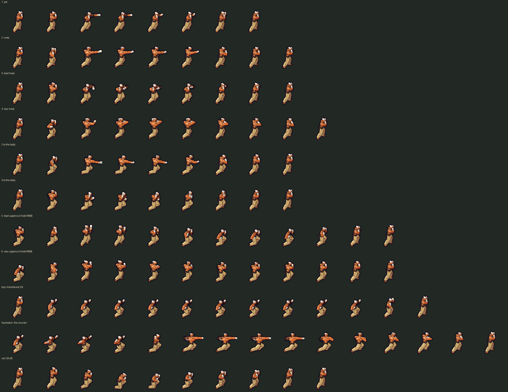

# Design decision log

Every decision that changes how the game plays, looks or feels gets an entry
here: mechanics, tuning, UI, content, art direction. This is how humans who
did not see the work can review it. Pure engine or tooling changes do not
need an entry.

Newest first. Use this format:

```
## YYYY-MM-DD: <short title>
- **Decision:** what was decided (and the numbers, if any)
- **Pillars:** which pillars it serves, and any it trades against
- **Why:** the reasoning, including alternatives rejected
- **Status:** Proposed | Built, needs review | Accepted (by whom) | Reverted
- **Where:** files, PR
```

Leave the status at **Built, needs review** until a human accepts it. When a
decision goes against a pillar or a design doc, say so plainly in **Why**.

---

## 2026-11-13: Wade's kit rebuilt on real boxing
- **Decision:** (requested by a human, with wireframe references for each
  move; the numbers and the points marked *agent's call* are mine.)
  - **Simple Punches (LMB):** the server picks the punch. He throws
    three-punch combinations chosen at random from ten (1-2-3, 1-1-2,
    1-2-3b, 1-2b-3, 1-3-2, 1-4-3, 2-3-2, 2-3-4, 3-2-3, 3b-3-2; b = to the
    body), never the same one twice running. Each of the six punches (jab,
    cross, lead hook, rear hook, cross to the body, lead hook to the body)
    has its own animation. Damage, range and cooldown are unchanged and
    identical for all six; the third punch still grants +1 Haste and
    resets Roll. *Agent's call:* the punches differ only in picture.
  - **Uppercuts (hold RMB):** alternating 5s and 6s, lead hand first, as a
    loop that stays low between punches. He is now planted: move speed is
    0 while the channel runs (was 55%).
  - **Slip (Q):** he slips to the rear side with the rear hand chambered
    and holds it for the 0.5 s window. Struck in the window, he throws a
    haymaker at the attacker. It now takes 210 ms to land (was instant);
    he is locked in place and cannot be hit until it does. Damage, range
    and the cooldown refresh are unchanged.
  - **Roll (Shift):** a boxing roll (slip, duck, under, up the other side)
    instead of a tumble. New, from the kit doc: with Resonance, Roll spends
    it to travel 430 instead of 190.
- **Pillars:**
  - Clarity, the pillar that decided most of this: you can read which punch
    was thrown; the chamber shows the Slip window is open; the haymaker's
    damage lands on the frame the fist does.
  - Crunch: planted Uppercuts and the haymaker's lock are commitments.
  - Creative Builds: combinations vary run to run; Roll gains a Resonance
    hook.
  - Comradery: neutral.
- **Why:**
  - The old kit alternated jab/cross, had no hooks or body shots, a duck
    for Slip and a forward tumble for Roll, and did not match the kit doc
    in three places (not planted, no Resonance roll, counter with no
    visible punch).
  - Combinations are fixed threes because the Haste trigger is every third
    punch: the finisher of each combination is the punch that pays out.
  - Rejected: per-punch damage or reach (head vs body, straight vs hook).
    The kit doc gives them one effect, and six sets of numbers would hide
    a dominant punch the player cannot choose anyway.
  - Rejected: an instant haymaker. A punch with no travel cannot be seen.
- **Known gaps:**
  - Nothing in the game gives Wade Resonance yet (only El Presidente gains
    it, from his own grab), so the long Roll cannot happen in play. It is
    covered by a test only.
  - Bots: over 6 seeds with Wade + Suds + Gravon + Isaac the team got as
    far as before (rounds 2 to 3), but the Wade bot scored lower in most.
    The bots hold Uppercuts while being hit and spam Slip; whether planted
    Uppercuts are too punishing for people needs a playtest.
  - Not seen in the running game: the client could not be built on the
    machine this was made on. Server logic is covered by
    `tests/test_wade_kit.cpp`; the art was checked in forge previews and
    on the baked sheet.
  - The sheet grew to 5984 x 5772 (15 clips), over the 4096 guideline but
    under the forge's 8192 limit and smaller than Gravon's.

  
- **Status:** Built, needs review.
- **Where:** `src/CharacterKits.cpp` (WadeKit), `include/ArenaData.h`
  (`Arena::WadeForm`), `src/AbilitySystem.cpp` (cast events carry the
  form), `src/ArenaView.cpp` (`actionClip`), `tools/sprite_forge/actors/wade.py`,
  `tools/sprite_forge/actors/_rig.py`, `tests/test_wade_kit.cpp`

## 2026-11-13: Fog of war with shared crew sight
- **Decision:** The crew shares sight. Every living hero sees 640 world
  pixels around themselves, a downed hero 260 (enough to see the revive),
  the ship 520. Ground is in one of three states: seen now (clear, and
  lifted by a faint cool light), explored (dimmed; enemies, shots and
  their light are hidden) or unexplored (solid fog). Hidden with the fog:
  enemies and their health bars, enemy shots, damage numbers, enemy dots
  on the minimap. Always shown: teammates, the ship, objectives, the zone
  ring, and pickups anywhere the crew has been. An attack or telegraph is
  shown as soon as any part of it reaches into sight. F3 turns the fog off
  for comparison. A new match starts unexplored.
- **Pillars:** Crunch (what you know is now scarce: scouting and where you
  stand are decisions). Comradery (a teammate's sight is yours, so
  spreading out helps everyone: "when I win, we win"). Clarity is traded
  against on purpose, since fog hides state; the cost is kept small by
  never hiding objectives, the ship, teammates or an attack that can reach
  you.
- **Why:** Requested by a human together with the unlocked camera: a free
  camera with no fog would show the whole map for free. Choices made here
  that were **not** specified and need review:
  - Sight is a plain circle. **Walls do not block it yet**; the arena map
    has one collision shape, so it would change little today.
  - The fog is drawn by the client. The server still sends every enemy, so
    this is presentation, not an anti-cheat boundary (fine for co-op PvE).
  - The minimap hides enemies out of sight but does not draw the explored
    area yet.
  - Before this, the minimap showed every enemy in range. It no longer
    does.
  - All radii are first guesses (`include/config/CameraConfig.h`).
- **Status:** Built, needs review (the feature was requested by a human;
  the rules and numbers above were not)
- **Where:** `include/FogOfWar.h`, `src/FogOfWar.cpp`, `src/ArenaView.cpp`,
  `src/ArenaHud.cpp`, `include/config/CameraConfig.h`,
  `docs/prototype/camera_fog_of_war.png`

## 2026-11-13: Locked and unlocked camera
- **Decision:** Y switches the camera between locked (centred on your hero,
  the default) and unlocked (it stays where you leave it; the cursor within
  28px of a screen edge pans it at up to 1600 world pixels a second, and it
  cannot leave the map). While unlocked, holding Space brings the camera
  back to your hero. A white "YOU" arrow at the screen edge points to your
  hero whenever they are off screen, and the HUD says which mode you are
  in. Aiming follows the camera, so the cursor always aims where it points.
- **Pillars:** Crunch (looking away from your hero to scout is a choice
  with a cost). Clarity (the arrow and the mode label mean you never lose
  your hero or wonder why the view stopped following).
- **Why:** Requested by a human, and it brings the game in line with the
  Controls/HUD doc (unlocked, edge-panning camera, Space to re-centre),
  which the 2026-11-11 entry below departed from. One conflict to flag:
  **Space now means two things.** Locked, it is still the basic attack
  (kept for trackpads); unlocked, it re-centres and does not attack, as the
  doc says. A key that changes meaning with a mode costs some Clarity; the
  alternative (a different re-centre key) would go against the doc. The
  mode is not saved between sessions, and there is no minimap click or
  drag panning yet.
- **Status:** Built, needs review (requested by a human; the Space rule and
  the pan numbers were not specified)
- **Where:** `include/Camera.h`, `src/InputSystem.cpp`,
  `src/ClientPrediction.cpp`, `src/ArenaHud.cpp`

## 2026-11-13: The camera is pulled back (world zoom 1.5 to 0.75)
- **Decision:** The world is drawn at 0.75x instead of 1.5x. About 1700x960
  world pixels are in view (four times the area), and a hero is about 8% of
  the screen height instead of 15%, matched to the reference frame a human
  supplied.
- **Pillars:** Crunch and Clarity of the game state (you can read the room,
  see a pack coming and plan a route, so less of a run is spent walking
  blind). It trades against Clarity of the characters: sprites are half the
  size on screen and are scaled down from their authored size, so fine
  detail and small effects read less well. Health bars and text are drawn
  at a fixed size and are unaffected.
- **Why:** Requested by a human with a reference image. The window is a
  fixed 1280x720; if it becomes resizable, zoom should scale with height so
  the field of view stays the same. Art authored for the old zoom
  (silhouettes, effect sizes, the 300px hero light pool, the floor
  vignette) has not been re-tuned for the new one.
- **Status:** Accepted (requested by a human); the exact value needs review
- **Where:** `include/config/ScreenConfig.h`

## 2026-11-12: The look: inked heroes on a dark world
- **Decision:** The in-game look is set as three layers:
  - **World:** dark, cool, low contrast (floor values in the bottom fifth
    of the range); genus colour arrives as light and glow, not bright
    tiles.
  - **Characters:** the brightest, most saturated things on screen, with
    solid ink shadows, a thick contour and a signature rim light.
  - **Effects:** additive light with bloom that lights the ground.
- **Built 2026-11-13 (the world and effects layers, in the engine):**
  - **World values:** the floor shader pushes every tileset dark and cool
    (texel value 0.045 to 0.245, slate tint), with a floor-only vignette.
    80% of the tile's hue is kept, not the mock-up's near-grey, so the
    map's genus regions still read on the floor (see Why).
  - **Grounding:** a soft contact shadow and a sheared silhouette shadow
    under every player and enemy, from the forge's `KEY_LIGHT`. All
    shadows are drawn under all bodies.
  - **Light pools:** a warm pool around each player; a faint genus-colour
    pool under each enemy that turns danger red as it winds up a hit;
    hits, bursts, swings, beams, projectiles, zones, telegraphs and
    infusion pickups light the floor. Pools add up in a quarter-size
    light map and roll off, so a swarm cannot white out the ground.
  - **Bloom and grade:** the world is drawn offscreen; only what is drawn
    as light (effects, telegraphs, auras) blooms, sprites do not. A mild
    grade and a weak whole-scene vignette (0.12) follow. Health bars,
    names, numbers and the HUD are drawn after it, untouched.
  - **F4** switches the look off and on in game, to compare.
  - Every strength is a named constant in `include/config/LookConfig.h`.
- **Pillars:** Clarity decided it: value separates floor, fighters and
  danger at a glance. It trades nothing against the other pillars. One
  risk for Clarity: a dark floor can hide dark enemies, so enemies need
  the same rim and ink treatment as heroes. Choices made while building,
  all decided by Clarity:
  - Floor hue kept at 80% (above), against the art direction's "never
    bright floor tiles" taken to its limit: the regions are gameplay
    information.
  - Bloom is weighted by coverage squared and telegraph pools were
    halved: at first a filled telegraph circle bloomed into an opaque
    blob over the fight. Readability beats spectacle.
  - The strong vignette is on the floor only, so enemies entering from
    the screen edge are not dimmed.
  - Shadows fall up and to the right, as `KEY_LIGHT` says. The mock-up
    flipped them toward the viewer; that would disagree with the light
    baked into the sprites.
- **Why:** The splash art promises comic inking on black with neon
  accents; the game showed smooth clay figures on a flat brown floor. A
  mock-up with the game's own sprites showed the presentation layer
  alone closes much of the gap (`docs/prototype/styleframe_target.png`).
  Real frames, look off and on, beside the mock-up:
  `docs/prototype/look_before_after.png`.
- **Not achieved / open:**
  - No rim light or outline on enemies. In the frames looked at (Toxlith
    and the old recoloured enemy sheets, on all four floor regions) they
    stayed readable thanks to their pools, so it was left out; a dark
    enemy on a dark floor is still the risk to watch. A rim needs a
    sprite shader (ImGui can only multiply a sprite's colour).
  - The boss (a dark purple body) was seen once, at the screen edge, and
    read as a dark mass on the dark floor. Its pool was then raised
    (`BOSS_POOL_STRENGTH`), but the boss was not seen on screen again
    after that: **unverified**, and the first thing to check.
  - The floor has no seams, cracks or leaking genus glow: the tileset is
    flat colour, and that detail is art, not code.
  - Effects are still alpha-blended shapes that bloom, not true additive
    light; hit flashes still tint red, not white.
  - The Blue Zone ring and the white ring under the local player are
    fainter against the graded world than before; not retuned.
  - Effect "verb" moments (detonate, spread) do not cast pools yet.
  - Looked at only in the WASM client (Edge, one map, Wade, about 20
    enemies). Not measured for frame time; not seen on the native client.
- **Status:** Built, needs review.
- **Where:** `docs/design/ART_DIRECTION.md` ("The look"),
  `tools/sprite_forge/styleframe.py`, `include/config/LookConfig.h`,
  `src/PresentationLayer.cpp`, `src/TileRenderer.cpp`,
  `src/ArenaView.cpp`, `src/RenderSystem.cpp`, `src/UISystem.cpp`

## 2026-11-12: Character bodies come from generated models; ink style
- **Decision:**
  - **Bodies:** a character's body is an image-to-3D model made from its
    concept art (`art/models/<Name>.glb`). The forge puts it on the
    existing skeleton, so clips, eight directions and carry sockets are
    unchanged. Code-built parts remain for props, springy cloth and
    simple creatures.
  - **Shading:** a new `ink` style: lit tone, cool shadow tone, solid ink
    in the shadow cores.
  - **This reverses** the earlier ruling against image-to-3D tools
    ("Heroic body kit" entry below). A human reopened and decided it.
- **Pillars:** Clarity: a character that matches its splash art is
  recognised at once, and ink blacks hold shapes together at 100 px.
  Creative Builds is helped indirectly: a 30-character cast is only
  reachable if a body costs a generation and a fit, not days of code
  modelling.
- **Why:** After many passes the code-built bodies still read as clay
  figures; code cannot draw a face or cloth. At game size the AI-drawn
  Wade turnaround already matches the splash art
  (`docs/prototype/styleframe_closeup.png`). Rejected: 2D frames from the
  image pipeline (every move in eight directions must stay consistent,
  which has not been tenable) and more shading on code-built bodies (the
  mock-up shows its ceiling).
- **Not yet shown:** the route is proven end to end only with a stand-in
  model exported from the code-built Wade. **No real generated model has
  been baked**, so the quality claim is untested. No shipped sprite
  changed; the five existing actors are still code-built.
- **Status:** Accepted (route chosen by a human); the pipeline is Built,
  needs review
- **Where:** `tools/sprite_forge/skin.py`, `fit.py`, `selftest_skin.py`,
  `forge.py` (`shade_ink`, albedo pass), `actors/_mesh_template.py`,
  `art/models/README.md`, `.claude/skills/character-art/SKILL.md`

## 2026-11-12: Wade's boxer guard and likeness restored
- **Decision:**
  - **Guard:** a boxer's guard, not Ken's stance. Chin tucked behind high,
    tight fists, elbows in, shoulders hunched, slight lean.
  - **Likeness:** a tight short white crop instead of spiked hair, a full
    dark beard and hard brows, bold tiger stripes on the left arm (on the
    skin, not floating), and forearm hand-wraps, a brown belt and bandaged
    lower legs, all from the splash art.
- **Pillars:** Clarity: a recognisable character at a glance. It is also
  the character's identity.
- **Why:** Human feedback: the stance was too stiff and upright for a
  boxer, and the likeness had drifted.
- **Status:** Accepted (requested by a human); the exact pose values are
  Built, needs review
- **Where:** `tools/sprite_forge/actors/wade.py`

## 2026-11-12: Proportions retuned to 3rd Strike, not DBZ
- **Decision:** Wade is retuned from bodybuilder to martial-artist
  proportions, using a 3rd Strike Ken reference from the human:
  - longer legs and arms,
  - squared capped shoulders (a new `square` clavicle bar in the body
    kit) over a real waist,
  - smaller deltoids and pecs, normal-sized fists,
  - an upright wide-stance guard with the fists in front of the chest.
- **Pillars:** Clarity: a familiar fighting-game silhouette. It is also
  the target look.
- **Why:** The first body-kit pass read as "muscly DBZ".
- **Status:** Accepted (requested by a human); the exact values are
  Built, needs review
- **Where:** `tools/sprite_forge/actors/_body.py`, `tools/sprite_forge/actors/wade.py`

## 2026-11-12: Heroic body kit and fighting-game motion; Wade rebuilt
- **Decision:** Characters build on a shared heroic body kit: a spine
  chain, curved muscle and proportion parameters. The forge gains:
  - overlapping action,
  - spring-driven secondary motion,
  - squash and stretch.

  Wade is rebuilt as the test, in the toon style: a broad, heavy-handed
  veteran with oversized wrapped mitts. His idle is a boxer's bounce. His
  punches have anticipation, a stretched smear, a held impact and a
  recoil. His hair and sash swing on springs.
- **Pillars:** Clarity: strikes read as strikes (the stretch and hold show
  the hit). It also gives the cast its feel.
- **Why:** Human feedback: proportions and rigid movement were what kept
  the characters from feeling like 3rd Strike / MvC2. The human ruled
  out image-to-3D tools.
- **Status:** Accepted (requested by a human); Wade's specific look and
  timing are Built, needs review
- **Where:** `tools/sprite_forge/actors/_body.py`, `tools/sprite_forge/actors/wade.py`,
  `tools/sprite_forge/forge.py` (`clip_frames`)

## 2026-11-12: Art style moves from pixel art to toon-shaded 3D
- **Decision:**
  - **Pixel art is dropped.** The forge gains a toon render: anti-aliased
    cel shading, ink outlines and creases, and a signature rim light.
  - **Organic shapes:** a `tube` primitive gives curved, tapering forms.
  - **Gravon rebuilt as the test case:** heroic proportions, smooth
    muscle, flared torn trousers, chunky hair, and the blade on his
    spine.
  - **Inspirations:** 3rd Strike / MvC2, Hades, Risk of Rain 2,
    Battlerite.
- **Pillars:** Clarity serves: bolder shapes, outlines and rim light. It
  also gives the game a visual identity.
- **Why:** Human direction. Blocky primitives at about 60 px could not
  give 30+ characters distinct, appealing shapes.
- **Open question (needs a human):** pre-rendered sprites or real-time
  3D?
  - At this resolution, Gravon's sheet is about 200 MB of GPU memory,
    with eight directions and 63 frames. That doesn't scale to four heroes
    in a match plus enemies, or to the WASM build.
  - Options:
    (a) keep pre-rendering, but mirror to five directions, trim frames and
    compress textures;
    (b) render these same jointed models in real time in Gambit with a
    toon shader. That is the Battlerite / Risk of Rain 2 approach: tiny
    memory, smooth turning at any angle, and dynamic light. It is engine
    work.
- **Status:** Proposed
- **Where:** `tools/sprite_forge/forge.py`, `tools/sprite_forge/actors/gravon.py`,
  `src/Texture.cpp`, `src/ArenaView.cpp`

## 2026-11-12: Poses carry personality; Gravon's silhouette is a sword
- **Decision:**
  - **Gravon:** the sword runs down his spine at rest (pommel above the
    head, crossguard at the shoulders), so his silhouette reads as a sword.
    The host slumps underneath. He draws the sword only to attack, using
    the new per-joint show/hide in the forge.
  - **Suds:** idles with a toast.
  - **Wade:** a compact, unbothered guard instead of a lunge.
  - **Presidente:** chest out and chin up, on sturdier legs.
- **Pillars:** Clarity: each character is still distinct, and now also
  in character. Presidente and Suds side-on sit exactly at the
  look-alike line (0.72): two heavy bruisers from the side are both thick
  columns. Front, back and three-quarter views are clearly different.
- **Why:** Human feedback: the silhouettes were distinct but did not show
  personality, and the postures looked odd. The sword silhouette was the
  human's idea, and it fits the Soulblade passive in Character Concepts.
- **Status:** Accepted (requested by a human); the specific poses are
  Built, needs review
- **Where:** `tools/sprite_forge/actors/`, `tools/sprite_forge/forge.py`

## 2026-11-12: Suds and Gravon get forge art; Toxlith restyled
- **Decision:**
  - **Suds** is "the barrel and the cooler": a cooler at his hip and a can
    raised high. His abilities play toss, belch, rounds and chug.
  - **Gravon** is "the blade": a sword longer than he is tall, resting
    across his back. His abilities play alternating slashes, the Ravager
    overhead smash, Fury and Rush.
  - **Toxlith** follows the reference image: a warty acid-green toad-lizard
    with a magenta spine crest, venom beads and a hanging tongue.
- **Pillars:** Clarity serves. The silhouette check flags no pair among
  the forge cast; Presidente and Suds side-on are the closest at 0.66.
  Creative Builds: the characters are visually distinct, and each move has
  its own animation.
- **Why:** Requested by a human. Suds is the MVP's lead character, and
  Gravon's blade is the cast's strongest silhouette hook.
- **Status:** Accepted (requested by a human); the specific looks are
  Built, needs review
- **Where:** `tools/sprite_forge/actors/`, `src/ArenaView.cpp` (`actionClip`)

## 2026-11-12: Silhouette-first art direction; Presidente and Wade reshaped
- **Decision:** Every in-game asset must pass the "who's that?" silhouette
  test from the art on-ramp. `tools/sprite_forge/silhouette.py` checks it.
  - Presidente is now an inverted triangle: boulder shoulders, small legs
    planted wide, a tall striped crest, and a fists-on-hips idle.
  - Wade is a lean lunge: a long bladed stance, oversized white wrapped
    mitts by his face, and swept-back hair.
  - Both render with chunkier pixels (`PIXEL_SCALE` 1.35), at the same size
    on screen, putting Wade near the 64 px target in DD-AA-007.
- **Pillars:** Clarity serves: the heroes now read as different shapes.
  It does not fix finding yourself in a swarm, because enemy bodies cover
  any outline; that needs a player rim or outline (not built).
- **Why:** The forge actors had shared one skeleton and posture, and their
  identity lived inside the outline. A cape flare was tried on Presidente
  and removed because it read as debris. The chunkier pixels look almost
  the same as standard pixels at play size, so they were kept for
  consistency with DD-AA-007.
- **Status:** Accepted (requested by a human); the specific shapes are
  Built, needs review
- **Where:** `tools/sprite_forge/actors/`, `tools/sprite_forge/silhouette.py`,
  `docs/design/ART_DIRECTION.md`

## 2026-11-12: Effect visual language and effect verbs
- **Decision:** Every effect gets its own colour, motion and icon. Stacks
  drive the size of its aura, its particles and the body tint. Six verbs
  have their own moments: apply, amplify, spread, detonate, corrupt
  (buff → debuff) and purify (debuff → buff). Ordinary enemies show
  small pips instead of icons; damage-over-time numbers are smaller and
  dimmer. There is an effect lab on F12 for trying it all.
- **Pillars:** Clarity serves: effects were text tags before. Creative
  Builds serves: this is the substrate for spread, detonate and corrupt
  builds. Clarity trades a little at scale: a big poisoned crowd makes a
  large green blob of auras. That reads as "the crowd is poisoned", but
  watch it in playtests.
- **Why:** Requested as a slice to judge before designing build pools. See
  `docs/design/EFFECT_VISUALS.md`.
- **Status:** Accepted (requested by a human); the specific look is Built,
  needs review
- **Where:** `src/EffectVisuals.cpp`, `src/AbilitySystem.cpp`, `src/MatchDirector.cpp`

## 2026-11-12: Poison is its own effect, separate from Wound
- **Decision:** Venoxarid infusions (Toxic Miasma, Toxic Blade, Acidic
  Shell, Speed Siphon, Venom Infusion) now apply Poison instead of Wound.
  Poison does 5 damage per tick per stack like Wound, but caps at 30
  stacks instead of 10. Cauterize consumes both. Mend purifies Poison.
- **Pillars:** Clarity: poison and bleeding look different. Creative
  Builds: a higher cap leaves room for amplify and spread builds.
- **Why:** Weaker per-stack values were tried. At 2 per stack the
  Suds/Gravon/Isaac/Zephyr bots won 1 of 3, and at 4 per stack 4 of 10.
  At 5 per stack they win 7 of 10, whether the cap is 10 or 30, the same
  as before the change. Mina/Volgore/Wade/Isaac still lose all 10, as
  before. Magnarok burn still uses Wound and should be split the same way.
- **Status:** Built, needs review
- **Where:** `include/config/EffectConfig.h`, `src/Infusions.cpp`

## 2026-11-11: El Presidente's leaps go higher and farther; Bomba is a sit-out powerbomb
- **Decision:** Leap height up about 60%. Bomba range is 170 to 420 by
  charge (was 120 to 320), Splash range 460 (was 360). Air time is 620ms
  for Bomba and 600ms for Splash, and he sits for 260ms after Bomba.
- **Pillars:** Clarity (a big, readable wind-up and landing) and Creative
  Builds (a distinct mobility-and-grapple playstyle). Crunch takes a small
  cost: the longer air time and the seated recovery are a deliberate
  commitment window.
- **Why:** Requested by a human. The commitment window keeps the extra
  range from being free.
- **Status:** Accepted (requested by a human)
- **Where:** `src/CharacterKits.cpp`, `tools/sprite_forge/actors/presidente.py`, FWFsoft/gambit#9

## 2026-11-11: Grappled foes are pinned to the carrier's hands
- **Decision:** The sprite tool exports a per-frame hand position, and the
  held foe is drawn there, in front of or behind the carrier.
- **Pillars:** Clarity: you can always see who is held and where they
  will land.
- **Status:** Built, needs review
- **Where:** `tools/sprite_forge/forge.py`, `src/ArenaView.cpp`

## 2026-11-11: El Presidente's kit (grappler Playmaker)
- **Decision:** 330 hp, speed 238. While holding a foe (up to 3.8s) he
  moves 15% slower and every button switches to a finisher. The boss cannot
  be grabbed. Abrazo (bear hug) has its own 7s cooldown.
- **Pillars:** Creative Builds (a hold-state kit unlike any other), Crunch
  (the hold timer forces you to choose a finisher quickly), Comradery
  (a held foe is helpless, which sets up teammates).
- **Why:** Built from his splash art and the Character Concepts doc. All
  numbers are first guesses and have not been through the bot simulator.
- **Status:** Built, needs review
- **Where:** `src/CharacterKits.cpp`, `src/ArenaData.cpp`

## 2026-11-11: Prototype match is co-op win/lose, not last player standing
- **Decision:** The crew wins by killing the boss and loses if everyone is
  down at once or the ship is destroyed. Score is per player, and the top
  scorer each round gets a bonus infusion.
- **Pillars:** Comradery in Competition is only half served. The GDD and
  CORE GAMEPLAY list "one player is left alive" as an end condition; that
  is **not built**, so the competitive tension the pillar asks for is
  weak.
- **Why:** The co-op loop came first so the core systems could be tested.
- **Status:** Built, needs review (open question: add a last-standing
  ending?)
- **Where:** `src/MatchDirector.cpp`

## 2026-11-11: Space is basic attack; the camera is locked to the player
- **Decision:** Space and LMB both basic attack. The camera follows the
  player.
- **Pillars:** Clarity (you never lose your character). Crunch is
  slightly weaker, because you cannot scout with the camera.
- **Why:** Simpler for the first prototype. This **differs from the
  Controls/HUD doc**, which has an unlocked, edge-panning camera and Space
  to re-centre it.
- **Status:** Superseded in part by "Locked and unlocked camera"
  (2026-11-13): the camera can now be unlocked, and Space re-centres it
  while it is.
- **Where:** `src/InputSystem.cpp`, `src/RenderSystem.cpp`

## 2026-11-11: Infusions give genus effects only, with no slot talents
- **Decision:** Each infusion applies its genus effect in the tree you put
  it in (Offense, Defense, Mobility or Genealogy). More infusions of the
  same genus level it up.
- **Pillars:** Creative Builds is only partly served. The Genera and
  Infusion doc decided on "BOTH" (a slot talent plus the genus effect) and
  per-item stat lines; neither is built.
- **Status:** Built, needs review
- **Where:** `src/Infusions.cpp`

## 2026-11-11: The input latch keeps quick taps
- **Decision:** A press is remembered until the server reads it, even if
  the press and release arrive in the same tick.
- **Pillars:** Clarity: every press you make does something.
- **Status:** Accepted (a bug fix)
- **Where:** `src/AbilitySystem.cpp`
