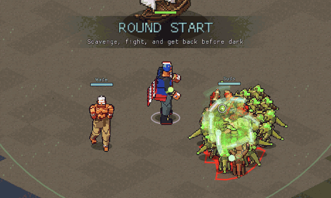
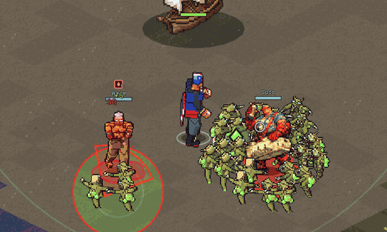
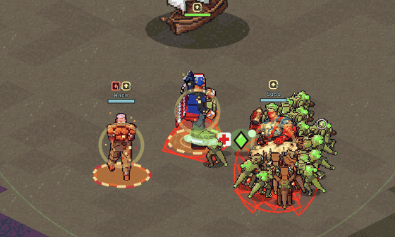
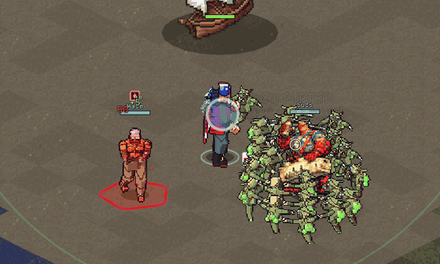

# Effect visual language

Almost every build in Alien Arena works by putting effects on things,
growing them, moving them and cashing them in. Effects are the substrate
of Creative Builds, so they must pass the Clarity test: in the middle of a
fight you can tell what is on whom, how strong it is, and when something
big just happened.

Code: `include/EffectVisuals.h`, `src/EffectVisuals.cpp` (client) and the
"effect verbs" in `src/AbilitySystem.cpp` (server).

## Every effect has an identity

| Effect | Colour | Motion on the body | Icon |
| --- | --- | --- | --- |
| Poison | acid green | bubbles rise and pop | droplet |
| Wound | red | drops fall | droplet |
| Mend | mint | soft motes drift up | cross |
| Empowered | gold | sparks rise, chest glow | up arrow |
| Weakened | violet | wisps sink | down arrow |
| Fortified | steel blue | plates orbit | shield |
| Vulnerable | pink | wisps sink | cracked shield |
| Haste | cyan | speed streaks | chevrons |
| Slow | pale ice | frost circles the feet | snowflake |

Buffs are warm or bright (gold, cyan, mint); debuffs are sickly or dim
(green, violet, pink). Red stays mostly for danger: enemy telegraphs keep
their own red so they never get lost.

## Stacks drive intensity

The stack count maps to an intensity from 0 to 1 on a log curve; "full"
is 30 stacks for Poison and 5 for the damage modifiers. Intensity scales:

- **Aura:** size, opacity and pulse speed of the ground ring. Buff rings
  are turning gold dashes, debuff rings wobble. At most one buff aura and
  one debuff aura per body.
- **Particles:** from 2 up to 12 particles in the effect's motion.
- **Body tint:** the strongest debuff tints the sprite. Buffs glow
  instead.
- **Pops:** crossing 5, 10, 20 or 40 stacks fires a ring and bumps the
  icon.

Displayed stacks ease toward the real count, so a jump from x3 to x12
reads as growth rather than a swap.

## The verbs

| Verb | What you see | Server call |
| --- | --- | --- |
| **Apply** | a bolt from the caster, then a sigil snaps on | `applyFrom` |
| **Amplify** | rings converge, then the aura blooms; "x3 >> x12" callout | `amplifyEffect` |
| **Spread** | tendrils arc out and reach far targets later, each target splashes; "SPREAD x26" callout | `spreadEffect`, `spreadEffectToAllies` |
| **Detonate** | the effect implodes, then bursts by stacks consumed; chunks fly, a scorch mark stays, the camera shakes | `detonateEffect` |
| **Corrupt** | the buff cracks, flashes white, shatters into shards that change colour, and the debuff blooms; "CORRUPTED" callout with each flip | `corruptBuffs` |
| **Purify** | the debuff boils off upward while a column of the buff's light pours down; "PURIFIED" callout | `purifyDebuffs` |

Corrupt and Purify use the mirrored pairs the effect system already has:
Empowered/Weakened, Fortified/Vulnerable, Haste/Slow, Mend/Wound, and
Poison purifies into Mend.

## Readability at scale

- **Ordinary enemies** show small coloured pips, not icons. Elites, the
  boss and players get full icons with stack counts.
- **Damage-over-time numbers** are small and dimmed, so detonations and
  crits stand out.
- **Big moments only** get screen emphasis (shake, callouts): spreads,
  detonations, corruptions. Steady ticks never do.

## Try it: the effect lab

In a round, press **F12**. Two training allies (Wade and Suds) appear
beside you; they take effects but never die. Then:

| Key | Action |
| --- | --- |
| 1 | spawn a crowd at the cursor |
| 2 / 3 / 4 / 5 | poison / amplify x4 / spread / detonate every poisoned enemy |
| 6 / 7 / 8 | empower yourself / amplify / share with allies |
| 9 / 0 | stack buffs on an enemy / corrupt them |
| - / = | debuff your allies / purify them |

## Not done yet

- **Your effects vs other players' effects.** The effect sync does not
  carry who applied an effect, so everything is equally bright.
- **Burn still shares Wound.** Magnarok burns should get their own
  effect, as Poison did.
- **Cross-genus reactions and threshold transformations** (Wound becoming
  Hemorrhage at x10, poison plus burn making caustic fire) need their own
  moments.
- **Steal / transfer** and **resist** verbs are designed but not built.
- **Art.** The visuals are drawn in code. The sprite forge could render
  matching icon and particle sprites.
