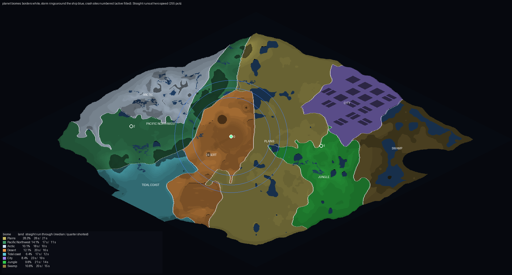

# Map and environment pipeline

How the planet is made, how to add art to it, and what is still missing.
Read `PILLARS.md` and `ART_DIRECTION.md` first; this builds on both. The
first-pass map spec ("SPEC: Map Design", Google Doc) and "On Setting" are the
design sources.

## The idea

The map is the game: a vast, unknown alien planet that the crew learns
over months of play, with a different route through it every run. The
designer writes, picks and critiques; code and AI do the rest. Nobody paints
tiles or places rocks by hand.

The split that makes this fast (the same one the character pipeline uses):

| Who | Does |
| --- | --- |
| Designer | writes environment briefs and objectives, picks images, gives verdicts against the vision board |
| AI image tools | key art, props and textures from the briefs (Midjourney, with a style reference from the approved board) |
| Meshy | image to 3D for props and set pieces (same rules as characters: ask before every spend) |
| Code | layout, height, placement, shading, consistency, checks: everything between the picks |

## What is built (v2: biomes)

`tools/maps/generate_planet.py` writes `assets/maps/planet.tmx`, the
default map (`assets/maps/arena.tmx`, the old prototype, still loads with
`--map`). One seeded command makes the whole planet:

- **Land:** a continent filling the map (720 x 720 tiles, about 840 m by
  420 m), with an east bay, coves and a peninsula off the warm south-west
  coast, in a dark sea. Sea far from land is left undrawn.
- **Biomes** (next section): earth-like places laid out like a compressed
  North America. The genera do not drive them; genus territories sit
  inside them.
- **Crash sites:** candidate landing spots where two to four biomes meet
  inside round 3's storm (`CrashSites` layer). The ship sits on one
  (`--site N`, default 0); the game does not choose per match yet.
- **Height:** each biome has its own relief, blended across borders. A
  mountain spine runs down the continent (below). Peaks, deep lakes and
  the sea are impassable (the `Blocked` layer). Height is gameplay-neutral,
  as the spec defines *elevation*: it lifts what is drawn and costs nothing
  to climb.
- **Regions:** up to 15 genus territories, nested inside biomes (a
  territory never crosses a biome border), dealt a genus by the server
  **every match** as before. Drops, camps and objective rewards follow it.
- **The city:** the city biome on the north-east shore, at real scale:
  8 m streets around 14 m blocks, two to five storeys, its neon in the
  colour of the genus holding it this match, the real city's skyline out
  past the shore.
- **The crash:** a scorched trench, ploughed in from the most open side.
- **Landmarks, objectives, trails, rocks:** as in v1, around the ship:
  a monolith, a spire, a ribcage, a crater and a freighter on sight lines;
  objectives as set pieces in three rings, placed by context and now by
  biome (frogs and gas by swamp and water, scrap and med pods in the city,
  outposts on high ground); one shortest-path tree of trails home.
- **Discovery:** unchanged from v1 (columns of light through the fog; the
  minimap shows explored land tinted by genus).

Review tools: `--preview <png>` writes two images: the terrain from above
(`docs/prototype/planet_overview.png`) and the biome map with the size
check (`docs/prototype/planet_overview_biomes.png`). In game, **N** jumps
a free camera to the city and each landmark in turn (Y takes it back),
and F3 turns the fog off.

## Biomes

| Id | Biome | Where, and why there | Ground | Relief and water | Dressing (slot) |
| --- | --- | --- | --- | --- | --- |
| 1 | Plains | the middle, north to south: grassland between dry and wet | grass, meadow | rolling, a few lakes | `grass`, boulders |
| 2 | Pacific Northwest | west of the spine, with its own rocky coast | moss, needle litter | hills, lakes, rivers off the spine | `conifer` |
| 3 | Arctic | the colder, higher, northern part of the same forest | snow, frozen lakes (walkable ice) | high, rugged | `snow_conifer` |
| 4 | Desert | east of the spine, in its rain shadow, inland of the warm coast | sand, dust, red rock | dunes and mesas (walkable tops) | `cactus`, bones |
| 5 | Tidal coast | south of where the spine meets the sea, and its peninsula | beach, coastal scrub, tide pools (walkable) | low; sea stacks offshore | `palm`, `reeds`, `sea_stack` |
| 6 | City | the north-east shore | street | flat | buildings, lamps, signs |
| 7 | Jungle | the hot, wet south-east | jungle floor, vines | steep hills, many lakes | `jungle_tree` |
| 8 | Swamp | around the east bay, between city and jungle | marsh, mud, bog (walkable shallows) | flat and low, deep pools | `cypress`, `reeds` |

How the layout is made, so it can be changed by rule rather than by hand:

- **Anchors** (`ANCHORS`): a few points per biome, with a size bias, laid
  out like the continent. Borders come from the nearest anchor after a
  two-scale domain warp, so they bend like real ecotones. Slivers smaller
  than `MIN_FRAGMENT_M2` fold into their neighbours.
- **The spine** (`SPINE`): one mountain range from the north coast down
  the continent, bending west to the sea in the south-west (like the
  Cascades and Sierra, then the Transverse Ranges). It is the border
  between the wet side (forest and snow, west and north of it) and the dry
  side (everything else). So the desert sits in its rain shadow and the
  warm coast lies south of the bend, as San Diego does. Four passes
  (`SPINE_PASSES`) cross it.
- **Cold:** the forest's colder part (north, high on the ridges) is Arctic
  (`ARCTIC_SHARE`), so snow starts deeper in. A boreal fringe
  (`BOREAL_FRINGE`) keeps forest between snow and the plains.
- **Coast rules:** tidal and city only within `TIDAL_DEPTH` and
  `CITY_DEPTH` of the sea.
- **Ground** reads the biome a few tiles off by noise, so borders blend.
  Biomes differ by hue at the same low value (`ART_DIRECTION.md`, "World");
  snow is the one light ground and is kept cool.

The hidden `Biome` tile layer stores the biome per tile (row 3 of
`terrain_data`, values 0..15, 0 = sea), and the map's `biomes` property
lists the ids. The engine does not read it yet; the music system will.

### Sizing biomes for music

Each biome will have three categories of music with at least six minutes
in each, so the music must not switch every few seconds. The preview
prints a size check: straight runs through each biome at hero speed (255
px/s) from random points in random directions. The medians at seed 3 are:

| Biome | Share of land | Straight run, median | Quarter of runs shorter than |
| --- | --- | --- | --- |
| Plains | 28% | 28 s | 21 s |
| Pacific Northwest | 14% | 17 s | 11 s |
| Arctic | 10% | 18 s | 10 s |
| Desert | 12% | 20 s | 16 s |
| Tidal coast | 6% | 17 s | 12 s |
| City | 8% | 23 s | 19 s |
| Jungle | 10% | 21 s | 14 s |
| Swamp | 11% | 20 s | 15 s |

A straight sprint is the worst case. In a match the crew stops to fight
and loot, so it stays in a biome for minutes. A match's storm (radius
5,075 px around the ship) covers two to four biomes. Two cheap ways to
keep music steady at borders: switch only after some seconds in the new
biome, and crossfade over a few seconds. The size knob is `--size`, but the
ground is drawn as one batch without culling, so a much bigger map needs
the renderer to cull or chunk first.

### Dressing sizes (for the placeholders and baked art)

Real sizes, as for everything else (`Scale`). Trees are taller than heroes
and need the ghost fade (`ArenaView::ghostAlpha`) when art lands.

| Slot | Real size |
| --- | --- |
| `conifer`, `snow_conifer` | 9 to 14 m, 3 to 5 m wide |
| `jungle_tree` | 10 to 15 m, broad canopy 6 to 9 m |
| `cypress` | 6 to 10 m, flared trunk |
| `palm` | 6 to 9 m |
| `cactus` | saguaro 3 to 5 m |
| `grass`, `reeds` | knee to waist high (0.5 to 1.2 m) |
| `sea_stack` | 6 to 15 m rock pillars, in the sea only |

## Scale

The world is drawn at real scale against the heroes, so the planet never
makes them look like giants. One metre is **55 world pixels**: a hero is
about 100 world px (~78 px on screen) and about 1.8 m tall. The constant
lives in `include/config/WorldScale.h` (`Config::World::METRE`) and in
`generate_planet.py` (`METRE`); keep them equal. A tile is about 0.65 m
along an axis, so size anything in metres and convert, never in tiles or
pixels by eye.

| Thing | Real size |
| --- | --- |
| Hero, door | 1.8 m, 2.2 m |
| Street lamp, neon sign board | 4.5 m, 2.5 to 4.2 m up |
| Town building | 2 to 5 storeys of 3.5 m, on 14 m blocks (some split by a 2 m alley), 8 m streets |
| Outpost watchtower | hut on a deck 6 m up, legs 3.2 m apart (heroes stand between them) |
| Scrapyard crane, heaps | 9 m; heaps 0.4 to 0.9 m, behind the zone |
| Med pod, probe, turret, gate | 1.3 m, 1.9 m, 2.5 m, 6 m |
| Boulders, ruins, crash wreckage | 0.7 to 1.5 m, 1.5 to 4.5 m columns, ~2 m pieces |
| Monolith, spire, ribcage, freighter | 14 m, 24 m, 24 m long, 28 m long |

Anything taller than a hero that a hero can walk behind (buildings,
monolith, spire, crater shard, freighter) fades to a ghost while one is
behind it (`ArenaView::ghostAlpha`). Baked art for a slot must be baked to
the same scale.

## Asset slots: adding real art without touching code

Every prop kind, landmark and objective type is drawn by a code placeholder
until real art exists. To replace one, bake a sheet with the sprite forge
and add it to `assets/sprites/manifest.txt` under the slot name with an
`idle` animation. The game draws it everywhere that kind appears (frame =
variant). No code change.

| Slot | What |
| --- | --- |
| `Prop_<kind>` | `boulder`, `ruin`, `bones`, `debris`, `lamp`, `sign`, `city_block`, `monolith`, `spire`, `ribcage`, `crater`, `freighter`; biome dressing `conifer`, `snow_conifer`, `cactus`, `palm`, `reeds`, `sea_stack`, `jungle_tree`, `cypress`, `grass` |
| `Prop_flora_<genus>` | `venoxarid`, `cerebrian`, `frigidariant`, `magnarok`, `none` |
| `Objective_<type>` | `alien_scrapyard`, `capture_outpost`, `salvage_medpacks`, `recover_probe`, `save_the_frogs`, `noxious_gas`, `little_john`, `derelict_turret` (frame 1 = completed) |

Static props need no rig: one view (the camera never turns), a few
rotations and scales for variety. The ship, its tiers and the roof turrets
already went this way (`tools/sprite_forge/actors/ship*.py`).

To add a **new kind**: add it to `dress()` (or a landmark list) in
`generate_planet.py` with its placement rule, and give it a placeholder
branch in `ArenaView::drawProp` (`src/ArenaWorld.cpp`).

## Working in parallel

- **Designer:** assemble the vision board (one column per environment,
  plus a "not this" column), write a brief per environment: mood, wild
  and urban halves, landmarks, story props, and the objectives that live
  there.
- **Claude:** turns briefs into prompt sets, generator rules and set
  pieces; bakes picked art into slots; renders each zone from the game
  camera for review next to the board.
- **Anyone:** tweak a spot in Tiled. Ground, `Height`, `Region` and
  `Blocked` are tile layers (the hidden three paint with the numbered
  `terrain_data` tiles). Caution: re-running the generator overwrites the
  file, and object layers use the engine's coordinates, which Tiled shows
  shifted. A locked override layer that survives regeneration is the next
  tooling step.

## Proposed answers to the spec's open questions

For the designer to accept or change:

- **How are maps drawn?** Generated isometric layout in Tiled format;
  ground from painted material tiles, terrain from a height mesh; props and
  set pieces are baked models.
- **What is randomised?** Fixed per map: zone shapes, coast, mountains. Per
  match: which genus holds each region. Next: which candidate sites host
  objectives, and several baked seeds per map.
- **Can environments be exchanged?** Yes, by region slot. Each genus pack
  will have a wild half and an urban half (from "On Setting").
- **How is exploration limited?** The storm and fog of war; later rounds
  open further.
- **Fast travel?** Prefer traversal skills and placed traversal (zip lines)
  over teleports; the spec wants traversal skill to matter.
- **Where does the crew crash?** One site in v1. Proposed: several
  candidate sites, the crew picks one in a short window (Strategic Crunch).
- **Elevation vs verticality:** elevation is built (free to climb, attacks
  unaffected). Verticality (cliffs that block melee but not shots) needs
  enemy pathfinding first, or chasers would snag on cliffs.

## Known gaps

- **Biome dressing is not drawn yet.** The new kinds (`conifer`, `palm`,
  `cactus` and the rest) are in the map, but the engine has no
  placeholder for them, so until there is art in their slots or a code
  placeholder in `ArenaView::drawProp`, the biomes read in game only by
  their ground, relief and water.
- **The engine does not read the Biome layer yet**, so music cannot follow
  biomes until `TerrainGrid` and the music system do.
- **One crash site per map.** The candidate sites are written, but the
  game always uses the one the map was generated for. Choosing per match
  is what lets a run see a different biome mix (Creative Builds), and most
  of the planet sits outside the storm until then.
- **Genus by biology:** territories are dealt any genus. Weighting the
  deal by biome (which genus can live in snow, swamp, desert) is not done.
- **Not checked in game yet.** The map was generated and its data checked
  but not loaded in the client here (no build environment). The ground
  batch is about 3.6 times the old tile count; watch boot time and frame
  time.
- **Tall terrain and buildings can hide things.** Buildings and the tall
  landmarks fade to a ghost when a hero is behind them; mountain faces do
  not yet, and nothing fades for an *enemy* behind it. This is the camera
  spike from the spec.
- **Only the scenery is at real scale.** Terrain height is still 16 px a
  level (about 0.3 m), so the tallest peaks are under 5 m, and the crashed
  ship is about bus-sized (~11 m).
- **The fog image is drawn flat:** on high ground its edge sits a little
  low.
- **Enemies have no pathfinding:** around lakes and peaks they slide along
  the edge. Camps are local, so this rarely shows; a chase across the map
  would.
- **One layout per map:** the genus deal changes every match, but site
  positions do not yet.
- **Placeholders are code-drawn prisms.** They carry silhouette and light,
  not the inked comic look; that comes from art in the slots.
