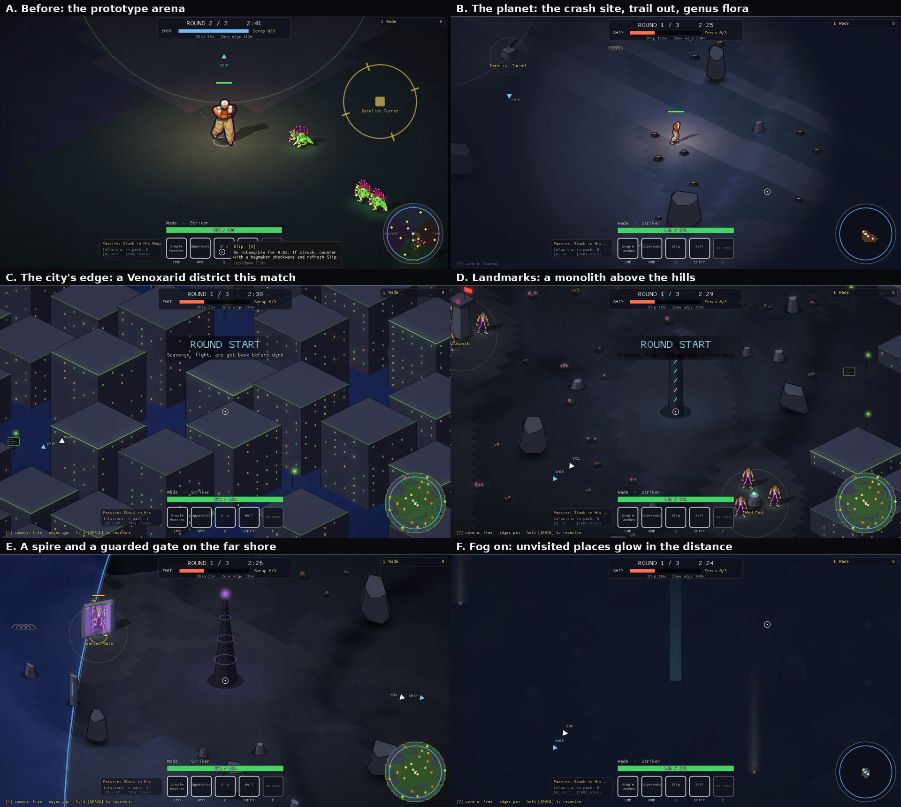

# Map and environment pipeline

How the planet is made, how to add art to it, and what is still missing.
Read `PILLARS.md` and `ART_DIRECTION.md` first; this builds on both. The
first-pass map spec ("SPEC: Map Design", Google Doc) and "On Setting" are the
design sources.

## The idea

The map is the game: a vast, unknown alien planet that the crew learns
over months of play, with a different route through it every run. The
designer writes, picks and critiques; code and AI do the rest. Nobody paints
tiles or places rocks by hand.

The split that makes this fast (the same one the character pipeline uses):

| Who | Does |
| --- | --- |
| Designer | writes environment briefs and objectives, picks images, gives verdicts against the vision board |
| AI image tools | key art, props and textures from the briefs (Midjourney, with a style reference from the approved board) |
| Meshy | image to 3D for props and set pieces (same rules as characters: ask before every spend) |
| Code | layout, height, placement, shading, consistency, checks: everything between the picks |

## What is built (v1)

`tools/maps/generate_planet.py` writes `assets/maps/planet.tmx`, now the
default map (`assets/maps/arena.tmx`, the old prototype, still loads with
`--map`). One seeded command makes the whole planet:

- **Land:** an island in a dark sea, with fingers and a bay (the concept
  map's shape), about 2.2 times the old arena across. The storm's radii
  scale with it (map property `zone_scale`, 1.75).
- **Height:** terraced hills and ridged mountain ranges. Peaks, lakes and
  the sea are impassable (the `Blocked` layer) and shape the routes. Height
  is gameplay-neutral, as the spec defines *elevation*: it lifts what is
  drawn and costs nothing to climb.
- **Regions:** the zone template from the spec. A basin around the crash, a
  ring of seven wild regions, and the city. The *shapes* are fixed; which
  genus holds each region is dealt by the server **every match**, so the
  genus layout is a discovery, not a fact. Drops, camps and objective
  rewards follow the region's genus.
- **The city:** streets and towers on the north-east shore, its neon in the
  colour of whichever genus holds the district this match, and the skyline
  of the real city beyond the shore.
- **The crash:** a scorched trench the ship ploughed on the way in, with
  wreckage.
- **Landmarks:** a monolith, a spire, a giant ribcage, a glowing crater and
  a crashed coalition freighter, on sight lines.
- **Objectives are places:** each type has a set piece (an outpost
  watchtower, a med pod, a scrap heap under a crane, a probe in a dent, a
  frog pond, spore vents, a sealed gate) instead of a reticle. Placement
  follows context: frogs and gas by water, outposts on high ground, scrap
  in the crash field and the city. Three rings, as the spec's black and
  orange pins: near, mid, far. Some far ones sit past round 3's storm, worth
  a dash through it.
- **Trails:** one shortest-path tree from the ship to every place, so
  trails merge into roads home.
- **Discovery:** unvisited places show as columns of light through the fog
  (amber for far ones), landmarks in their own colour. The minimap shows
  only explored land, tinted by the genus that holds it this match. The old
  compass of genus quadrants is gone on the planet.
- **Set dressing:** about 1,900 props (flora dressed per genus, boulders,
  ruins, bones, debris, street lamps and signs), kept off pads and trails
  so fights stay readable.

Review tools: `--preview <png>` draws the whole planet from above
(`docs/prototype/planet_overview.png`). In game, **N** jumps a free camera
to the city and each landmark in turn (Y takes it back), and F3 turns the
fog off.

## Asset slots: adding real art without touching code

Every prop kind, landmark and objective type is drawn by a code placeholder
until real art exists. To replace one, bake a sheet with the sprite forge
and add it to `assets/sprites/manifest.txt` under the slot name with an
`idle` animation. The game draws it everywhere that kind appears (frame =
variant). No code change.

| Slot | What |
| --- | --- |
| `Prop_<kind>` | `boulder`, `ruin`, `bones`, `debris`, `lamp`, `sign`, `city_block`, `monolith`, `spire`, `ribcage`, `crater`, `freighter` |
| `Prop_flora_<genus>` | `venoxarid`, `cerebrian`, `frigidariant`, `magnarok`, `none` |
| `Objective_<type>` | `alien_scrapyard`, `capture_outpost`, `salvage_medpacks`, `recover_probe`, `save_the_frogs`, `noxious_gas`, `little_john`, `derelict_turret` (frame 1 = completed) |

Static props need no rig: one view (the camera never turns), a few
rotations and scales for variety. The ship, its tiers and the roof turrets
already went this way (`tools/sprite_forge/actors/ship*.py`).

To add a **new kind**: add it to `dress()` (or a landmark list) in
`generate_planet.py` with its placement rule, and give it a placeholder
branch in `ArenaView::drawProp` (`src/ArenaWorld.cpp`).

## Working in parallel

- **Designer:** assemble the vision board (one column per environment,
  plus a "not this" column), write a brief per environment: mood, wild
  and urban halves, landmarks, story props, and the objectives that live
  there.
- **Claude:** turns briefs into prompt sets, generator rules and set
  pieces; bakes picked art into slots; renders each zone from the game
  camera for review next to the board.
- **Anyone:** tweak a spot in Tiled. Ground, `Height`, `Region` and
  `Blocked` are tile layers (the hidden three paint with the numbered
  `terrain_data` tiles). Caution: re-running the generator overwrites the
  file, and object layers use the engine's coordinates, which Tiled shows
  shifted. A locked override layer that survives regeneration is the next
  tooling step.

## Proposed answers to the spec's open questions

For the designer to accept or change:

- **How are maps drawn?** Generated isometric layout in Tiled format;
  ground from painted material tiles, terrain from a height mesh; props and
  set pieces are baked models.
- **What is randomised?** Fixed per map: zone shapes, coast, mountains. Per
  match: which genus holds each region. Next: which candidate sites host
  objectives, and several baked seeds per map.
- **Can environments be exchanged?** Yes, by region slot. Each genus pack
  will have a wild half and an urban half (from "On Setting").
- **How is exploration limited?** The storm and fog of war; later rounds
  open further.
- **Fast travel?** Prefer traversal skills and placed traversal (zip lines)
  over teleports; the spec wants traversal skill to matter.
- **Where does the crew crash?** One site in v1. Proposed: several
  candidate sites, the crew picks one in a short window (Strategic Crunch).
- **Elevation vs verticality:** elevation is built (free to climb, attacks
  unaffected). Verticality (cliffs that block melee but not shots) needs
  enemy pathfinding first, or chasers would snag on cliffs.

## Known gaps

- **Tall terrain and towers can hide a hero.** City towers fade to a ghost
  when a hero is behind them; mountain faces do not yet. This is the
  camera spike from the spec.
- **The fog image is drawn flat:** on high ground its edge sits a little
  low.
- **Enemies have no pathfinding:** around lakes and peaks they slide along
  the edge. Camps are local, so this rarely shows; a chase across the map
  would.
- **One layout per map:** the genus deal changes every match, but site
  positions do not yet.
- **Placeholders are code-drawn prisms.** They carry silhouette and light,
  not the inked comic look; that comes from art in the slots.
