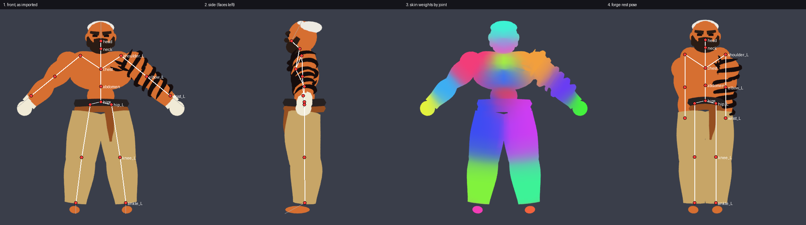
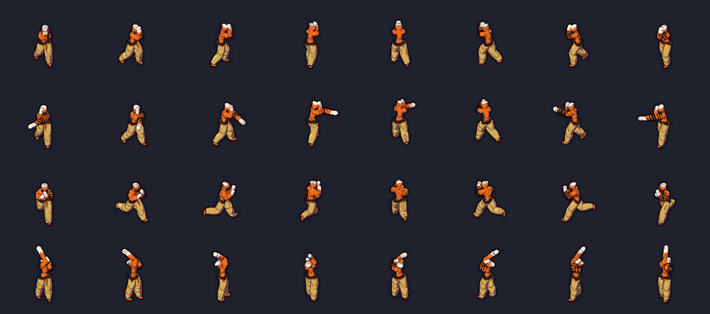

# Sprite forge

In-game character and creature sprites, baked from 3D models by code.

Each actor in `actors/` is a Python file that puts a 3D model on a small
joint skeleton and defines animation clips as keyframed poses. `build.py`
renders every clip in all 8 directions from the game camera and shades
the renders with one shared set of rules (light direction, ink, outlines,
size) in `forge.py`. Those shared rules are what keep every character and
creature looking like part of one game.

Where the model comes from:

- **A generated model** (the way forward): an image-to-3D GLB made from
  the character's concept art, in `art/models/`. Its shape and texture
  carry the drawing. See "Generated models" below and the
  `/character-art` skill.
- **Code-built parts** (blobs, tapered limbs, boxes, tubes): for props,
  springy cloth and simple creatures, and for the five older actors that
  do not have a model yet.

## Setup (once)

From the repo root. `bpy` is Blender as a Python module; bpy 5.3 needs
Python 3.13, which `uv` fetches.

```bash
uv venv --python 3.13 tools/sprite_forge/.venv
uv pip install --python tools/sprite_forge/.venv/Scripts/python.exe bpy numpy pillow
```

On Linux and macOS the interpreter is `tools/sprite_forge/.venv/bin/python`.
Below, `/opt/forge/bin/python` stands for that interpreter.

## Use

```bash
/opt/forge/bin/python tools/sprite_forge/build.py              # every actor
/opt/forge/bin/python tools/sprite_forge/build.py wade toxlith  # some
```

It writes `assets/sprites/actors/<Name>.png` and `manifest.txt`. The game
uses an actor's baked sheet automatically for any character or enemy with
the same name; everything else falls back to the older placeholder sprites.
A full character with 10 clips bakes in about 30 seconds.

While modelling or animating:

```bash
/opt/forge/bin/python tools/sprite_forge/preview.py wade jab /tmp/jab.png
python3 tools/sprite_forge/showcase.py /tmp/all.gif Wade:1 Toxlith:7
```

## Adding an actor

Write a shape brief first (`docs/design/ART_DIRECTION.md`): the dominant
shape, the signature piece that breaks the outline, the idle pose. Then
copy `actors/toxlith.py` (creature) or `actors/wade.py` (character) and
give it its own proportions:

- `build()` returns `(Model, rest_pose)`
- `clips()` returns `Clip`s; each clip is a list of `Key(t, pose, root_offset,
  root_rotation)`
- optional `CELL = (width, height, feet_line)` in standard pixels
- optional `PIXEL_SCALE` (characters use 1.35): chunkier art pixels at
  the same on-screen size; the sheet is rendered smaller and the game draws
  it larger
- preview at a given pixel scale:
  `/opt/forge/bin/python tools/sprite_forge/preview.py wade idle out.png 0 1.35`

After baking, run the silhouette check: the "who's that?" test from the
art on-ramp. It writes a lineup of black silhouettes at in-game size and
flags pairs that are too alike:

```bash
python3 tools/sprite_forge/silhouette.py            # forge actors
python3 tools/sprite_forge/silhouette.py --legacy   # plus the old cut-outs
```

A pose value may carry a fourth number, a scale: `"sword": (0, 0, 0, 0)`
hides the joint and everything on it. Gravon uses this to wear his sword
on his back and draw it into his hand only for attacks. Scale steps between
keys rather than blending.

Clip names the game looks for: `idle`, `run`, `hit`, `death`, and
`attack` for enemies. Character abilities map to clips in `actionClip()`
in `src/ArenaView.cpp` (Wade: `jab` / `cross` on LMB, `uppercut_R` /
`uppercut_L` on RMB, `slip` on Q, `roll` on Shift).

## Body kit and motion

Characters start from `actors/_body.py`. A `Build` sets their proportions;
`skeleton`, `torso`, `head`, `arms` and `legs` build the body, and the
character adds costume and props. See Wade.

Motion tools, all in `forge.py`:
- **Overlapping action:** `Clip(..., overlap=0.01)` delays each joint by
  that many seconds per level below the hips, so motion ripples outward.
- **Secondary motion:** `FOLLOW = {"hair": ("head", gain, stiffness,
  damping, drag)}` in an actor module springs a joint after its driver.
- **Squash and stretch:** a six-value pose `(rx, ry, rz, sx, sy, sz)`
  scales a joint in its rest axes (a forearm that stretches on a punch).

## Generated models (`skin.py`)

```python
import skin
m = Model("Wade")
skin.attach(m, "art/models/Wade.glb", height=1.95, fit=FIT)
```

`attach` imports the file, stands it on the ground at `height`, places
the body-kit joints from `fit`, computes skin weights, re-poses the mesh
into the forge rest pose (arms and legs straight down, so body-kit poses
mean the same thing) and creates the joints. After that `Model.pose()`
deforms the mesh, and props can be added to its joints as usual. Start
from `actors/_mesh_template.py`.

- **Fit.** `fit.py <model or actor> out.png` draws the joints on the
  model, shows which joint owns each part of the surface and the re-posed
  result, and prints a starting `FIT`. Correct it by eye.

  
- **Weights** use Blender's automatic weights on a watertight voxel copy
  of the mesh, so messy generated meshes work. They are cached next to
  the model (`*.weights.npz`, not committed).
- **Colour** comes from the model's own texture through an extra albedo
  pass. Skinned meshes need `STYLE = "ink"`.
- **Self-test.** `selftest_skin.py` builds its own GLB from the code-built
  Wade and runs it through the whole path. Run it after changing
  `skin.py` or the shading.

  

Non-humanoids: pass your own `skeleton=[(joint, parent), ...]`, `tails`,
`down={}` and `level=()` to `attach`, and give every joint in `fit`.

## Ink style

`STYLE = "ink"` is the splash art's comic inking: a lit tone, a cool
shadow tone, and shadow cores filled with solid ink, under the same
outlines and rim light as the toon style. It works on textured meshes and
on code-built parts, so a generated body and a hand-built prop sit in one
drawing. The knobs are the `INK_*` constants in `forge.py`.

## Toon style

Set `STYLE = "toon"` and a signature `RIM = (r, g, b)` in an actor module
to render smooth art instead of pixel art. It renders at twice the
resolution, then averages down. The shading is:
- three cel bands,
- ink on the outer contour (`TOON_OUTLINE`), on overlaps and on creases
  (`CREASE_DEG`),
- a rim light from behind (`RIM_LIGHT`).

The sheet is marked `smooth` in the manifest, so the game filters it
linearly. Use `PIXEL_SCALE` below 1 (Gravon uses 0.75) so the sheet is
drawn close to 1:1 on screen.

For organic shapes, use `m.tube(joint, material, points, radii)`: a smooth
tube through control points, with the radius easing through `radii`. Use
it for muscles, hair spikes, tails, horns and cloth flaps. For smooth bodies,
use `blob(..., smooth=True)` with more segments.

## Style knobs (`forge.py`)

`PIXEL_SIZE` (overall sprite scale), `KEY_LIGHT` / `FILL_LIGHT`,
`make_ramp()` (shadow and highlight hue shifts), `OUTLINE_RGB`,
`DEPTH_EDGE` (how readily internal lines are drawn). Change one, rebake,
and the whole cast changes together.

## Carry sockets

An actor can set `SOCKET = ("wrist_L", "wrist_R")`. The forge then writes a
`socket <Actor> <clip> x,y,roll,front ...` line per clip: for every
direction and frame, where the midpoint of those joints is (pixels from the
feet pivot), the roll of whatever is being carried (the `carry` pseudo-joint's
x rotation in the pose, in degrees: 0 upright, 90 lying across the hands,
180 head-down) and whether it is in front of the body. The game pins a
grappled foe to that point, so El Presidente's held foe follows his hands
through leaps, the Látigo whirl and the sit-out powerbomb with no extra code
per move.
